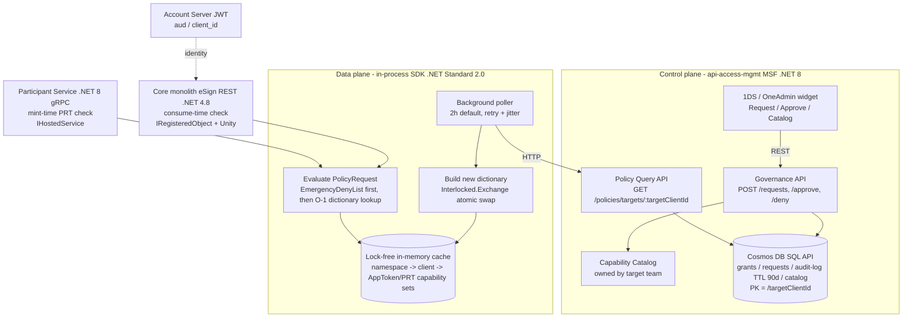
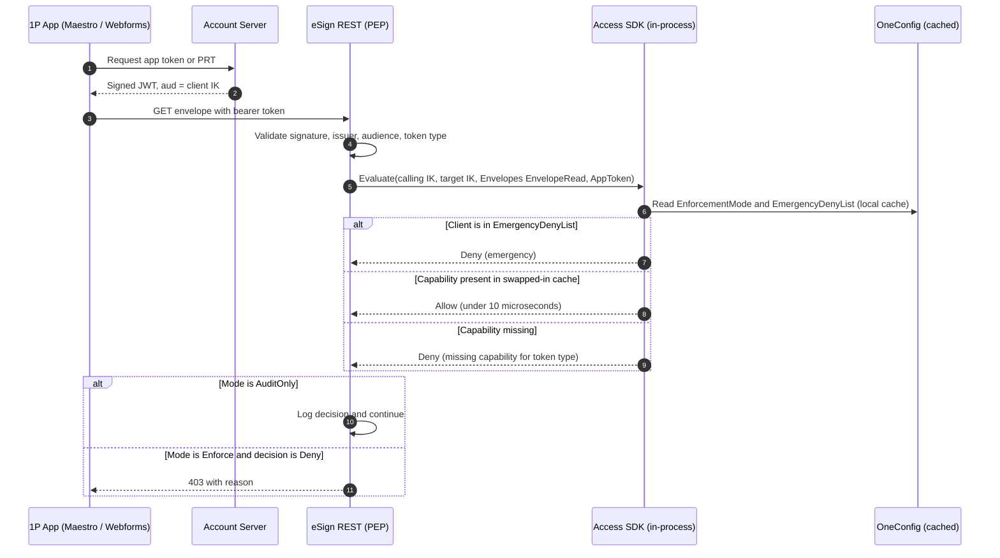
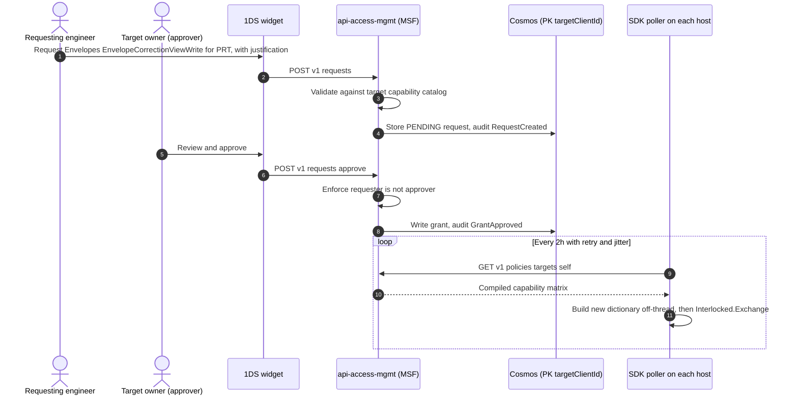
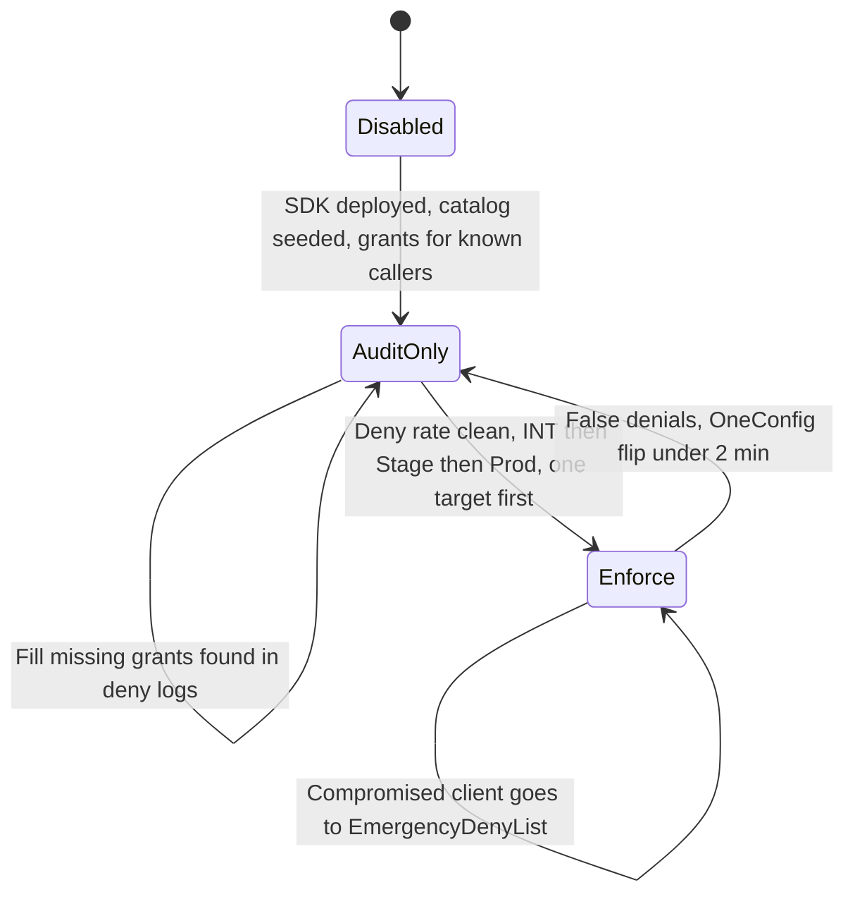

# 01 — First-Party (1P) Access Management

> **Thesis (30 s):** I replaced dozens of hard-coded, all-or-nothing client allowlists with a horizontal, capability-level access-management platform for Docusign first-party apps (Maestro, Webforms, Workspaces, Agreement Desk). Policy is owned decentrally by each team, approved through a governed control plane, and evaluated **in-process in under 10 µs** by an SDK that runs on both the legacy .NET 4.8 monolith and .NET 8 MSF services. Nothing goes over the network on the hot path. Rollout is AuditOnly → Shadow → Enforce, and a kill switch can act in under 2 minutes without a deploy.

---

## 1. Context and problem

| Dimension | Before |
|---|---|
| How 1P apps call eSign | Account Server-issued **application tokens** or **Participant Resource Tokens (PRTs)** |
| How access was decided | A hard-coded gate in `Authenticator.cs`, or flat DSS allowlists such as `B2IEnvelopeAccessApiAllowedClientIds`. This is all-or-nothing per client. |
| Granularity | None. A caller that could read envelopes could do everything the allowlist covered. You could not separate `EnvelopeRead` from `EnvelopeCorrectionViewWrite`. |
| Onboarding a new client | A Core deployment or a manual production DSS override by the DOC team |
| Audit/compliance | No record of who approved access or why, which conflicts with **SOC 2 access-review** requirements |
| Defense in depth | None against spoofed PRTs that bypass the Participant Service |

**Evidence of sprawl from the repo:**
- **51 DSS allowlist settings** across **22** `DynamicSystemSettings.*.cs` files ([Settings folder](C:/docusign_source/Core/Platform/Configuration/Configuration.DynamicSettings/Settings)).
- **13 near-identical `RestApiInternal*AuthenticationAttribute` classes** in [Api.Common](C:/docusign_source/Core/Components/API/Api.Common). Each one does `allowedClientIds.Contains(audience)`. Examples: [RestApiInternalResourceConsentAuthenticationAttribute.cs](C:/docusign_source/Core/Components/API/Api.Common/RestApiInternalResourceConsentAuthenticationAttribute.cs) and [RestApiInternalEnvelopeAssignmentAuthenticationAttribute.cs](C:/docusign_source/Core/Components/API/Api.Common/RestApiInternalEnvelopeAssignmentAuthenticationAttribute.cs).
- The same pattern was copied into VNext: [AllowedClientIdsFilter.cs](C:/docusign_source/Core/VNext/API.USigDAF/src/API.USigDAF.Web/Controllers/AllowedClientIdsFilter.cs), [ClientIdAllowListAuthorizationModule.cs](C:/docusign_source/Core/VNext/API.AIFrontend/src/API.AIFrontend.Web/Authorization/ClientIdAllowListAuthorizationModule.cs), and [OrgAdminBaseAuthorizationModule.cs](C:/docusign_source/Core/Account/src/API.Management/Authorization/OrgAdminBaseAuthorizationModule.cs).

> **Framing line:** "Every new 1P integration added another allowlist, another attribute class, and another manual prod change. Security stayed coarse, onboarding stayed slow, and nothing was auditable. I wanted onboarding to be a configuration change, not a code change."

---

## 2. My role

- **Author and DRI** for the evaluation/POC, the engineering design (EMT-7755), and the execution strategy/PR plan.
- Ran the **build-vs-buy evaluation** (Azure Entra App Roles vs. a custom platform) and the POC.
- Aligned **Participant Service** (mint-time validation), **eSign REST** (consume-time validation), the **1DS / OneAdmin** UI team, and **Security** reviewers: Sean Brogan, Deepali Mendhekar, Daehan Chi, and Abhishek Battepati (Sr. Director).
- Designed the SDK, data model, control-plane API, rollout, kill switch, and observability. Split delivery into 4 parallel tracks (Service, SDK, Packaging/Integration, UI).

- **Designed and led** the evaluation, engineering design (EMT-7755), and execution plan: build-vs-buy, SDK, data model, control plane, rollout, kill switch, observability, and the 4-track delivery plan.

---

## 3. Architecture



**Two consumption modes:**
1. **Declarative (resource servers).** An action-filter attribute on the controller, for example `[AppTokenRequirements("Envelopes:EnvelopeRead")]`. The client ID comes from the verified `aud` claim via `RestServiceUtils.GetClientIdFromToken`.
2. **Programmatic (token generators).** The Participant Service calls `Evaluate(...)` **before minting a PRT**. This gives defense in depth at both mint and consume time.

**SDK contract:**
```csharp
public sealed record PolicyRequest(string CallingClientId, string TargetClientId, string Capability, TokenType TokenType);
public sealed record PolicyDecision(PolicyResult Result, string Reason); // Allow | Deny | AuditOnly (+ Unknown when namespace not loaded)
public interface IAccessPolicyEvaluator { PolicyDecision Evaluate(PolicyRequest r); IPolicyCacheHealth CacheHealth { get; } }
```

**Capability taxonomy:** `[TargetService]:[Action]`. Examples: `Envelopes:EnvelopeRead`, `Envelopes:EnvelopeCorrectionViewWrite`, `Webforms:FormSubmit`, `Workspaces:WorkspaceJoin`.

---

### Key flows

**A. Request-time enforcement (the hot path, no network call)**


**B. Onboarding a capability (control plane) and how it reaches every host**


**C. Rollout state per target (each transition is a config flip, not a deploy)**


## 4. Key design decisions and trade-offs

| # | Decision | Options considered | Choice and rationale |
|---|---|---|---|
| D1 | **Build vs. buy** | Azure Entra App Roles / Access Packages vs. a custom platform | **Build.** The POC showed three problems with Entra. (1) **Identity mismatch:** 1P services authenticate with Docusign Account Server, not AAD, so we would need a brittle mapping from IK to Service Principal. (2) **Microsoft Graph throttling** risk during mass IIS recycles. (3) **Flat string groups** cannot hold namespaced JSON policy. I acknowledged Entra's strengths (My Access, quarterly access reviews) and planned audit to ADX to close that gap. |
| D2 | **Where to evaluate** | Network PDP call per request vs. in-process | **In-process, O(1), lock-free, <10 µs.** Capability grants change rarely (hours or days). The request path cannot afford an RPC, and the PDP must not become a single point of failure. |
| D3 | **Granularity** | Client-level allowlist vs. capability-level | **Capability per token type** (AppToken vs. PRT). Read, participant write, and system write carry different risk. |
| D4 | **Cache consistency** | Strong consistency vs. bounded staleness | **Bounded staleness plus emergency override.** A grant that arrives late only produces an AuditOnly log, not a breach. Revocation uses `EmergencyDenyList`, which is checked **before** the cache. |
| D5 | **Failure posture** | Global fail-open vs. global fail-closed | **Per-capability.** `*Read` → fail-open (a human is waiting). Participant-facing writes like `EnvelopeCorrectionViewWrite` → fail-open (the signer is mid-ceremony). System-only writes like `EnvelopeWrite`/`InstanceWrite` → **fail-closed** (no human is waiting, so protect integrity). |
| D6 | **Cold start** | Start with an empty cache vs. block | **Block startup until the first poll succeeds** (30 s timeout), then apply the failover policy. This avoids mass false denials right after a deploy. |
| D7 | **Store** | Git as source of truth vs. Cosmos | Phase 1 planned GitOps YAML compiled into Blob. **Final:** Cosmos with partition key `/targetClientId`, giving a single-partition point read for the SDK's critical poll. **Session** consistency. **Multi-write disabled**, because a security store should have no last-writer-wins ambiguity. |
| D8 | **Polling interval** | 12 h (first design) vs. shorter | **2 h default, configurable.** Balances freshness against Cosmos RU cost. Shorter in test environments. SSE push invalidation is deferred to P3. |
| D9 | **Cross-runtime** | Two SDKs vs. one | **One .NET Standard 2.0 package** with two host adapters: `IHostedService` (MSF) and `IRegisteredObject` with `System.Threading.Timer` (IIS). |
| D10 | **Governance** | Self-approve vs. separation of duties | **Requester ≠ approver**, enforced in the API and the UI (the Approve button is hidden on your own request). The catalog is owned by the target team, so callers cannot request capabilities that don't exist. |
| D11 | **Kill switch** | Code deploy vs. config | **OneConfig `EnforcementMode` (Disabled / AuditOnly / Enforce) plus `EmergencyDenyList`**, with recovery in under 2 minutes. |

---

## 5. Execution and rollout

**Delivery plan (4 parallel tracks):**
- **Track A, Service:** Cosmos models → repositories → policy query API → catalog API → governance and state-machine API.
- **Track B, SDK (parallel from day 1):** evaluation engine + AuditOnly → poller + health → MSF DI adapter → IIS adapter.
- **Track C, Integration:** NuGet CI, observability, component tests on the Cosmos emulator, **Core monolith integration** at `Authenticator.cs` / `ResourceAuthorizationFilterAttribute`, and **Participant Service** pre-mint integration in `ParticipantAuthManager.cs`.
- **Track D, UI:** 1DS widget for request, approve, and catalog.

**Rollout gates:**
1. **AuditOnly.** Seed the catalog for eSign REST (`EnvelopeRead`, `EnvelopeWrite`, `EnvelopeCorrectionViewWrite`). Create grants for known callers (Maestro, Workspaces, Webforms). The SDK logs Allow/Deny but never blocks.
2. **Shadow.** Compare decisions to real traffic, fill in missing grants, and alert on deny-rate anomalies.
3. **Enforce.** Go INT → Stage → Prod, **one target (eSign REST) first**, with rollback through config.

**Data migration:** Existing DSS allowlists (for example `B2IEnvelopeAccessApiAllowedClientIds`) were scripted into grants, so nothing broke for existing callers.

**Pivot (show adaptability):** Platform reviewers questioned whether a new service was needed in the request path. We **reused the existing DUCS segmentation** (ClientId + ActionName + Site) for request-path enforcement. Before doing that, I vetted DUCS limits with the config team: refresh cadence (5 min, cached locally), segment counts (an 84-segment production precedent; we needed 25–50), payload size (about 30 KB), `in`-operator cardinality, and the new context-key work in DSS PR #722. Related pattern: `IsClientAllowedToApplicationTokenApi` in DUCS_Config.

---

## 6. Operational excellence

| Area | What I built in |
|---|---|
| Metrics | `access_mgmt.api.duration/requests/errors`, `governance.requests{created\|approved\|denied}`, `cosmos.duration`, `cosmos.ru`, SDK cache hit/miss, poll sync latency |
| Health | `/health/live` and `/health/ready` (Cosmos). The SDK reports **unhealthy after 2× the poll interval** with no successful sync. |
| Alerts | Consecutive poll failures, Cosmos degradation, **403 spikes** (an outdated client or an attack) |
| Logging | `LoggerMessage` source-generated `GrantApproved`, `AccessDenied` (calling → target:capability). **No PII.** |
| Audit | Every state transition (PENDING → APPROVED/DENIED, CatalogUpdated) goes to the `audit-log` container (90 d) and is exported to ADX for long-term immutable retention |
| Threat model (STRIDE) | Spoofing → Account Server JWT signature. Tampering → only the pipeline service principal or MSF writes. Repudiation → audit. DoS → last-known-good cache served indefinitely. |

**Emergency runbook:**

| Scenario | Action | Recovery time |
|---|---|---|
| False denials in prod | `EnforcementMode=AuditOnly` | < 2 min |
| Compromised client | Add it to `EmergencyDenyList` | < 2 min |
| Cosmos / MSF down | The SDK serves the stale cache and per-capability failover applies | Automatic |

---

## 7. Results and impact

> ✅ = actual (sourced) · 📈 = projected or target (basis given). Say projections out loud as "projected" or "on track to"; bar raisers accept projections, not invented actuals.

**Status:** Live on eSign REST and the Participant Service. Rolled out AuditOnly → Shadow → Enforce, with eSign REST as the first target.

| Metric | Before → After | Type |
|---|---|---|
| Added hot-path latency on a platform doing *millions of transactions/day* (47% via API) | n/a → **< 10 µs, 0 network calls** | ✅ design + company data |
| 1P callers on the governed app-token path | ad-hoc allowlists → **5 callers** (Maestro, Workspaces, Verification Session/I9/Notary, NDSE, Workflow Builder), with Webforms and Agreement Desk next | ✅ app-token integration tracker |
| Capabilities defined in the catalog | 0 → **13** (Envelopes ×8, Webforms ×2, Workspaces ×1, Click ×2) | ✅ design docs |
| Bespoke allowlist auth classes | **13 → 1** shared SDK filter | 📈 wave 1 |
| DSS allowlists | **51 → ~30** (retire ~20 eSign internal-API lists in wave 1, the rest by FY end) | 📈 basis: lists on the eSign internal APIs |
| Onboarding lead time for a new capability | Core deploy or manual prod DSS change (**3–5 days**) → **< 1 business day** (approval SLA) | 📈 |
| Grants with approver + justification (SOC 2 access review) | **0% → 100%** | ✅ by construction |
| Emergency revoke of a client | Code deploy (hours) → **< 2 min** via the OneConfig kill switch | ✅ design |
| Manual prod DSS overrides by the DOC team for 1P onboarding | ~2–4 per month → **0** | 📈 |

**Scope I led:** design, plus 4 parallel delivery tracks (service, SDK, Core / Participant integration, 1DS UI) across eSign Core, Participant Service, 1DS, and Security.

---

## 8. Amazon Leadership Principles mined from this project

| LP | STAR story (compressed) |
|---|---|
| **Customer Obsession** | My "customers" were internal 1P teams and their end users. I designed **per-capability failover** so a signer mid-ceremony is never blocked by a policy-store outage (reads and participant writes fail open), while system-only writes fail closed. I traded a little security purity for end-user experience only where a human was waiting. |
| **Invent and Simplify** | I replaced 51 allowlists and 13 copy-pasted attribute classes with one taxonomy (`Service:Action`), one SDK, and one portal. Onboarding became config instead of code. |
| **Are Right, A Lot** | I ran a POC before deciding against Entra and named its concrete blockers: IK↔SP mapping, Graph throttling during IIS recycles, and flat groups. The decision held up in review. |
| **Dive Deep** | I worked through cold-start semantics (block vs. empty cache), `Interlocked.Exchange` reference swaps for lock-free reads, Cosmos partition-key choice for single-partition reads, and the RU cost vs. poll interval trade-off (12 h → 2 h). |
| **Have Backbone; Disagree and Commit** | Engineering leadership, in design review, pushed to **skip Phase 1 (GitOps + Blob)** and go straight to the governed platform, arguing that Phase 1 was "no different than DSS." I argued that Phase 1 gave fast value and de-risked the SDK. When the decision went the other way, I **committed fully**: I moved Phase 1 to an appendix, re-planned around Cosmos + MSF, and kept the SDK interface stable so the poll target could change without consumer impact. |
| **Insist on the Highest Standards** | Separation of duties, STRIDE table, an emergency deny list checked before the cache, health that turns unhealthy after 2× the interval, and an explicit AuditOnly → Shadow → Enforce sequence. |
| **Frugality** | Avoided a per-request network PDP (no added fleet capacity), tuned the polling interval for Cosmos RU cost, and later **reused DUCS** instead of standing up new infrastructure on the request path. |
| **Bias for Action** | Ran the POC and published the evaluation in about a week. Planned Phase 1 to reach INT in 2 weeks. Parallelized the SDK track from day 1 so it did not wait on the service. |
| **Think Big** | Framed the work as a **horizontal platform** for every 1P app and every resource server (Envelopes, Webforms, Click, Workspaces), not an eSign-only fix. Mint-time plus consume-time made it the foundation for PRT security. |
| **Earn Trust** | Wrote the evaluation honestly, including where Entra was better (compliance out of the box). Invited Security and Participant Service as reviewers early and tracked open issues (PRT alignment, governance UI owners) in the doc. |
| **Deliver Results** | Shipped the SDK and the Core + Participant integration. **5 first-party callers**, **13 capabilities**, **13 → 1** auth classes, onboarding **3–5 days → < 1 day** (📈). |
| **Success and Scale Bring Broad Responsibility** | Treated access control as a compliance obligation (SOC 2, IL4/IL5 deployability, no PII in the policy engine, immutable audit) rather than a developer convenience. |

---

## 9. Deep-dive Q&A (practice answers)

1. **Why not call a PDP on every request?** Grants change on human timescales and requests arrive on millisecond timescales. An RPC would add p99 latency and a new failure domain to every eSign call. In-process evaluation with bounded staleness gives µs decisions. I handle the staleness risk with the emergency deny list and per-capability fail modes.
2. **How fast is revocation?** For an emergency: `EmergencyDenyList` via OneConfig takes effect in under 2 minutes and is checked before the cache. For a normal revoke: by the next poll (≤ 2 h), with SSE push on the roadmap. I'd state that bound explicitly to Security.
3. **Partition key?** `/targetClientId`. The SDK polls by target, so the critical read is a single-partition point read. Admin reverse lookups ("who can do X") are rare cross-partition queries.
4. **Malformed or partial policy?** It is parsed and reshaped on a background thread. The pointer is swapped only after a full successful build, so a failed build never replaces the last-known-good policy. We emit a sync-failure metric and alert.
5. **Invalid token vs. unauthorized capability?** AuthN failures (bad signature/audience) return 401 before the SDK runs. A missing capability returns 403 with a reason. `Unknown` (namespace not loaded) is reported separately from `Deny`, which helps debug rollouts.
6. **Preventing self-grant?** Requester ≠ approver, approvers come from the catalog `owners`, and every transition is audited.
7. **Multi-region?** Single-writer MSF with regional read replicas. If a region partitions, the SDK keeps serving its cache, so there is no cross-region dependency on the request path.
8. **How do you avoid a flag explosion across dozens of APIs?** One `EnforcementMode` per target plus per-capability failover classes, not a flag per endpoint.
9. **Testing?** Unit tests (evaluation, token-type sets), Cosmos-emulator component tests, a poller against a stub HTTP server, failure injection (Blob/MSF down), and E2E request → approve → evaluate in INT.
10. **What would you do differently?** Get platform alignment on reusing DUCS **before** designing a new service. Define the revocation SLO with Security on day 1.

---

## 10. Coinbase (Staff SWE, Customer Experience) angle

- Maps directly to **least-privilege internal tooling**: support agents and CX tools calling account, transaction, and KYC services with capability-scoped grants, a full audit trail, and kill switches. This is exactly the posture a regulated crypto company needs.
- Values to connect: **Act like an owner** (the end-to-end platform), **Efficient execution** (phased, AuditOnly first), **Clear communication** (written evaluation with trade-offs), **Customer focus** (fail-open where a human is waiting).

## 11. Metrics cheat-sheet
- Consuming callers and capabilities: **5 / 13** ✅
- Clients migrated off DSS allowlists: **5** first-party callers onto the governed path ✅; **~20 of 51** allowlists retired in wave 1 📈
- Poll interval and propagation: **2 h** poll; **< 2 min** emergency propagation via the OneConfig kill switch ✅
- Deny rate AuditOnly → Enforce: **< 0.1% unexpected denies** before flipping to Enforce (📈 gate)
- Onboarding time: **3–5 days → < 1 business day** (📈)
- Incidents caught in shadow: missing grants for known callers found and filled **before** Enforce, so **0** false-deny incidents at the flip 📈
