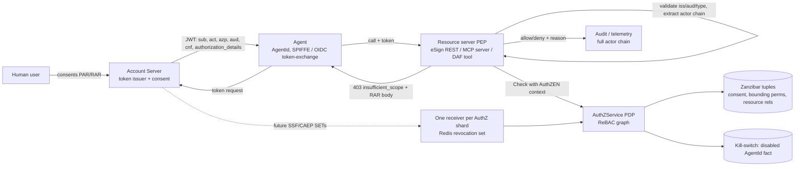
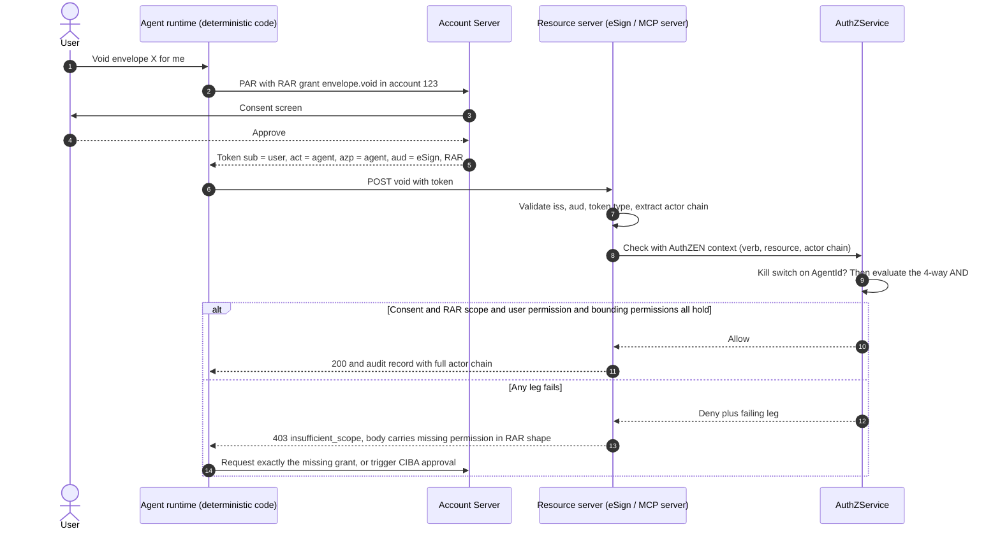
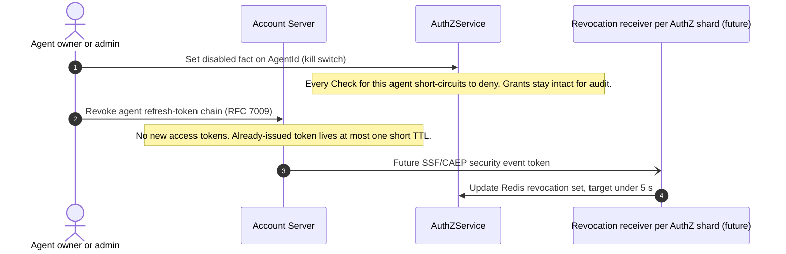

# 02 — AuthZ and Non-Human Identities (Agentic Access)

> **Thesis (30 s):** I led Docusign's **Agentic and Non-Human Identity (NHI) program**, which makes AI agents a first-class, governable identity across the whole platform.
>
> - **Scope:** **25 work items**, **4 agent scenarios** (Docusign-owned or customer-owned × delegated or autonomous), rollout phases **P0–P4**, about **101–148 engineer-weeks** with **4–5 engineers** over **2–3 quarters** to a first cut.
> - **What it spans:** agent identity in the Global Directory, workload credentials (SPIFFE, OIDC token exchange), RAR consent and token issuance, AuthZService decision invariants, the eSign enforcement point, revocation, a kill switch, proof-of-possession, and admin governance.
> - **Core rule:** agents keep a verifiable human → agent → app actor chain, and can never exceed what their user delegated, what that user can do, or what their owner allowed (the "4-way AND").
> - **Safety posture:** revocation is surgical and the system fails closed.

---

## 1. Context and problem

- The identity stack knew two principal types: **User** and **ClientApplication**. The Global Directory (GDS) modelled User and Group. Agents act for humans (delegated) **and** as themselves (autonomous). One agent run fans out across directory, templates, and envelopes in rapid succession, and the actions are hard to attribute to a human's intent.
- **Authorization was mostly local to each service.** AuthZService (a Zanzibar-style ReBAC PDP) existed but adoption was partial. In the Core repo alone there are 51 DSS client allowlists, which shows how much "authZ" was hand-rolled ([DynamicSystemSettings.AuthZ.cs](C:/docusign_source/Core/Platform/Configuration/Configuration.DynamicSettings/Settings/DynamicSystemSettings.AuthZ.cs), [ClientIdAllowListAuthorizationModule.cs](C:/docusign_source/Core/VNext/API.AIFrontend/src/API.AIFrontend.Web/Authorization/ClientIdAllowListAuthorizationModule.cs)).
- **Revocation gap:** Account Server could not revoke an individual refresh token. The only tool was the user-wide `RefreshTokenNotBefore` cutoff, which kills **every** app's refresh tokens for that user. A misbehaving agent could not be stopped surgically.
- **Agent surfaces multiply:** DAF Tools, the public REST API, and MCP (outbound Docusign MCP server plus inbound connectors). Each was trending toward its own permission model, for example DAF allow-listing *tools*.

---

## 2. What I owned (program scope)

1. **Program owner and architect of the NHI plan:**
   - 25 work items, 4 scenarios, phases P0–P4;
   - effort and staffing (101–148 engineer-weeks, 4–5 engineers);
   - exit criteria per phase;
   - cross-org sequencing.
2. **Identity foundations:**
   - a new **Agent** principal type in the Global Directory (GDS) with owner/DRI, discovery, and CRUD;
   - **workload credentials** instead of shared secrets: SPIFFE/SVID inside our mesh; OIDC federation + RFC 8693 token exchange (or `private_key_jwt`) for third-party agents.
3. **Token and consent:**
   - PAR + **RAR** consent;
   - the agent token shape (`sub`, `act`, `azp`, `aud`, `cnf`, `authorization_details`, ES256);
   - the consent UI.
4. **Authorization:**
   - one canonical permission projected 3 ways (consent grant, runtime check, stored tuple), plus a verb registry;
   - the delegated (4-way AND) and autonomous (3-way AND) invariants in AuthZService;
   - AuthZEN-style context on checks.
5. **Enforcement:**
   - eSign as the first enforcement point (PEP): actor-required checks, act-on-behalf validation, fail closed;
   - the **Agent-token ramp** per API, where migration is the security boundary;
   - enforcement shipped as both an MSF sidecar and a .NET library.
6. **Revocation and safety:**
   - RFC 7009 refresh-token revocation;
   - a graph-wide **kill switch**;
   - the SSF/CAEP receiver-per-shard design;
   - a denial contract that lets agents self-recover;
   - CIBA out-of-band approval (designed, deferred);
   - a DPoP proof-of-possession layer for sensitive tiers.
7. **Governance:**
   - agent admin UI (MVP management, kill switch);
   - lifecycle when the owner/DRI departs;
   - audit of the actor chain.

Partners: Identity / Account Server, AuthZ platform, GDS, Agent Platform (DAF), eSign, Security, and Product.

---

## 3. Architecture

### Token shape (agent tokens)

| Claim | Delegated | Autonomous |
|---|---|---|
| `sub` | the human UserId | the AgentId |
| `act` | `{ sub: AgentId, sub_profile: "ai_agent" }` (OAuth Actor Profile), the root of the audit chain | absent |
| `azp` | AgentId | AgentId |
| `aud` | the specific target API/MCP server (RFC 8707) | same |
| `cnf` | DPoP `jkt` (RFC 9449) or mTLS `x5t#S256` | same |
| `authorization_details` | RAR grant (RFC 9396) | same |

**Signed with ES256**, because the RAR payload makes tokens larger. An EC signature is about 64 B versus 256 B for RSA-2048, which recovers header budget on every request.

### The "action, not tool" canonical permission
`{ subject, verb, resource_type, resource_selector, constraints }`. It is projected three ways:
1. **RAR `authorization_details`**: what is consented at PAR time.
2. **AuthZService Check** with AuthZEN context: the runtime decision.
3. **Zanzibar tuple**: the stored fact.

As a result, **DAF Tools, REST APIs, and MCP tools are governed identically**, because you allow-list the *verb* (`envelope.void`), not the tool name.

### What each Check must prove
- **Delegated = 4-way AND:**
  1. delegation consent (UserId→AgentId), **and**
  2. the token's RAR covers this call, **and**
  3. the user personally holds the permission in the ReBAC graph, **and**
  4. the action falls within the agent's **bounding permissions** set by its owner/DRI.

  ⇒ Effective authority = **intersection**. Delegation can never escalate privilege.
- **Autonomous = 3-way AND:** resource-owner grant **and** bounding permissions **and** RAR scope. The granter's own authority is checked at grant time.
- **Invariant enforced in the graph, not inferred from the token.** A token is necessary but never sufficient.
- **Operating mode is decided by configuration plus credential, never by the model at inference time.** This is a prompt-injection safeguard.

---

### Key flows

**A. Delegated agent action, end to end (including the self-recovery path)**

**B. Stopping one agent (without logging the user out of everything)**

## 3b. Program plan: 25 work items, 4 scenarios, 5 phases

| Phase | Theme | Exit criteria |
|---|---|---|
| **P0** | Foundations | Agent type in GDS; internal SPIFFE client auth; PAR/RAR tokens with enforced `aud`; AuthZEN context on Check; canonical permission + verb registry |
| **P1** | Scenario 1: Docusign-owned **delegated** (MVP) | PAR → consent → token → API with an in-service AuthZ decision; agents discoverable in the directory; actor chain audited; denial contract; admin UI; graph-wide kill switch |
| **P2** | Limited constraints + hardening | TTL / session constraints; **proof-of-possession layer GA** (sidecar + .NET library) for the top data-sensitivity tier; 403 → owner notification; DRI-departure governance |
| **P3** | Scenario 2: Docusign-owned **autonomous** | 3-way AND with grant-time authority checks |
| **P4** | Scenarios 3–4: **customer / third-party** delegated and autonomous | OIDC federation + token exchange as the default; SPIFFE federation for SPIRE customers |

**Effort (single-engineer weeks, build + tests).** Examples:
- GDS agent identity **7–10**; directory discovery **4–6**.
- Internal SPIFFE/SVID **4–6**; third-party federation **10–14**.
- PAR/RAR **6–9**; consent UI **8–11**.
- AuthZEN context **6–9**; DPoP PoP layer **12–16**.
- RFC 7009 endpoint **2–3**; OAuth Actor Profile **3–5**.

**Core build ≈ 101–148 engineer-weeks**, staffed with 4–5 engineers over 2–3 quarters. I deliberately **deferred 3 items** to ship Scenario 1 sooner: SSF/CAEP push revocation, CIBA, and Cross-App Access (ID-JAG).

### Standards decisions (adopt / partial / defer)

| Standard | Decision | Why |
|---|---|---|
| RFC 9396 **RAR** | **Adopt** | Action- and resource-granular consent |
| RFC 8693 **Token Exchange** | **Adopt** | Delegation and deeper actor chains at internal hops; the third-party default |
| **OAuth Actor Profile** (draft) | **Adopt (draft risk noted)** | Standard `act` claim, `sub_profile = ai_agent`, nested chains |
| **SPIFFE/SVID** | **Adopt internally**; federation later | Verifiable workload identity, no shared secrets |
| **AuthZEN** | **Partial**: borrow the typed `context`, keep our own Check API | Don't rewrite a working PDP contract |
| RFC 9449 **DPoP** | **Selective (P2)**, not everywhere | Cost and latency only where data sensitivity justifies it |
| RFC 7009 **Revocation** | **Adopt, refresh tokens first** | Surgical revocation with bounded residual exposure |
| **SSF / CAEP** | **Defer**; one receiver per AuthZ shard when added | No fan-out to legacy hosts; one place to be stale |
| **CIBA** | **Defer** | URI hand-back / proactive grants cover early flows |

## 4. Key decisions and trade-offs

| # | Decision | Alternatives | Choice / why |
|---|---|---|---|
| D1 | Scopes-only tokens vs. a runtime PDP | Fat scopes in the token | **Token + PDP.** Scopes can't express "this envelope, in this account, only if the user can." Relationships change after issuance. |
| D2 | Flatten the agent into the user vs. preserve the chain | `sub=user` only | **Preserve `act`.** Audit, revocation of *one agent*, and a confused-deputy defense all need it. |
| D3 | Revocation | Opaque tokens + introspection / fleet-wide revocation caches / SSF to every service | **Phase 1:** short access-token TTL + **RFC 7009 refresh-token revocation** (residual exposure = one access-token lifetime). **Future:** SSF/CAEP to **one receiver per AuthZ shard** (Redis set), not to the fleet. That means no inbound endpoints on legacy Windows hosts and exactly one place that can be stale. Universal Bus was rejected because it is competing-consumer, not broadcast. Introspection was rejected because it breaks existing APIs and loads Account Server. Phantom tokens were rejected because not every API sits behind a gateway. |
| D4 | Failure posture | Fail-open on AuthZ outage | **Fail closed for agent actions.** Revocation lives on the PDP's critical path, so it inherits fail-closed behavior. |
| D5 | **Migration gating** | Let agents call any API | **An API serves agent tokens only when it is in the Agent-token ramp.** It must validate the new token shape, log the actor chain, and call AuthZService. *Migration is part of the security boundary.* The ramp is owned per API surface, with no separate registry. |
| D6 | Enforcement packaging | Sidecar only | **Both:** an Istio/MSF **sidecar** and a **.NET library** for legacy Windows/IIS. Every primitive ships in both forms. |
| D7 | Denial semantics | Plain 403 | **403 + `WWW-Authenticate: Bearer error="insufficient_scope"` (RFC 6750) + `resource_metadata` (RFC 9728)**. MCP clients read this as a step-up signal. The **body carries the missing permission in canonical RAR shape plus the failing-leg code**, so the agent knows whether to ask the user, the owner, or trigger CIBA approval. **Agents can recover without a human.** |
| D8 | Kill switch | Delete all tuples | **A single `disabled` fact on the AgentId** that short-circuits every Check. It is reversible, preserves grant history for forensics, and is paired with token revocation. Open decision: tuple vs. Redis flag (which sets the Redis failure posture). |
| D9 | Phasing | Ship everything | **P0 foundations → P1 DS-owned delegated MVP → P2 constraints + PoP hardening → later autonomous/customer-owned.** I stated plainly what P1 does *not* provide: aud-bound bearer (not DPoP), and revocation bounded by TTL. |

---

## 5. Execution

- **Phase plan:**
  - **P0:** Agent type in GDS, SPIFFE client auth, PAR/RAR issuance, AuthZEN context on Check, verb registry.
  - **P1 (Scenario 1 MVP):** PAR → consent → token → API with an in-service AuthZ decision, actor-chain audit, the denial contract, admin UI, and the kill switch.
  - **P2:** TTL/session constraints, PoP layer GA (sidecar + library), top data-sensitivity tier first.
- **eSign as the first real PEP:** delivered resource-associated AuthZ, act-on-behalf actor validation, **actor-required checks** (deny if the actor is missing), normalized resource IDs, a per-request decision cache (key includes `permissionId` to avoid collisions), and fail-closed on the application-token path. Code: [AuthZRestClient.cs](C:/docusign_source/Core/Components/BusinessObjectsCore/AuthZ/AuthZ.Client/AuthZRestClient.cs) (`CheckEnvelopeAccessWithCache`; invalid IDs or empty grants deny), [ResourceEnvelopeAuthZService.cs](C:/docusign_source/Core/Components/BusinessObjectsCore/Integrator/Integrator/ResourceEnvelopeAuthZService.cs).
- **Legacy-safe migration primitive:** [EnvelopeAccessRamp.cs](C:/docusign_source/Core/Components/BusinessObjectsCore/EnvelopeAuthorization/EnvelopeAuthorization/EnvelopeAccessRamp.cs) runs **learning mode** (compare legacy vs. AuthZ, emit metrics, return the legacy decision). Tests cover returning legacy on comparison failure ([EnvelopeAccessRampTests.cs](C:/docusign_source/Core/Components/BusinessObjectsCore/EnvelopeAuthorization/EnvelopeAuthorization.UnitTests/EnvelopeAccessRampTests.cs)).

---

## 6. Threats and mitigations (have these ready)

| Threat | Mitigation |
|---|---|
| Confused deputy (the agent uses its own broader power for a user) | 4-way AND: the **user's own permission** is required |
| Privilege escalation via consent | Bounding permissions set by the owner/DRI cap what any user can grant |
| Token replay / theft | Audience-bound tokens (RFC 8707), short TTL, DPoP/mTLS in P2 |
| Audience substitution | The PEP validates `aud` equals itself, and the `aud` claim is checked |
| Cross-tenant access | The account is in the resource selector and the route, and is checked in the graph |
| Prompt injection expanding scope | Mode and credentials come from configuration, not the model. Tools are filtered by capability **before** the model sees them. The PDP decides independently of model text. |
| Actor chain dropped | Missing `act`/actor ⇒ deny (eSign requires `actorId` for user-based checks) |
| Revocation lag | Bounded by access-token TTL now; under 5 s target with SSF/CAEP later; kill switch is immediate at the PDP |

---

### Failure behavior (state this crisply)

| Condition | Behavior | Why |
|---|---|---|
| Invalid or expired token, wrong audience | Deny locally at the PEP (401) | No PDP call needed. Cheapest rejection. |
| AuthZService unavailable or times out | **Fail closed** for agent actions | Agents act at machine speed. An outage must not become an open door. |
| Kill-switch store unavailable | Fail closed (open decision: tuple vs. Redis sets this posture) | A kill switch that fails open is not a kill switch |
| API not yet in the Agent-token ramp | Reject agent tokens | Migration is the security boundary. No bypass via unmigrated services. |
| Actor chain missing or malformed | Deny | The audit identity chain is mandatory |
| PDP denies one leg | 403 + failing leg + missing permission | The agent can recover without a human |

## 7. Results and impact

> ✅ = actual (sourced) · 📈 = projected or target (basis given). Say projections out loud as "projected" or "on track to"; bar raisers accept projections, not invented actuals.

**Status:**
- Program plan approved: 25 work items, P0–P4.
- **P0 foundations underway.** The GDS Agent identity is in the H2 capacity plan, **in progress / on track**.
- **eSign live as the first enforcement point** (actor-required checks, fail closed).
- Scenario 1 (Docusign-owned delegated agents) MVP is targeted at the end of P1.

| Metric | Before → After | Type |
|---|---|---|
| Program scope | **25 work items, 4 scenarios, 5 phases**; **101–148 engineer-weeks**; **4–5 engineers**; **2–3 quarters** to first cut | ✅ NHI spec |
| Scope cut to ship faster | **3 items deferred** (SSF/CAEP, CIBA, ID-JAG) from the core build | ✅ |
| Identity types | User + ClientApplication → **+ Agent** as a first-class principal | ✅ design / 📈 P0 |
| Credentials for agents | Shared secrets → **SPIFFE/SVID internally, token exchange for third parties** | 📈 P0 / P4 |
| Revocation blast radius | **All of a user's apps** (`RefreshTokenNotBefore`) → **one agent / one token chain** (RFC 7009) | ✅ design |
| Max exposure after revoking an agent | Until refresh-token expiry → **≤ 1 access-token lifetime**; **immediate** via the kill switch; **< 5 s** once SSF lands | ✅ / 📈 |
| Privilege-escalation paths | "agent = user" → **0** (4-way AND enforced in the graph) | ✅ by construction |
| Permission models across agent tools / REST / MCP | **3 → 1** canonical permission | ✅ design |
| Denials an agent can act on | Opaque 403 → **100%** carry the missing permission + failing leg | ✅ design |
| Token overhead | RSA-2048 → **ES256, ~190 bytes smaller** per token | ✅ math |
| AuthZ check latency budget | **< 15 ms p99** intra-region | ✅ SLO |
| Addressable base | IAM **40K customers, $350M+ ARR**; MCP Server GA on 6 AI clients | ✅ |

**Scope I led:** a cross-org program across Identity / Account Server, AuthZ, GDS, Agent Platform, eSign and Security, with **4–5 engineers** in the core build.

---

## 8. Amazon Leadership Principles from this program

| LP | Story |
|---|---|
| **Think Big** | Reframed "add an agent scope" as "agents are a third identity type." One canonical permission governs agent tools, REST and MCP. A 25-item, 4-scenario program covers Docusign-owned and customer-owned agents. |
| **Are Right, A Lot** | Standards calls: adopt RAR, token exchange and the Actor Profile; partially adopt AuthZEN (keep our Check API); selective DPoP; defer SSF/CAEP and CIBA. Chose the intersection invariant over "agent inherits user". |
| **Bias for Action / Frugality** | Cut the core build to 101–148 engineer-weeks by deferring 3 items, so Scenario 1 ships in P1 with honest limits instead of waiting for full zero-trust. |
| **Have Backbone** | Refused to let unmigrated services accept agent tokens "temporarily". Migration is the security boundary. |
| **Earn Trust** | Gave Security the exact residual exposure (≤ 1 access-token lifetime) instead of claiming instant revocation. |
| **Insist on the Highest Standards** | Fail closed; the 4-way AND is enforced in the graph; P1 limits documented; every primitive ships as both sidecar and library. |
| **Invent and Simplify** | "Action, not tool": allow-list `envelope.void`, not dozens of tool names. One permission projected 3 ways. |
| **Customer Obsession** | Denial contract lets agents self-recover; the kill switch stops one agent without logging the user out of everything. |
| **Dive Deep** | Token-size math (RAR + ES256), RFC 7009 semantics, why competing-consumer buses can't broadcast revocation, confused-deputy paths. |
| **Learn and Be Curious** | OAuth Actor Profile, AuthZEN, SSF/CAEP, ID-JAG, DPoP, CIBA, SPIFFE: turned into an adopt / defer table. |
| **Success and Scale Bring Broad Responsibility** | Agents acting on legal agreements need least privilege, attribution and human approval. |

---

## 9. Deep-dive Q&A

1. **Why not just scopes?** Scopes are static and coarse. Authorization depends on relationships that change after issuance (sharing, membership). The token says what was *consented*; the PDP says what is *true now*.
2. **What belongs in the token vs. at request time?** In the token: identity, actor chain, audience, PoP binding, consented RAR. At request time: relationships, bounding permissions, kill-switch state, resource-specific facts.
3. **How is the actor chain unforgeable?** Account Server signs it. The PEP reads `act` only from the verified token, never from a header. A missing actor means deny.
4. **Different-risk tools in one run?** Classify verbs as read, draft, or state-change. Higher risk requires narrower RAR, CIBA out-of-band approval, and idempotency keys.
5. **Revoke one agent, not the user's session?** Kill-switch fact on the AgentId (immediate at the PDP) plus RFC 7009 revocation of that agent's token chain. Other apps stay intact.
6. **Latency budget?** One PDP check per sensitive call, a per-request decision cache, regional PDP. p99 target **< 15 ms intra-region** (same SLO as the sharing migration).
7. **Migrating legacy without a bypass?** Agent-token ramp per API. Learning mode (legacy decides, AuthZ shadows, compare), then enforce. Agent tokens are rejected until the API is ramped.
8. **Audit record for a denied agent action?** Timestamp, sub, act chain, azp, aud, verb, resource, failing leg, policy version, correlation ID. No document content.
9. **Testing negatives?** Contract tests per leg of the AND (remove each leg ⇒ deny), cross-tenant fuzzing, missing/forged `act`, expired consent, kill-switch flip.
10. **Max exposure after revocation?** Today: one access-token lifetime (with the refresh token revoked). With the kill switch: immediate for PDP-checked calls. With SSF: under 5 s target.

## 10. Coinbase angle
Coinbase CX is shipping AI support agents that act on customer accounts. This story shows I can make **AI agents safe on money-adjacent actions**: delegated vs. autonomous identity, least privilege, human approval for irreversible actions, attribution, and a kill switch. Connect to **Customer focus**, **Repeated innovation**, and **Act like an owner**.
