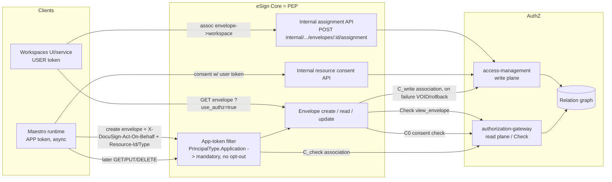
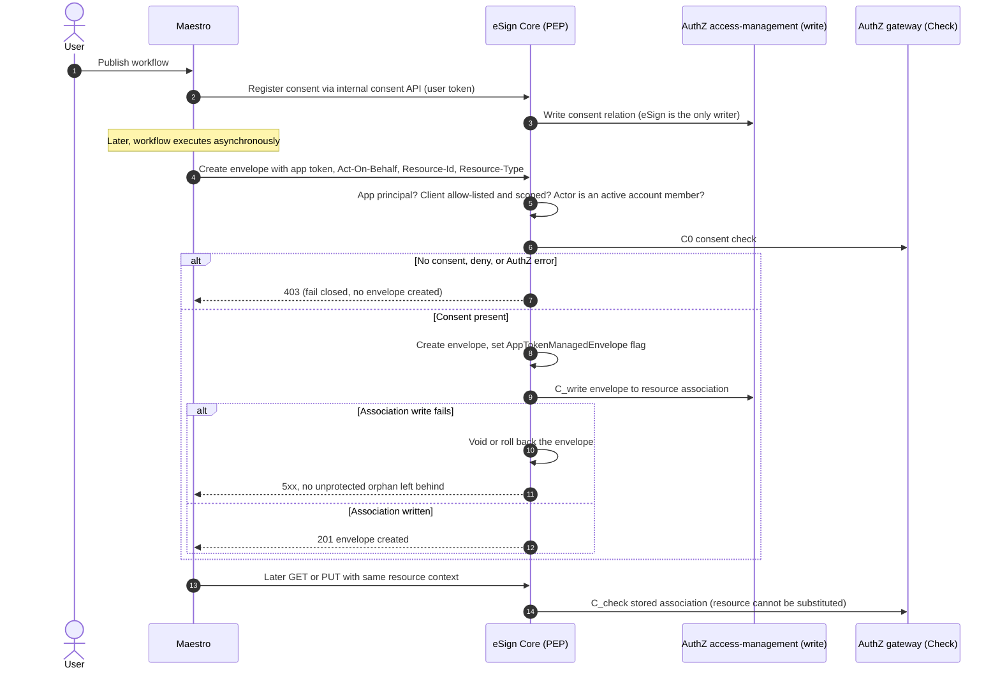
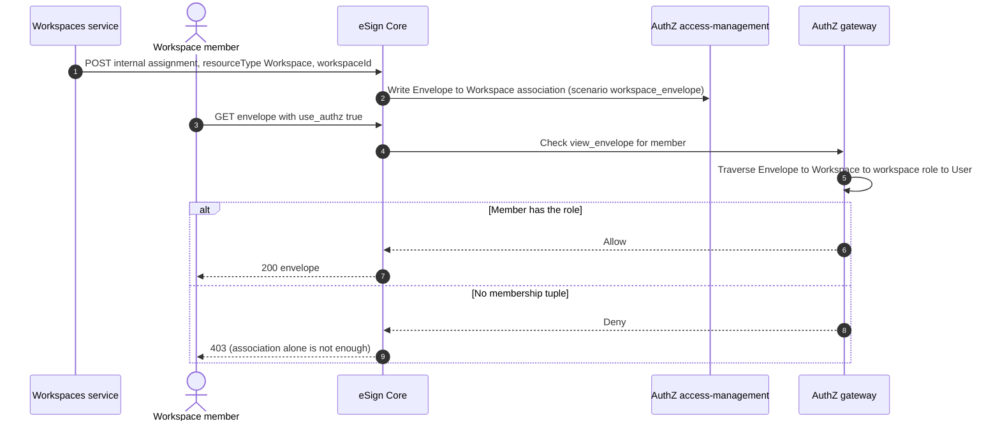

# 03 — Maestro and Workspaces Delegated Access

> **Thesis (30 s):** I built **one delegated-access platform with two trust models** on top of the AuthZ graph. **Workspaces** uses the *interactive* model: a user token, and access is derived through membership (`Envelope → Workspace → User`). **Maestro** uses the *asynchronous* model: an application token acting on behalf of a user who consented. In both, **eSign is the only policy enforcement point and the only writer of protected AuthZ tuples.** Consent, authorization, ownership, and lifecycle are kept as separate concepts. I published the result as a reusable onboarding pattern, so the next 1P app adds configuration, not code.

---

## 1. Context and problem

- **Maestro** (workflow orchestration) called eSign using **user-impersonation tokens**. Every user had to consent per workflow definition, and Maestro minted user tokens in the background. That is fragile, over-privileged, and hard to audit. Maestro was also moving to mTLS / app identity.
- **Workspaces** needed its members to see envelopes associated with a workspace without each envelope being shared individually.
- There was one prior pattern: **Agreement Desk Tickets** (`ticket_envelope`, opt-in `?use_authz=true`, graph traversal). It was hard-coded to tickets in the AuthZ client (`"ticket_envelope"` constant).
- The risks were real: a new **impersonation primitive** (an app acting as a user), **partial failure** between envelope storage and AuthZ, and **silent cross-integration breakage** (see the C6 bug below).

---

## 2. My role

- **Author/DRI** of: *Maestro ↔ eSign: Application Token + AuthZ* (design + summary), *WI: Workspace/eSign Envelope AuthZ Association* (EMT-8295, completed), the Confluence **"Envelope Resource Association & Sharing" reusable pattern**, and the **"eSign App-Token Onboarding Guide: AuthZ and Essential DSS Steps."**
- Owned the **eSign / Core implementation**: resource-associated envelope AuthZ foundation (PR #117683), flows (PR #118061), resource-ID normalization and act-on-behalf user ID (PR #118142), Workspace generalization (PR #116851), and the later **user-based model switch** (EMT-8869, PRs #119497/#119543).
- Coordinated **Maestro, Workspaces, Identity/AuthZ, and Security**. Reviewed and unblocked the AuthZ namespace PR (#251) and roles PR (#653). Allow-listed Workspaces' IK in TK/Stage and drove INT/TK end-to-end testing.

---

## 3. Architecture

### Workspaces flow (interactive)
1. **Prerequisites owned by Workspaces:** register the `Workspace` resource type, write `Workspace:W → workspace_editor → User:Z` on membership changes, and keep its own audit trail.
2. **Associate:** `POST internal/{vx}/accounts/{acct}/envelopes/{id}/assignment { resourceType: "Workspace", resourceId, userId }` → AuthZ stores `Envelope → workspace → Workspace:W`.
3. **Access:** `GET …/envelopes/{id}?use_authz=true` → the engine walks `Envelope → Workspace → workspace_* → User` → `view_envelope` / `manage_envelope`.
4. **Key insight:** *the association alone is not enough.* Membership traversal must also exist, or access is correctly denied.

### Maestro flow (asynchronous, app token)
1. The user publishes or starts a workflow. **Consent is recorded with a user token** through the eSign internal consent API. Maestro never writes protected tuples.
2. At execution time Maestro calls eSign with an **app token** + `X-DocuSign-Act-On-Behalf` + `X-DocuSign-Resource-Id/Type`.
3. eSign validates the token (`PrincipalType.Application`, allow-listed client **and** scope). It validates the **actor scope** (an active account member). It checks consent (**C0**), creates the envelope, then **writes the association (C_write)**. **If the write fails, the envelope is voided/rolled back**, so no unprotected orphan is left behind.
4. Subsequent calls: **C_check** validates the stored association. The caller cannot substitute a different resource ID or type.
5. Lifecycle: unpublish or consent removal stops new creations. Existing envelopes need explicit void/delete (C6), which is documented.

**Repo evidence:**
- [ResourceEnvelopeAuthZService.cs](C:/docusign_source/Core/Components/BusinessObjectsCore/Integrator/Integrator/ResourceEnvelopeAuthZService.cs): `ValidateResourceConsent` (DSS `EnableResourceAssociatedEnvelopeAuthZ`, integrator actors only, 403 on missing consent) and `WriteResourceAssociation` (sets the `AppTokenManagedEnvelope` flag, then `CreateEnvelopeResource`; throws on failure).
- [AuthZRestClient.cs](C:/docusign_source/Core/Components/BusinessObjectsCore/AuthZ/AuthZ.Client/AuthZRestClient.cs): scenario derived from resource type (`{resourceType}_envelope`) instead of the hard-coded `ticket_envelope`, behind `EnableResourceEnvelopeAssignment`. Per-request cached checks.
- [RestApiInternalResourceConsentAuthenticationAttribute.cs](C:/docusign_source/Core/Components/API/Api.Common/RestApiInternalResourceConsentAuthenticationAttribute.cs) and [DynamicSystemSettings.AuthZ.cs](C:/docusign_source/Core/Platform/Configuration/Configuration.DynamicSettings/Settings/DynamicSystemSettings.AuthZ.cs) (`ResourceConsentInternalApiAllowedClientIds`, owner: you).
- [ClientApplicationTokenDelegateHandler.cs](C:/docusign_source/Core/API.Workflows/src/Workflows.Web/ClientApplicationTokenDelegateHandler.cs): the workflows-side app-token acquisition.
- [WorkspaceEnvelopeModule.cs](C:/docusign_source/Core/Components/BusinessObjectsCore/Workspace/Workspace/WorkspaceEnvelopeModule.cs).

---

### Key flows

**A. Maestro asynchronous envelope creation (app token on behalf of a consenting user)**

**B. Workspaces member reads an envelope (user token, access derived through membership)**

## 4. Key decisions and trade-offs

| # | Decision | Rationale |
|---|---|---|
| D1 | **eSign is the sole AuthZ writer and reader for envelope associations.** Maestro never calls AuthZ. | AuthZ allow-lists eSign on the write plane. The PEP must be able to audit what it enforces. It also prevents an app from writing its own grants. |
| D2 | **Consent gates creation; the association gates later access.** | User identity matters at consent time. Later operations must remain bound to the original resource, so no user header is needed on every call. |
| D3 | **Enforcement trigger is the principal type** (`PrincipalType.Application`), not a query flag. | No client-controlled opt-out. User-token traffic is untouched, which means zero regression risk to existing flows. |
| D4 | **Client ID from the verified token, never a header.** | An app cannot register envelopes under another IK. |
| D5 | **C_write failure ⇒ void/rollback the envelope.** | A just-created, unsent envelope has no external side effects. That is better than an unprotected orphan. |
| D6 | **Fail closed on AuthZ error/deny/no decision** for the app-token path. | App tokens have no legacy behavior to preserve. |
| D7 | **Actor-scope validation in eSign** (account membership), behind an interface. | eSign is the system of record for membership. Replicating it into AuthZ adds sync lag on the most security-relevant fact. The interface allows org/claimed-domain scope later. |
| D8 | **Workspaces = no new access model.** Onboard `ResourceType.Workspace` onto the existing assignment infrastructure and generalize the scenario. | It is additive with zero regression to Tickets/Agreement Desk. That made it the template for N+1 integrations. |
| D9 | **Iteration:** two-gate + *IK-ownership* model (Aug) → **user-based model** (Oct, EMT-8869, require `actorId`). | IK-ownership removed the dependency on an AuthZ engine rule and the graph traversal. Integrated testing and downstream needs (Maestro attributes activity to the *last-publishing admin*, and downstream calls need a real user permission check to prevent a permission bypass) showed that every access must stay bound to a user's actual permission. We switched and made the actor mandatory. |

### The latent bug I found (great Dive Deep story)
**C6 (delete envelope resource) deleted the *whole* AuthZ resource, not one association.** The code even noted that there was no unlink API yet. Once an envelope could be both ticket-associated and workflow-associated, unassigning one would **silently strip the other integration's access**. This was latent only because `ResourceType.Workflow` was unused, and Maestro would have made it reachable.
- **Mitigation:** (1) asked AuthZ for an association-level unlink. (2) **Shipped a guard regardless:** refuse to unassign an envelope that has more than one association, so the failure is **loud, not silent**.

### Security review highlights
| Threat | Mitigation |
|---|---|
| `X-DocuSign-Act-On-Behalf` becomes a general impersonation primitive | Honored only for `PrincipalType.Application`, on filtered routes, for allow-listed clients, after actor-scope validation. Requires a dedicated security review before the 2nd integration. |
| Forging the relationship via envelope custom fields | Correlation is read only from the registered AuthZ relation |
| Cross-account replay | `accountId` is in the route **and** in the AuthZ resource scope |
| AuthZ outage | Fail closed |
| Regressing user traffic | Immediate return for non-application principals. AuditOnly ramp first. |
| Stale allow after removal | Bounded by the per-request cache TTL (per-request scope only) |

---

### Failure modes

| Failure | Behavior | Design reason |
|---|---|---|
| AuthZ down or times out (3000 ms client timeout) on the app-token path | 403, fail closed | App tokens have no legacy behavior to preserve |
| AuthZ down on the user-token path | Unchanged legacy behavior | Enforcement triggers on principal type, so there is zero regression for users |
| Association write fails after the envelope is created | Void or roll back the envelope, return 5xx | Never leave an unprotected envelope |
| Client retries after a timeout | Idempotent upsert on (resourceType, resourceId, envelopeId) | No duplicate associations |
| User removes consent | New creations fail at C0. Existing envelopes need an explicit void/delete. | Documented product decision, not an accident |
| Workspace member removed | Next Check traversal denies immediately | Access is derived, not copied onto the envelope |
| Unassign while the envelope has more than one association | Guard refuses the unassign (loud failure) | Prevents whole-resource delete from silently revoking another integration |

## 5. Execution and rollout

- **DSS controls:** `EnableApplicationTokenCredentials`, `IsClientAllowedToApplicationTokenApi` (per API × client, in DUCS), `WorkflowAuthorizationInternalApiAllowedClientIds`, `AppTokenAuthorizationMode_Workflow` (Disabled → AuditOnly → Enforce), `EnableResourceAssociatedEnvelopeAuthZ`, `EnableResourceEnvelopeAssignment`.
- **Testing matrix in the onboarding guide:** missing consent → 403, unallow-listed client → 403, invalid resource type, missing association, expired token, AuthZ error ⇒ no accessible or orphaned envelope. GET/PUT/DELETE enforce ownership. Audit/telemetry/rollback validated.
- **Workspaces:** code complete in Aug. Waited on the AuthZ namespace and roles PRs. I reviewed them, chased the remaining comments, allow-listed the Workspaces IK in TK/Stage, and ran end-to-end tests in TK.
- **Operational:** "eSign ApplicationToken Path Alerts" page. Patch rollout with CAB plus TK verification for the user-based switch.
- **Pushback example:** Workspaces asked to let a non-owner (even DSAdmin) do the association. I held the line: association is a **safety check that only the envelope owner can perform at creation**, while post-association reads can still use admin paths.

---

## 6. Results and impact

> ✅ = actual (sourced) · 📈 = projected or target (basis given). Say projections out loud as "projected" or "on track to"; bar raisers accept projections, not invented actuals.

**Status:**
- **Workspaces:** live (EMT-8295 complete; allow-listed and E2E-verified in TK and Stage, then ramped).
- **Maestro:** app-token path live behind DSS. The user-based model shipped as a CAB-approved patch (Oct 21).

| Metric | Before → After | Type |
|---|---|---|
| Maestro workflow runs (30-day) | **123K** runs (Q2) | ✅ IAM planning review |
| Envelopes moved off per-user impersonation tokens onto app identity + consent | → **~120K+ / month** at full Maestro ramp | 📈 basis: ≥ 1 envelope per run |
| Consent prompts | Per user per workflow definition → **once per workflow** | ✅ design |
| AuthZ calls in the design | **7 → 2** on the creation path (5 removed) | ✅ |
| Orphaned or unprotected envelopes on write failure | possible → **0** (void / rollback) | ✅ by construction |
| First-party apps on the delegated app-token pattern | 0 → **5** (Workspaces, Maestro, Verification Session/I9/Notary, NDSE, Workflow Builder) | ✅ tracker |
| Workspaces reach | Target **10% of IAM paying accounts (~4K of 40K)** in FY27 | ✅ target |
| Time to onboard the next app | Workspaces ~**6–8 weeks** → **~2 weeks** with the reusable guide (config + allowlist + regression) | 📈 basis: actual Workspaces timeline |
| Silent cross-integration access-loss bugs reaching prod | **0** (guard shipped pre-launch) | ✅ |

**Scope I led:** 4 teams (Maestro, Workspaces, Identity/AuthZ, Security) plus eSign Core.

---

## 7. Amazon Leadership Principles mined from this project

| LP | STAR story |
|---|---|
| **Customer Obsession** | Maestro users were asked to consent per workflow, and impersonation tokens were brittle. I moved to consent once plus app identity, and kept user-token traffic completely untouched so existing customers saw zero change. |
| **Ownership** | I owned it end to end across four teams: design, Core implementation, AuthZ PR reviews, IK allow-listing, TK testing, alerts, onboarding guide, and the post-launch model change. |
| **Dive Deep** | Found the **C6 whole-resource delete** bug by reading the business logic, not the docs. Proved it was latent and only became reachable through Maestro. |
| **Insist on the Highest Standards** | Shipped the multi-association guard **even without** the AuthZ unlink API, so the failure is loud. C_write failure voids the envelope. No opt-out on the app-token path. |
| **Invent and Simplify** | "One delegated-access platform, two trust models." Generalized `ticket_envelope` into a resource-type-derived scenario so new apps are configuration. Removed 5 of 7 planned AuthZ calls (C1–C5) in the first design. |
| **Are Right, A Lot / Learn and Be Curious** | Pivoted from IK-ownership to the **user-based model** once integration showed downstream calls needed the real user's permission. I changed my mind with data instead of defending the first design. |
| **Have Backbone** | Pushed back on letting non-owners (including admins) perform associations, and on the impersonation header without a dedicated security review. |
| **Earn Trust** | Wrote explicit team-ownership splits (Workspace / eSign / AuthZ) and "what is NOT changing" sections so partner teams knew exactly what they owned. Answered "I'm not AuthZ team, but here's the eSign contract" to set clear boundaries. |
| **Deliver Results** | Workspaces association shipped (completed). Maestro app-token flows shipped behind DSS with a CAB-approved patch for the model change. |

---

## 8. Deep-dive Q&A

1. **What stops Maestro acting for the wrong user?** Consent is recorded for (user, workflow) with the **user's** token. The actor must be an active account member. On the user-based model, the actor's own permission is checked on access.
2. **Trusted claims vs. headers?** Client ID comes only from verified token claims. Headers carry context (actor, resource) that is **validated** against AuthZ and membership. The workflow definition ID is caller-asserted but is never an authorization input by itself.
3. **Envelope created but association write fails?** Void/rollback within the same request and return 5xx. Retries are idempotent on (envelope, resource).
4. **Duplicate associations on retry?** Writes are keyed by the (resourceType, resourceId, envelopeId) tuple, so they are idempotent upserts.
5. **What does revoking consent do?** It blocks new creations immediately. Existing envelopes need explicit void/delete. That is documented, and it is a product decision, not an accident.
6. **Workspace membership changes?** They propagate through the graph traversal at Check time. There is no envelope rewrite.
7. **Why does eSign own protected writes?** Single PEP, auditability, and no app can grant itself access.
8. **Tenant boundary?** `accountId` is in the route and in the AuthZ resource scope, plus a membership check on the actor.
9. **Onboarding the next app?** Register the resource type, membership graph, and scenario in AuthZ. Allow-list the IK via DSS. Use the assignment API and `use_authz=true`. Run the checklist.
10. **What should be generalized next?** A parameterized enforcement filter (app N+1 adds config, not code), a pluggable actor-scope check, and association-level unlink in AuthZ.

## 9. Coinbase angle
This maps to **delegated access for support agents and automation acting on a customer's behalf**: consent, attribution, a fail-closed path, and rollback on partial failure. Coinbase values: **Act like an owner** (cross-team end-to-end), **Clear communication** (ownership tables), **Efficient execution** (reuse an existing pattern).
