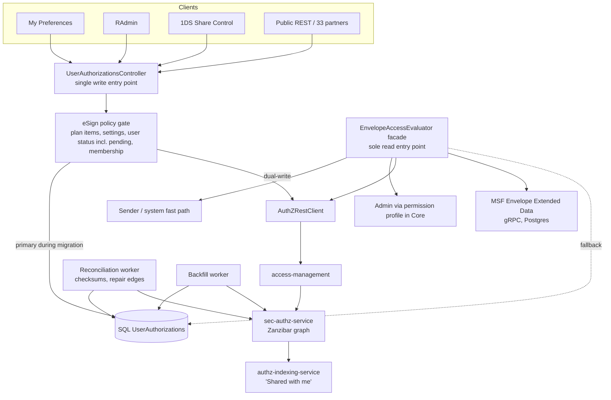
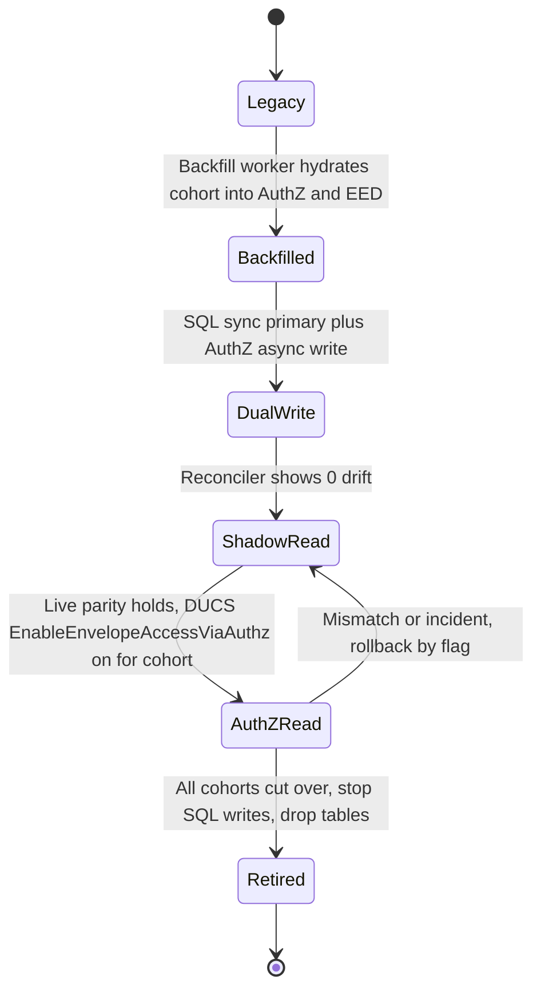
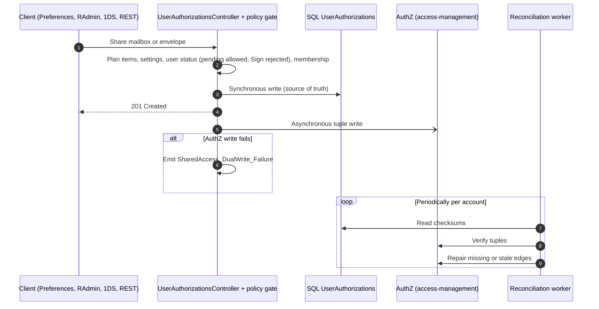
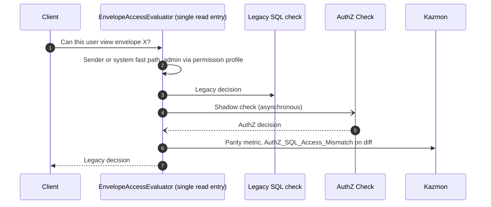

# 04 — Unified eSign Sharing Migration to AuthZ

> **Thesis (30 s):** I helped converge a mission-critical legacy authorization system (SQL `UserAuthorizations` / `Share` tables covering **~40.5M sharing configurations across ~183.8K accounts**, with **$59M MRR** of legacy Shared Envelopes customers) onto the Zanzibar-style AuthZ platform. The rule was no loss of access, no unsafe gap, and no flag day for 33 partner integrations. The approach was: explicit semantic mapping → backfill → dual-write → reconciliation → shadow reads → cohort-based read cutover → legacy retirement. Measurable parity gates sat at every step.

---

## 1. Context and problem

| Fact | Value (source: P&T deep dive / eng design PFPP-3291) |
|---|---|
| Legacy Shared Envelopes | ~21K monthly accounts (87% direct) ≈ **$59M MRR** |
| Accounts with ≥1 share | **183.8K** |
| Total sharing configurations | **40.5M** |
| Shared Access (XOBO, Act-On-Behalf-Of) | Manage **~89.6K** accounts, Send **~24.2K**. ~30K MAA, +11% YoY |
| Legacy account sharing still active | ~137.2K accounts |
| External consumers | **33 partner integrations** on the public REST API |
| Storage cost context | ESDB ≈ $1.68M/yr prod (≈ $2M with demo/test). Citus Postgres ≈ 42% cheaper per vCore than Hyperscale → ≈ $1.14M/yr equivalent |

**Pain:**
- Two overlapping sharing features (legacy Shared Envelopes and Shared Access) confused customers and internal teams.
- No individual envelope sharing, no group sharing.
- Customers worked around this with shared service accounts and shared passwords (hr@company.com), which is a security risk.
- Envelope access was disconnected from the rest of the agreement graph (Agreements, Agreement Desk, Workspaces, Maestro, CLM folders, 20+ resource types).

---

## 2. My role

- **Technical owner of the migration:** the authorization model (legacy semantics → tuples), the migration architecture (backfill, dual-write, reconciliation, shadow reads, cohort cutover), the guardrails (plan items stay in eSign, single write entry point, never fall back on a deny), and the parity-gap resolutions.
- Built the Core enforcement and migration primitives (learning-mode writer, access ramp, evaluator integration) and the resource-association pattern that put Workspaces, Tickets, and Maestro on the same graph (story 03).
- Drove alignment across EMT, CSI, Data Replication, AuthZ, Search/List, and Product, with milestone gates, against a 13.5-FTE peak plan.

---

## 3. Architecture



**Graph model (simplified):**
```
definition account_member { relation shared_access_manage: user; relation shared_access_send: user }
definition envelope {
  relation owner: user; relation direct_share_viewer|editor|manager: user
  permission view  = viewer + editor + manager + owner + owner->account_member#shared_access_manage
  permission send  = manager + owner + owner->account_member#shared_access_manage + owner->account_member#shared_access_send
  permission transfer_custody = manager + owner + owner->account_member#shared_access_manage
}
```

---

### Key flows

**A. Per-cohort migration state (every arrow is gated by a metric)**


**B. Write path during dual-write, plus reconciliation**


**C. Read path in shadow mode (customers always get the legacy answer until cutover)**


## 4. Migration plan (the heart of the story)

| Phase | What | Exit gate |
|---|---|---|
| 0. Model | Map senders, recipients, signing groups, legacy sharing, XOBO, and delegates to tuples. List the semantics that **intentionally change**. | Design sign-off (Gate 1, 10/15) |
| 1. Backfill | Stream ~89.6K Manage / ~24.2K Send plus historical shares into AuthZ and EED. Idempotent, resumable, cohort-scoped. | Counts match per cohort |
| 2. Dual-write | SQL is synchronous and primary. AuthZ is asynchronous. A **reconciliation worker** compares checksums and repairs missing or stale edges. | Dual-write success > **99.99%** |
| 3. Shadow reads | `EnvelopeAccessEvaluator` queries AuthZ alongside SQL and logs parity (`AuthZ_SQL_Access_Mismatch`). | **0 drift** before cutover |
| 4. Read cutover | DUCS `EnableEnvelopeAccessViaAuthz` 0 → 100% **per cohort**. Legacy fallback for approved exceptions. | Mismatch/fallback within limits (Gate 4) |
| 5. Retire | Stop SQL writes, drop tables, EOL legacy Shared Envelopes (all customers Q3 CY2027). | Q2 exit: cohorts migrated with no loss of access |

**Program gates:** G1 design 10/15 → G2 foundation in test 1/15 (also *stop new enablements of legacy sharing*) → G3 prod pilot 3/1 (**rollback rehearsed**, reconciliation tooling ready) → G4 limited availability 4/15 → G5 Q2 exit 6/1.

**Resourcing (cross-org ask):** 13.5 FTE peak = EMT 5, CSI 3, DB replication 3, AuthZ 2.5 (dotted line to the DRI EM), plus 2.5 AuthZ scaling.

**Repo primitives that make this safe:**
- [DynamicSystemSettings.ESignAuthZMigration.cs](C:/docusign_source/Core/Platform/Configuration/Configuration.DynamicSettings/Settings/DynamicSystemSettings.ESignAuthZMigration.cs): `ESignAuthZMigration_WriterMode` = Off / Learning / On.
- [EnvelopeAuthorizationWriter.cs](C:/docusign_source/Core/Components/BusinessObjectsCore/EnvelopeAuthorization/EnvelopeAuthorization/Writers/EnvelopeAuthorizationWriter.cs): in learning mode, calculate updates, report exceptions, write nothing. In enforced modes, throw on calculation failure (no silent gaps).
- [EnvelopeAccessRamp.cs](C:/docusign_source/Core/Components/BusinessObjectsCore/EnvelopeAuthorization/EnvelopeAuthorization/EnvelopeAccessRamp.cs): learning-mode read comparison that always returns the legacy decision, with comparison/error metrics. Tests: [EnvelopeAccessRampTests.cs](C:/docusign_source/Core/Components/BusinessObjectsCore/EnvelopeAuthorization/EnvelopeAuthorization.UnitTests/EnvelopeAccessRampTests.cs).
- [DynamicSystemSettings.IndividualEnvelopeSharing.cs](C:/docusign_source/Core/Platform/Configuration/Configuration.DynamicSettings/Settings/DynamicSystemSettings.IndividualEnvelopeSharing.cs): feature, AuthZ permission, and per-request cache flags, all default **off**.
- [EnvelopesSharesBizLogic.cs](C:/docusign_source/Core/Components/BizLogic/EnvelopesSharesBizLogic.cs) `GetEnvelopePermissionImpl` (DSS-gated, account-ownership validation). Legacy list path: [SharedEnvelopesBizLogic.cs](C:/docusign_source/Core/Components/BizLogic/SharedEnvelopesBizLogic.cs). Legacy SQL: [dbo.rptUserSharesByAccount.sql](<C:/docusign_source/Core/Databases/Docusign/Stored Procedures/dbo.rptUserSharesByAccount.sql>).

---

## 5. Key decisions and trade-offs

| # | Decision | Why |
|---|---|---|
| D1 | **Parity on capabilities needed to migrate, not full legacy parity.** Workarounds for niche flows. | Full parity would make the program impractical. This was an explicit P&T-level alignment. |
| D2 | **Plan items and account settings stay in eSign, not in AuthZ** (Sep 14 consensus). | Product only requires blocking *new* assignments when a plan item is off. Keeps AuthZ decoupled from licensing and billing. |
| D3 | **Do not index all account envelopes to admins** (Sep 15). Admins are evaluated in Core via the permission profile. | Indexing every envelope to every admin would explode the graph and the "Shared with me" index for no product value. |
| D4 | **Single write entry point** (all UIs and APIs go through the eSign sharing layer). Access Management write permission is restricted to the eSign service principal. | One policy gate, one audit point, and no bypass by the 1DS widget. |
| D5 | **SQL is the source of truth during dual-write.** AuthZ is asynchronous plus reconciliation. | Customer-visible writes cannot fail because of the new system. Drift is repaired, not prevented. |
| D6 | **Distinguish "not migrated" from "not authorized."** | Fallback to legacy only for not-migrated cohorts. Never fall back on an AuthZ *deny*, because that would open a security gap. |
| D7 | **Cohort-based rollout** (account cohorts) rather than per-API. | Lets an account move atomically. Rollback is per cohort. |
| D8 | **Don't launch individual envelope sharing before unifying.** | Avoids deepening UX fragmentation. Documented as **reversible** if the "Shared with me" timeline slips. |
| D9 | **Pending users:** Manage/Edit/Send allowed, **Sign rejected (400)**. | HR pre-onboarding use case vs. signing requiring an accepted ToS identity. |
| D10 | **Parity gaps resolved in the model:** `transfer_custody` permission, `send_on_behalf` checked before a bulk-send batch is queued, cross-site via GDS global identity (no stub users), doc visibility deferred to Phase 2. | Explicit, written trade-offs. |

---

### Cost and scope discipline (Frugality)

| Lever | Decision | Impact |
|---|---|---|
| Storage | ESDB (**$1.68M/yr prod, ~$2M all envs**) → EED on Citus Postgres (**~42% cheaper per vCore**, **≈ $1.14M/yr**) | **$0.54M/yr prod; up to ~$0.9M/yr** all environments 📈. Query-plan parity is a perf gate. |
| Scope | Parity matrix: migration-blocking / workaround-able / retire | Deferred doc visibility, template sharing, participant tokens, AuthZ platform scale work |
| Graph size | No "index every envelope to every admin" | Avoids graph and index blow-up; admins use Core permission profiles |
| Commercial logic | Plan items stay at the eSign boundary | No licensing logic in AuthZ |
| Legacy growth | Stop new enablements of legacy sharing at Gate 2 | Migration population stops growing |
| People | 2.5 dedicated AuthZ engineers (dotted line), not a new team; staffing **5 → 13.5 → 11 → 4–5 FTE** by phase | Peak held at 13.5 FTE |

## 6. Observability and SLOs

- AuthZ access check p99 **< 15 ms** intra-region. Dual-write success **> 99.99%**. **0** parity drift before cutover. Sharing API error rate **< 0.05%**.
- Alerts: `AuthZ_SQL_Access_Mismatch`, `SharedAccess_DualWrite_Failure`, `AuthZRestClient_CircuitBreaker_Open`.
- Success metrics: 100% migration off Shared Envelopes, Shared Access adoption, individual envelope sharing adoption, "Shared with me" engagement, migration success rate without intervention, number of customers requesting extensions, migration-related support tickets.

---

## 7. Results and impact

> ✅ = actual (sourced) · 📈 = projected or target (basis given). Say projections out loud as "projected" or "on track to"; bar raisers accept projections, not invented actuals.

**Status:** Architecture signed off (Gate 1). Backfill, dual-write, and shadow reads are built behind flags. Cohort cutover is on track for Q2 2027, with all-customer EOL in Q3 2027.

| Metric | Value | Type |
|---|---|---|
| Customers protected by "no loss of access" | **~21K accounts, ≈ $59M MRR** (Shared Envelopes); **~30K MAA** (Shared Access, +11% YoY) | ✅ |
| Relationships migrated | **40.5M** sharing configs across **183.8K** accounts, plus **~113.8K** Shared Access grants (89.6K Manage + 24.2K Send) | ✅ scope / 📈 per cohort |
| Partner integrations with zero contract change | **33** | ✅ |
| Parity gate before any cohort reads from AuthZ | **0 drift** (reconciler + shadow reads) | ✅ gate |
| SLOs | Dual-write **> 99.99%**, AuthZ check p99 **< 15 ms**, sharing API errors **< 0.05%** | ✅ targets |
| Storage cost | ESDB **$1.68M/yr** (~$2M with demo/test) → Postgres-backed EED **≈ $1.14M/yr** → **$0.5–0.9M/yr saved** | 📈 computed |
| Customer-visible access-loss incidents | **0** target, with rehearsed rollback per cohort | ✅ gate |
| Product unlocked | Individual envelope sharing, inherited access via 20+ resource types, agent identities | ✅ |

**Scope I led:** technical owner across EMT, CSI, Data Replication, AuthZ, and Search/List. **13.5-FTE peak** program.

---

## 8. Amazon Leadership Principles mined from this project

| LP | STAR story |
|---|---|
| **Customer Obsession** | "No loss of access" was the non-negotiable. We chose cohort migration with rehearsed rollback and legacy fallback for approved exceptions, because $59M MRR of customers depend on sharing every day. |
| **Think Big** | Positioned this as bringing envelopes into the same access graph as 20+ resource types, which unlocks IES, inherited access, and agent identities, rather than as "rewrite sharing." |
| **Dive Deep** | Mapping legacy semantics to tuples: admins (not indexed), pending users (no Sign), custody transfer, bulk send, and cross-site stub users. Each needed a documented decision. |
| **Are Right, A Lot** | Kept plan items out of AuthZ. Didn't index admins. Each decision avoided graph bloat or a licensing coupling that would have hurt for years. |
| **Insist on the Highest Standards** | 0 drift before cutover. Rollback rehearsed before the pilot. Never fall back on deny. Learning-mode writers that throw in enforced modes instead of silently skipping. |
| **Frugality** | Moved to cheaper storage (Citus Postgres, about 42% cheaper per vCore). Scoped parity to what migration needs. Asked for a *dedicated* 2.5 AuthZ FTEs rather than a large new team. |
| **Disagree and Commit** | Whether to ship IES before unification was debated. The decision was to unify first. I committed and helped document it as a reversible decision with a trigger to revisit. |
| **Earn Trust** | Wrote explicit "intentionally changed semantics" and exclusion lists so customers and support weren't surprised. Gave support tooling and runbooks as a gate item. |
| **Deliver Results** | [Gate milestones met on time / pilot cohorts live]. |
| **Success and Scale Bring Broad Responsibility** | Eliminating the shared-password workaround (hr@company.com) is a real security improvement for customers. |

---

## 9. Deep-dive Q&A

1. **Source of truth during dual-write?** SQL. AuthZ is a projection until read cutover. Reconciliation is the repair loop.
2. **Idempotent historical replay?** Tuples are naturally idempotent (set semantics). The backfill is resumable by cohort and watermark. Conflicts resolve to the SQL state at the watermark, and dual-write handles mutations after the watermark.
3. **Detect missing/extra permissions?** Checksums per account in the reconciler, plus shadow-read decision diffs on live traffic (`AuthZ_SQL_Access_Mismatch`).
4. **Huge sharing graph for one customer?** Cohort it alone. Throttle backfill. Pre-warm the index. Watch p99 for that tenant.
5. **Read-after-write?** During dual-write, reads still come from SQL. After cutover, AuthZ writes are synchronous, with consistency tokens (Zanzibar-style 'zookies') for read-after-write where needed.
6. **AuthZ healthy but index stale?** List endpoints ("Shared with me") are eventually consistent and documented. Point checks go to the PDP, not the index.
7. **Rollback after partial migration?** Flip the cohort's DUCS flag back to legacy reads. Dual-write keeps SQL current, so rollback is lossless.
8. **Prove equivalence?** Shadow-read parity at 0 drift over N days of real traffic per cohort, plus contract tests for every permission in the matrix.
9. **Semantics intentionally changed?** Admins are not indexed into "Shared with me." Doc visibility is deferred. Legacy-only niche flows get workarounds.
10. **External integrations without a flag day?** The public API contract is unchanged. Enforcement moves underneath it, and partners see the same responses.

## 10. Coinbase angle
This maps to migrating **ledger, entitlement, or permission systems** with zero customer-visible regression: dual-write, reconciliation, shadow reads, cohort cutover, and rehearsed rollback. Coinbase values: **Customer focus**, **Efficient execution**, **Clear communication** (gates and written decisions).
