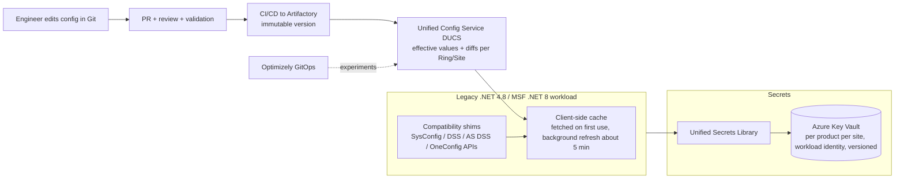
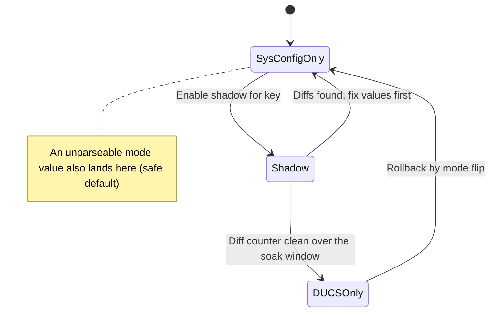
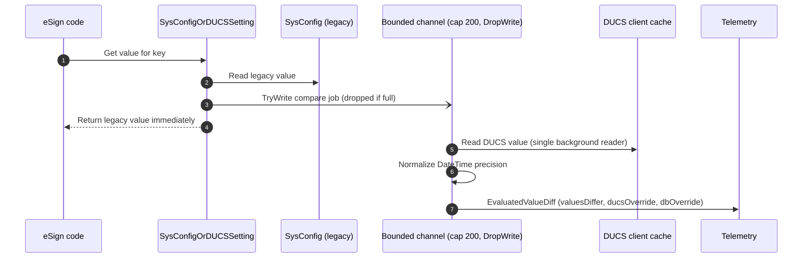
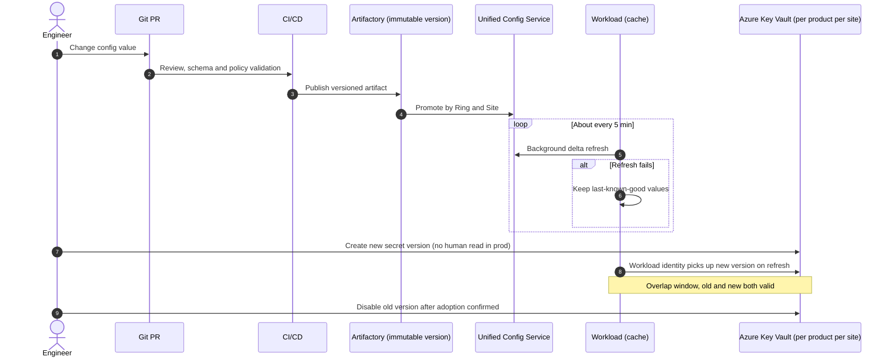

# 05 — Runtime Configuration and Secrets Modernization

> **Thesis (30 s):** eSign ran on **5+ overlapping configuration systems** (DSS, SysConfig, OneConfig, AccountServer DSS, Optimizely) and **6+ secret stores**, several of them unencrypted and without access control. Every flag ramp took **50+ PRs plus manual DOC operations**, configuration requests ran **2,500+ per year**, and misconfiguration caused **13% of incidents**. I helped drive the unification: one GitOps-governed configuration service (DUCS) with **zero-touch compatibility shims**, a **shadow-mode migration** that compares old and new values off the hot path, and Azure Key Vault-backed unified secrets with workload identity and no human read access.

---

## 1. Context and problem (current-state audit)

| Facility | Store | Ownership | Versioning | Controlled rollout | Rollback | Notes |
|---|---|---|---|---|---|---|
| OneConfig | Git | strong | by version | ✓ | ✓ | **MSF only**, no dynamic overrides |
| DSS | DSDB + Git | weak | Kusto/Git | ✓ | ✗ | 500 MB heap per workload; delta refresh every 5 min per workload |
| SysConfig (deprecating) | DSDB | weak | current only | ✗ | ✗ | holds some of the **most sensitive secrets** |
| AccountServer DSS | Sauce / Cosmos | weak | current only | ✗ | ✗ | ring-global |
| Optimizely (± GitOps) | Optimizely | strong | varies | ✓ | ✓ | flags/experiments |

**Secrets:** SysConfig, AS DSS, and Sauce Secure Store had **no enforced encryption and no access control**. File-based stores, Key Manager (Cosmos), and Azure Key Vault (workload identity, versioned, 2,000 TPS per subscription per region) also existed. Thycotic was in operational use.

**Pain (quantified):**
- Confusion about which facility to use and which value wins (bootstrap vs. dynamic, key qualifiers vs. value conditionals).
- No visibility of effective values across builds, Rings, and Sites.
- Large blast radius with no controlled rollout or rollback. **No CI/CD for configuration.**
- **50+ PRs for one DSS flag ramp**, plus manual DOC operations. **2,500+ DOC config requests/year.**
- **13% of incidents in 6 months (12) were misconfigurations.**
- Configuration data sat **next to customer data** (the DSS DB).
- Up to **350 of 800 secrets were globally scoped** in Demo/Prod.

---

## 2. My role

- **Owned the runtime configuration and secrets modernization:** the unified config model, the zero-touch compatibility shims, the shadow-mode migration (SysConfigOnly → Shadow → DUCSOnly), the bootstrap and preload path, the secrets boundary (Key Vault with workload identity, no human read), and the rollout across legacy and MSF workloads.
- Set the program objectives (velocity, security, reliability) and milestones, and made DUCS the substrate for new enforcement features (1P access, app-token allowlists, limit exceptions).

---

## 3. Target architecture

### Zero-touch migration: the SysConfig → DUCS shim (repo)
[SysConfigOrDUCSSetting.cs](C:/docusign_source/Core/Platform/Configuration/Configuration.DynamicSettings.SysConfig/SysConfigOrDUCSSetting.cs) has three modes:
1. `SysConfigOnly`: the legacy value. **An unparseable mode defaults here** (safe default).
2. `SysConfigWithDUCSInShadow`: **return the SysConfig value.** Asynchronously fetch the DUCS value and emit `EvaluatedValueDiff(valuesDiffer, ducsOverride, dbOverride)`.
   - Comparisons go through a **bounded `Channel` (capacity 200, `DropWrite`)** with a single reader, so shadow mode **never adds latency** to the hot path and can't cause memory blow-up.
   - **DateTime precision normalization** avoids false-positive diffs.
3. `DUCSOnly`: DUCS is authoritative.

Other details:
- `AsyncLocal` transient overrides for tests and per-flow overrides.
- The shim version is emitted at startup, so you can see which consumers run which shim.
- Mode-in-use counters and an optional evaluation timer.
- Tests: [SysConfigOrDUCSSettingTests.cs](C:/docusign_source/Core/Platform/Configuration/UnitTest.DynamicSettings.SysConfig/SysConfigOrDUCSSettingTests.cs) and [DUCSValueProviderTests.cs](C:/docusign_source/Core/Platform/Configuration/UnitTest.DynamicSettings.SysConfig/DUCSValueProviderTests.cs).

[DucsBootstrapper.cs](C:/docusign_source/Core/Platform/Configuration/Configuration.DynamicSettings/DucsBootstrapper.cs) `PreLoadDUCS` initializes the client with host, site, application, version, and MSF environment. It **preloads namespaces with a timeout** to avoid first-request misses, and emits timer and error telemetry.

The legacy INI layer ([Account.Configuration ConfigFiles](C:/docusign_source/Core/Account/src/Account.Configuration/ConfigFiles)) uses `&envtype:` and `&application:` conditionals. Application-specific INI overrides must be mirrored in DUCS_Config so a later DUCS edit doesn't silently override them.

---

### Key flows

**A. Shim migration state per key or namespace**

**B. Shadow-mode read (validation can never add latency or memory pressure)**

**C. Config change and secret rotation lifecycle**

## 4. Key decisions and trade-offs

| # | Decision | Alternatives | Choice and rationale |
|---|---|---|---|
| D1 | **Compatibility shims vs. a clean-slate API** | Force every team to rewrite | **Shims** for the OneConfig, DSS, SysConfig, and AS DSS interfaces. *Zero barrier to adoption* and zero barrier to MSF migration. |
| D2 | **Migration safety** | Big-bang cutover | **Shadow mode, then DUCS-only**, per key/namespace, with diff counters as the gate. |
| D3 | **Shadow cost** | Synchronous compare | **Async compare via a bounded drop-on-full channel.** It is better to lose some comparisons than to add latency or memory pressure. |
| D4 | **Push vs. pull** | Push to every workload | **Pull with a local cache** (first-use fetch plus about 5-min background refresh). The request path never makes a remote call. Avoid synchronous `linkedFeature` lookups on hot paths (a known multi-second p99 cause). |
| D5 | **Freshness vs. availability** | Strong consistency | **Last-known-good cache.** Emergency changes rely on the refresh cadence. Truly urgent kills use dedicated kill switches. |
| D6 | **Should the config service resolve secrets for callers?** | UC Service reads AKV on the caller's behalf | **No.** UCS would need read permission on *every* AKV, which bypasses access control, and its cache would mix secrets with non-secrets. Workloads read AKV directly with workload identity. *"Keep the door closed until a real use case appears."* |
| D7 | **Generic secret rotation** | Platform rotates everything | **No generic rotation.** Rotation is use-case specific. Provide **self-serve AKV pipelines** plus guidance. |
| D8 | **Config/customer-data separation** | Keep DSS DB co-located | **Separate.** It reduces load on customer stores and limits blast radius. |
| D9 | **Build vs. buy** | Optimizely for everything | Keep Optimizely (GitOps) for **experiments**. Unified config for runtime configuration. |

---

### Failure modes

| Failure | Behavior | Design reason |
|---|---|---|
| Config service unreachable | Serve last-known-good from the client cache, alert on staleness | The request path never depends on a remote config call |
| Bad config value merged | Staged promotion by Ring and Site, health-gated, roll back to the previous immutable version | Limits blast radius; rollback is one step |
| Shadow diffs spike | Stay in shadow, alert, fix values before DUCS-only | Diff counter is the gate |
| Shadow channel full | Drop compare jobs (DropWrite) | Validation must never hurt production |
| Unparseable mode value | Fall back to SysConfigOnly | Safe default |
| Key Vault throttling (2,000 TPS per sub per region) | Client caching, a vault per product per site | Stay well under the limits |
| Secret leaked | Rotate with an overlap window, then disable the old version | You can't un-leak; rotation is the only fix |
| Someone asks the config service to read secrets for callers | Not supported | It would need read access to every vault (bypassing access control) and mix secrets into its cache |

## 5. Objectives and milestones (program)

- **Velocity:** eliminate DOC involvement in config **100%** (from 2,500+ requests/yr). Config and secret deploy time **−99%** (days → minutes). Rollout activities from **50+ to 1**. Edit, check in, and start deploying in **< 5 min**. Rollout latency **< 60 s**.
- **Security:** **100%** of secrets encrypted and access-controlled. **No human read** of production secrets. Reduce the 350 globally scoped secrets. Separate non-customer secrets from customer data.
- **Reliability:** **−75%** misconfiguration incidents (13% baseline) and lower MTTR. Rollout within 5 min. **−500 MB** DSS heap per workload.
- **Milestones (5 engineers):** Mar–May 2025 service + library + DSS interface → Jun–Aug SysConfig interface, DSS migration, secrets library → Sep–Nov AS DSS, Optimizely, CI/CD, adoption → Q4 SysConfig and AS DSS migration, and Secure Store / Directory Service / Key Manager migration to AKV.

---

## 6. Results and impact

> ✅ = actual (sourced) · 📈 = projected or target (basis given). Say projections out loud as "projected" or "on track to"; bar raisers accept projections, not invented actuals.

**Status:** SysConfig → DUCS **shadow mode 100% in Prod**. DUCS **100% in Demo**. Prod cutover is per namespace.

| Metric | Before → After | Type |
|---|---|---|
| Config change time-to-deploy | **15 min → 5 min (−67%)** | ✅ SRE notes, Nov 2026 |
| Shadow validation coverage | 0 → **100% of Prod** traffic compared off the hot path | ✅ |
| Steps to ramp a flag | **50+ PRs + manual DOC ops → 1 GitOps change** | 📈 program target |
| DOC config requests | **2,500+/yr → ~0** for migrated namespaces | 📈 |
| Heap per workload | DSS library **500 MB → reclaimed** | 📈 |
| Misconfiguration incidents | **12 in 6 months (13% of incidents)** → **−75%** | ✅ baseline / 📈 target |
| Secrets | **100%** encrypted, workload identity, **0 human-readable** prod secrets. **350 of 800** globally scoped secrets scoped down. | 📈 target |

**Lesson I applied (good Dive Deep follow-up):** an NA1 incident traced to a mode value with the wrong capitalization. That silently turned DUCS-driven SysConfig changes into no-ops. Fix: case-insensitive mode parsing, validation of allowed values, and an alert on any unknown mode.

---

## 7. Amazon Leadership Principles mined from this project

| LP | STAR story |
|---|---|
| **Invent and Simplify** | Collapsed 5 config facilities into one, with shims so no consumer had to change code. Shadow mode made migration a configuration flip. |
| **Insist on the Highest Standards** | Shadow comparisons can never hurt production (bounded channel, drop-on-full, single reader, safe default mode). DateTime normalization prevents false alarms that would erode trust in the diff signal. |
| **Dive Deep** | Root-caused **why** DSS cost 500 MB heap per workload plus a 5-minute delta refresh per workload, and why synchronous `linkedFeature` lookups caused multi-second p99s. |
| **Frugality** | 500 MB heap savings per workload across the fleet. Separating config from customer DBs lowers load. Reused AKV instead of building a secret store. |
| **Have Backbone** | Pushed back on "the config service should fetch secrets for callers" because it would bypass AKV access control. Held the line until there is a real use case. |
| **Ownership** | Took eSign's side of the migration end to end: the shim, shadow-mode validation, and bootstrapping in the monolith. Then built new enforcement (1P access, app-token allowlists) directly on DUCS segments instead of adding more one-off DSS lists. |
| **Earn Trust** | Before using DUCS as an enforcement substrate on the request path, I asked the config team publicly for SLOs, segment limits, payload caps, and `in`-operator cardinality, instead of assuming. |
| **Deliver Results** | [shadow → DUCS-only migrations completed; ramp time reduced]. |
| **Success and Scale Bring Broad Responsibility** | Secrets in unencrypted config stores next to customer data was a latent compliance and security risk. Fixing it protects customers who never see it. |
| **Bias for Action** | Adopted DUCS segments for new enforcement immediately rather than waiting for a bespoke service (see story 01 pivot). |

---

## 8. Deep-dive Q&A

1. **How do you stop a bad config from taking down every region?** GitOps review plus validation, immutable versions, progressive rollout by Ring/Site, health-gated promotion, and one-click rollback to the previous version.
2. **Config rollback vs. secret rollback?** Config: re-pin the previous version. Secrets: you can't "un-leak." Rotate with an **overlap window** (new and old both valid), confirm adoption, then revoke the old one.
3. **Wrong-environment secret?** Separate AKV per product per site. Workload identity is scoped to its own vault. There is no cross-environment access path.
4. **Cache freshness?** First-use fetch, about 5-min background delta refresh, last-known-good on failure, and alert on refresh staleness.
5. **Rotate without restart?** The library re-reads the versioned secret on refresh and consumers tolerate both versions during the overlap.
6. **Audit without exposing values?** Log key, version, actor, and time. Never log values. No human read permission in prod.
7. **Legacy and MSF identical?** Same shims and library on .NET Framework and .NET 8. Behavior is identical by construction.
8. **Testing compatibility?** Shadow-mode diff counters on real traffic, plus unit tests for mode handling and type coercion.
9. **Emergency disable?** A dedicated kill-switch key and revert to the previous version. For truly instant needs, a flag the service reads on every refresh, plus a documented cadence.
10. **Which metric proves it worked?** Misconfiguration incident rate, time from PR to effective-in-prod, number of manual DOC operations, and diff rate during shadow.

## 9. Coinbase angle
Regulated environments need **auditable, reversible, least-privilege configuration and secrets**. This story shows I can migrate a large fleet with **no behavior change** and **measurable safety gates**. Coinbase values: **Efficient execution**, **Act like an owner** (eSign side of the migration end to end), **Clear communication** (current-state audit tables).
