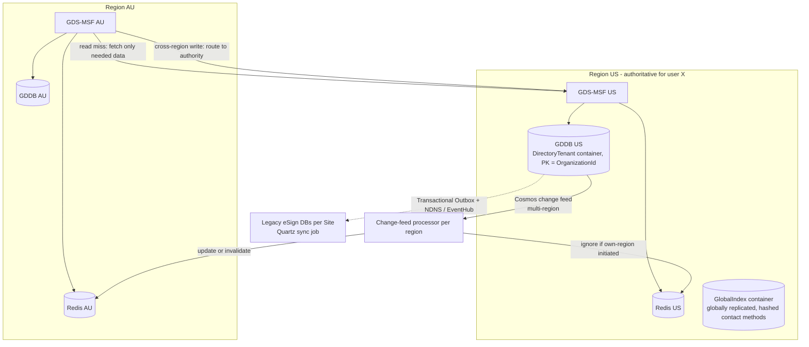
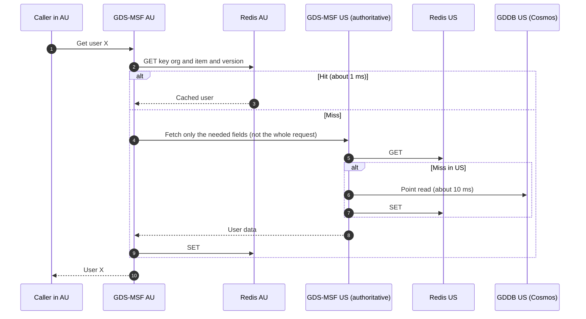
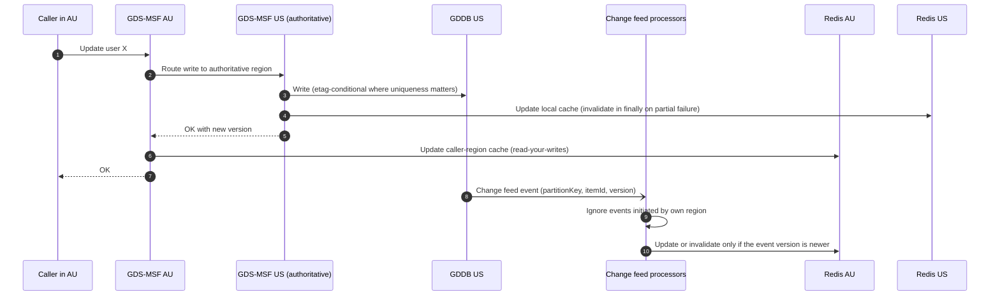
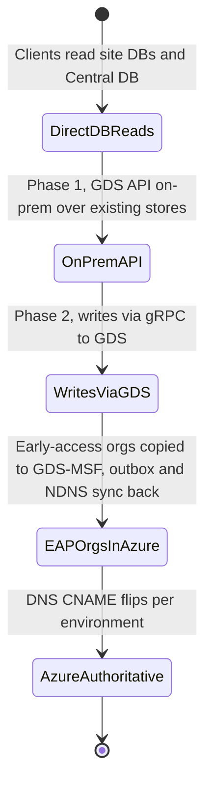

# 06 — Global Directory and Multi-Region Identity Caching

> **Thesis (30 s):** I designed the read and write paths of Docusign's **Global Directory** (GDS + GDDB). This is the cloud-native source of truth for users, memberships, organizations, and groups, replacing about **8 site-partitioned eSign databases**, the regional DocuSign Central DBs, and PubSub sync. Writes go to the **authoritative region**. Reads are served from **regional Redis caches (~1 ms)**, kept fresh through the **globally replicated Cosmos DB change feed** used as a cross-region notification bus. Consistency contracts are explicit, and the legacy migration is phased so the end-user experience never changes.

---

## 1. Context and problem

- **Site partitioning:** eSign scaled horizontally into about 8 Sites, each with its own DocuSign DB. A User, Membership, and Account had to live on the same Site. Cross-site reads went through PubSub → regional **DocuSign Central DB** (read-only) plus a separate **Global Index** DB.
- **The "User Model Problem":** multiple active users per email.
  - *Same-site:* the "husband & wife emails" feature. New creations blocked since summer 2022.
  - *Cross-site:* a cloned user per site. This caused the **user-selection challenge** at login and required **fan-out writes** to every site to keep clones in sync.
- **Costs and risk:** duplicated directory data across DocuSign DB, Central DB, Sauce, and the AccountServer DB. Business logic drifted between copies. Partitioning bugs leaked into client code.
- **Goals:** cloud-native; deprecate Central DB and most Sauce/AS DB directory data; org-based tenancy; email aliases; **one principal per email**; data residency; single business-logic implementation; faster reads.

---

## 2. My role

- **Designed the multi-region read and write architecture:**
  - Authoritative-region writes.
  - Regional Redis caches.
  - The Cosmos change feed as the global invalidation bus.
  - Invalidate-on-write invariants (including partial failures).
  - Etag-conditional uniqueness.
  - The caller consistency contract.
- **Owned the phased migration:** on-prem API first, writes via gRPC, early-access org cutover, DNS flip, and Outbox + NDNS sync back to legacy.

---

## 3. Architecture

### Read path
1. Regional GDS checks local Redis → **hit** returns.
2. **Miss** → if the data is owned by another region, call that region's GDS for **only the needed data** (not the whole request). That region checks its own cache, then its DB.
3. Populate the remote cache on the return path, then the local cache.

### Same-region write
DB write → update the local cache → return. The change feed notifies all regions. The local handler **ignores events it initiated**. Remote regions update or invalidate.

### Cross-region write
Route the write to the **authoritative region** → it commits → update the caller-region cache on response. The change feed propagates to everyone else.

### Data model highlights
- **Partition key = `OrganizationId`** for nearly everything. Cosmos has no global secondary indexes, so access patterns drive the design. A physical partition is limited to 10K RU and 50 GB. Transactions and sprocs are scoped to one logical partition.
- **GlobalIndex** (globally replicated) holds hashed contact methods. **Uniqueness ("one principal per email") is enforced with an etag-conditional write** after a read. This is optimistic concurrency without distributed locks.

### Repo evidence
- [GlobalDirectoryDALService.cs](C:/docusign_source/Core/VNext/API.GlobalDirectory/src/API.GlobalDirectory.DAL.Impl.ForGDVNext/GlobalDirectoryDALService.cs): `InvalidateCachedUser(...)` runs in a **`finally` block** after user updates, invalidating **every constituent cross-site user** via `userCacheInvalidator.InvalidateUsers`.
- [GlobalDirectoryDALServiceTests.cs](C:/docusign_source/Core/VNext/API.GlobalDirectory/test/API.GlobalDirectory.Tests/UnitTest/GlobalDirectoryDALServiceTests.cs): tests prove invalidation happens **even when concealed or work-address saves fail** (partial-failure correctness).
- [GlobalDirectoryUserWriteService.cs](C:/docusign_source/Core/VNext/API.GlobalDirectory/src/API.GlobalDirectory.DAL.Impl.ForGDVNext/GlobalDirectoryUserWriteService.cs): `CreateCrossSiteCompatibleUsers(crossSiteUserConsolidationOverride: true)` consolidates site clones into one logical user.
- [GlobalDirectoryAuthorizationEvaluator.cs](C:/docusign_source/Core/VNext/API.GlobalDirectory/src/API.GlobalDirectory.AuthZ/GlobalDirectoryAuthorizationEvaluator.cs): per-API authorization definitions (`ClientIdsAllowedToCallApi`). GDS is locked down to specific integrations.
- [AccountCacheConfiguration.ini](C:/docusign_source/Core/Account/src/Account.Configuration/ConfigFiles/AccountCacheConfiguration.ini): `&application:API.GlobalDirectory`-scoped cache settings.

---

### Key flows

**A. Read with a cache miss in a non-authoritative region**

**B. Write from a non-authoritative region, and global propagation**

**C. Migration phases (consumers move before the data does)**

## 4. Key decisions and trade-offs

| # | Decision | Alternatives | Choice and rationale |
|---|---|---|---|
| D1 | **Write topology** | Multi-region writes on user data | **Authoritative-region writes.** Identity and membership need a single authority. Avoids last-writer-wins conflicts on security-relevant fields. |
| D2 | **Cache engine** | Cosmos "foreign copy" with TTL; Cosmos integrated cache | **Redis.** About 1 ms reads vs. about 10 ms Cosmos point reads. An integrated-cache miss still costs about 10 ms, and Cosmos copies don't fix latency. Redis is available in Azure and GCP. |
| D3 | **Notification bus** | EventHub / Service Bus | **Multi-region Cosmos change feed**, because EventHub/SB lack global locality. Redis writes (about 1 ms) let the processor keep up. Precedent: the scim-service change-feed processor writing to Service Bus at 20–100 ms. |
| D4 | **Update vs. invalidate** | Always update | **Remote regions may update or invalidate.** Invalidate is the safer default for out-of-order events, update is faster for hot keys. The originating region ignores its own events. |
| D5 | **Invalidation on write failures** | Invalidate only on success | **Invalidate in `finally`.** A partially failed write must never leave a stale cache believing the old state. |
| D6 | **Uniqueness** | Distributed lock / SQL unique index | **Etag-conditional write to GlobalIndex.** |
| D7 | **Partitioning** | UserId / AccountId | **OrganizationId.** Matches the org-tenancy model and query patterns. The GlobalIndex handles cross-org lookups. |
| D8 | **Migration** | Big-bang data move | **Phased:** (1) GDS API on-prem backed by existing stores, so clients move reads to the API first; (2) writes via gRPC; (3) … (4) EAP orgs copied to GDS-MSF; DNS CNAME switches on-prem → Azure; Transactional Outbox + NDNS sync back to legacy; change feed → EventHub for products. |

---

## 5. Consistency contract (say this crisply)

- **Read-your-writes in the caller's region:** yes. The caller-region cache is updated on the write response.
- **Other regions:** eventually consistent, bounded by change-feed lag plus processing (target: **< 5 s p99**).
- **Security-critical reads** (for example membership right after removal): route to the authoritative region or bypass the cache [confirm the policy]. Never serve a **negative-cached "allowed"** from the cache.
- **Out-of-order events:** compare versions (`_ts`/etag) and apply only newer. When in doubt, invalidate.

---

## 6. Failure modes

| Failure | Behavior |
|---|---|
| Redis down in a region | Fall through to the DB (higher latency). Shed load with request coalescing. Never fail the read solely because of the cache. |
| Region partitioned from the authority | Reads served from the local cache (stale but bounded). Writes for users owned by that authority fail fast with a retryable error. |
| Change-feed lag | Lag metric and alert. TTL as a backstop so stale entries expire. |
| Cache stampede after invalidation | Single-flight / request coalescing, jittered TTLs, hot-key protection. |
| Cache corruption / loss | Rebuild lazily on miss. The authoritative DB is the source of truth. |

---

## 7. Results and impact

> ✅ = actual (sourced) · 📈 = projected or target (basis given). Say projections out loud as "projected" or "on track to"; bar raisers accept projections, not invented actuals.

**Status:** Live across **5 data-residency regions (NA, CA, AU, EU, IL4)**. API-first migration in progress; early-access orgs moving to GDS-MSF.

| Metric | Before → After | Type |
|---|---|---|
| Read latency on a cache hit | Cosmos point read **~10 ms → Redis ~1 ms (−90%)** | ✅ design measurements |
| Cross-region reads avoided | Intercontinental hop (**~150–200 ms** US↔AU) → **local hit** | 📈 basis: typical RTT |
| Cache hit rate | → **≥ 95%** target | 📈 basis: caller-side user-lookup cache ran **~96.5%** ✅ |
| Cross-region propagation | → **< 5 s p99** via the change feed | 📈 target |
| Login "pick which user" challenge | Present for cross-site users → **eliminated** for migrated orgs (one principal per email) | ✅ by design |
| Legacy stores on the deprecation path | ~**8** site DBs' directory tables, regional Central DBs, Sauce / AS DB directory data | ✅ |
| Partition-aware client code | Every consumer → **0** (single API) | ✅ |

**Scope I led:** read/write architecture and consistency contract across GDS, eSign, AccountServer, and product consumers.

---

## 8. Amazon Leadership Principles mined from this project

| LP | STAR story |
|---|---|
| **Customer Obsession** | Users had to pick "which you" at login because of cross-site clones. The goal of one principal per email removes that confusion, and the phased migration meant users never saw a cutover. |
| **Think Big** | One global directory for every Docusign product (not eSign-shaped), with org tenancy and data residency built in. |
| **Are Right, A Lot** | Chose Redis over Cosmos integrated cache with numbers (1 ms vs. 10 ms, and miss cost still 10 ms). Chose the change feed over EventHub because of global locality. |
| **Dive Deep** | Invalidation in `finally` with tests for partial-failure paths, and own-region event suppression. These are the subtle correctness bugs caches create. |
| **Insist on the Highest Standards** | Explicit consistency contract per caller class. Etag-conditional uniqueness instead of "hope." |
| **Invent and Simplify** | Used the Cosmos change feed itself as the global notification bus. No new messaging infrastructure. |
| **Frugality** | Retire Central DB, Sauce directory data, and duplicated tables. Fetch only the needed data cross-region, not the whole request. |
| **Bias for Action** | Phase 1 launched the API on-prem over existing stores to get clients onto the API early while data migration continued. |
| **Earn Trust** | Wrote down which reads are eventually consistent and which are not, so consumer teams could design safely. |

---

## 9. Deep-dive Q&A

1. **What does a caller get after a write?** Read-your-writes in its own region. Other regions are eventually consistent within the change-feed SLO.
2. **Out-of-order events?** Version-compare on apply, prefer invalidate, TTL backstop.
3. **Region partitioned from the authority?** Reads from the local cache; writes fail fast and retry. No split-brain writes because there is a single authority per user.
4. **Avoid stale permissions/membership?** Security-sensitive checks go to the authority or bypass the cache. Shorter TTL for membership keys. No positive caching of authZ decisions derived from directory data beyond a short window.
5. **Cache key and tenant isolation?** Key = `{type}:{orgId}:{itemId}` plus a version. The org is in the key. No cross-tenant key collisions.
6. **Rebuild after loss?** Lazy on miss, plus pre-warm for top N hot orgs.
7. **Thundering herd?** Single-flight per key, jittered TTL, serve-stale-while-revalidate for non-sensitive keys.
8. **Migrating while both systems get writes?** The authority moves per org (EAP cohorts). Outbox plus NDNS sync back to legacy. Reconciliation jobs. DNS CNAME flip per environment.
9. **Why not Cosmos integrated cache?** A miss still pays the about 10 ms Cosmos read, and it doesn't solve cross-region latency.
10. **Test failover and divergence?** Chaos tests (kill Redis, delay the change feed, partition a region), plus divergence detectors comparing the cache vs. the DB on samples.

## 10. Coinbase angle
Coinbase runs global, latency-sensitive identity and account lookups for CX tools. This shows I can reason about **authoritative writes, regional caches, change-data-capture propagation, and explicit consistency contracts**. Values: **Customer focus** (no login confusion), **Clear communication** (written consistency contract).
