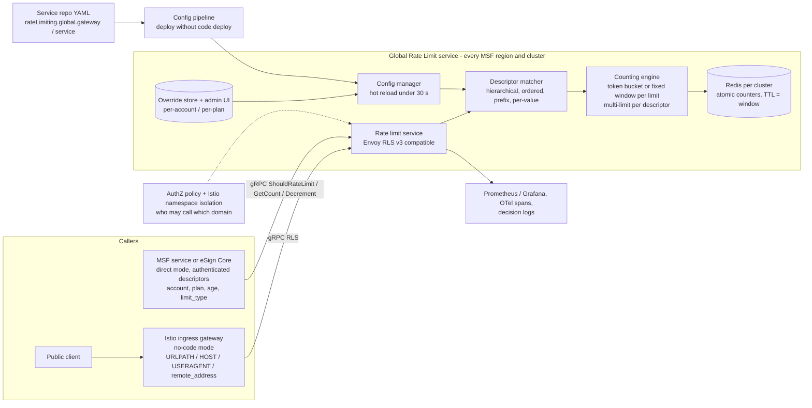
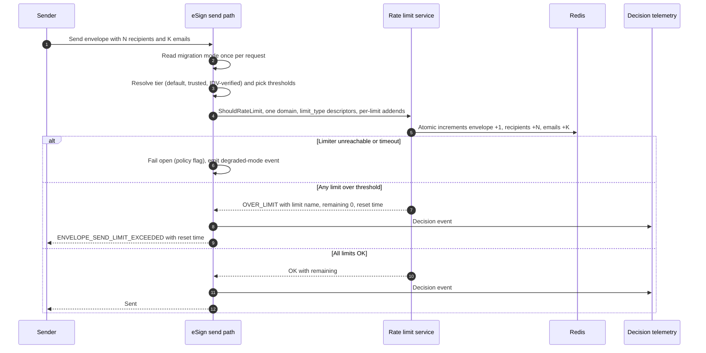
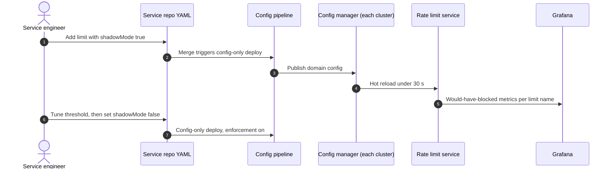
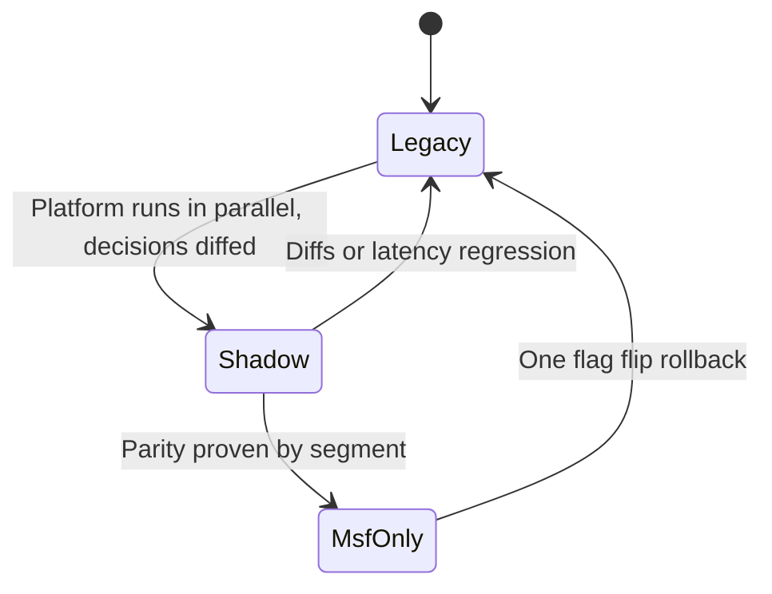
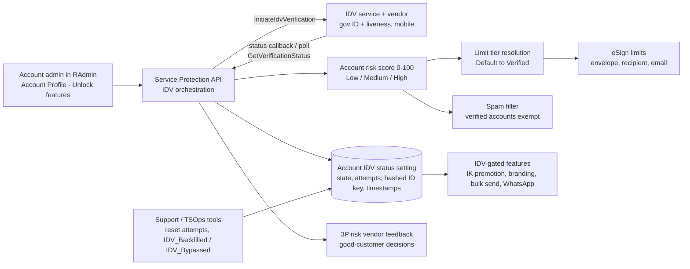
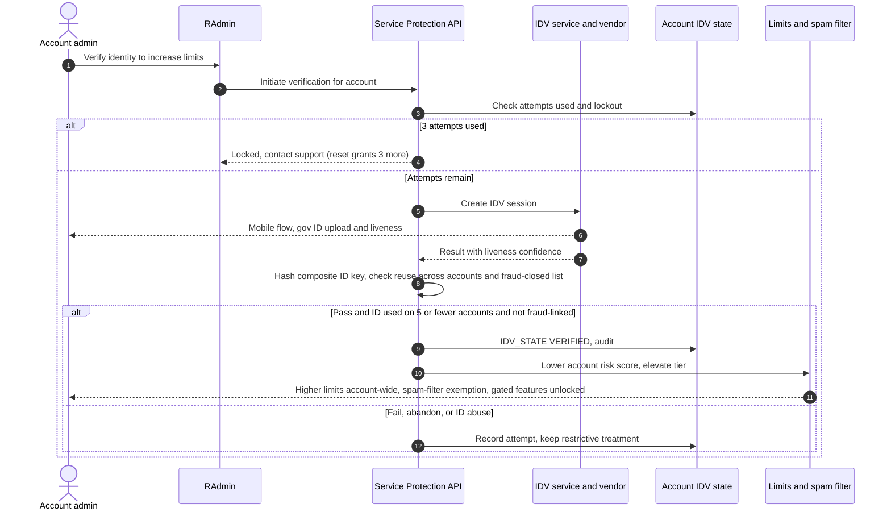
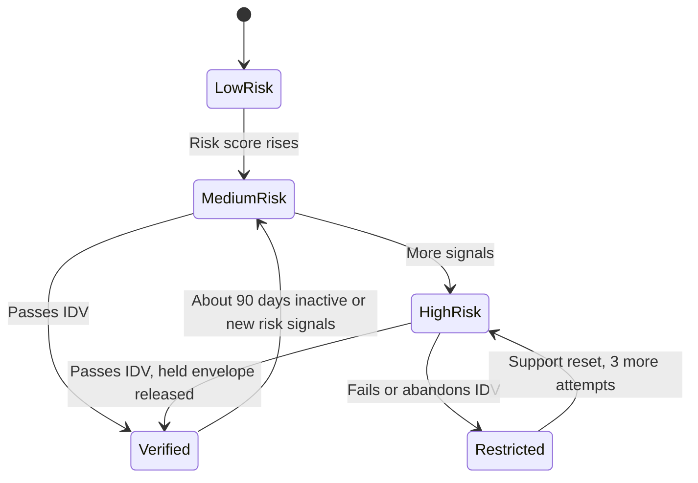

# 07 — Adaptive Service Protection: Global Rate Limit Platform + Trusted Account (IDV)

> **Thesis (30 s):** I designed Docusign's **MSF Global Rate Limit platform**: a multi-tenant, Redis-backed limiting service available in every MSF region, used for both infrastructure protection and business quotas. I moved eSign's fraud limits onto it. I then designed and shipped the **Trusted Account / ID-Verification (IDV) integration**, which turned blunt anti-fraud limits into **progressive, risk-based friction**: verified customers unblock themselves in minutes, and fraudsters hit a wall they can't pass at scale. In production, trusted accounts get **100× limits** and IDV is **100% ramped**, with **~150 accounts self-verifying** in the first weeks.

---

## 1. Problem

- **Fraud:**
  - Docusign envelopes were a phishing vector on digital plans.
  - Target: cut fraud-envelope recipients from **~0.5% to < 0.2%**.
- **Blunt defenses hurt good customers:**
  - Default send limits.
  - **5 recipients per envelope** on fraud-impacted plans.
  - Spam-filter suppression.
  - Branding disabled for **~240K eligible accounts**.
  - **~80 support cases a month** just for limit increases.
- **No shared limiting substrate in the cloud:**
  - eSign limits ran on an on-prem engine (ServiceProtection + Distributed Computation).
  - Every MSF service either had no protection or built its own.
- **Requirements of eSign's business limits:**
  - Rolling multi-day windows (30-day and 3-day).
  - Per-plan and per-account-age thresholds.
  - Thousands of per-account overrides.
  - Several limits evaluated on every send (envelopes, recipients, cumulative recipients, emails).

## 2. What I owned
1. **Designed the Global Rate Limit platform:**
   - API, config model, counting and storage, integration modes, config plane, multi-tenancy and isolation, observability.
   - Its evolution: multi-limit, batch evaluation, deploy-free config, override store.
2. **Migrated eSign's limits onto it** with a Legacy → Shadow → MsfOnly path at parity.
3. **Designed and built the Trusted Account / IDV integration end to end:**
   - Account verification state and data model.
   - Orchestration API with the IDV vendor flow.
   - RAdmin entry point and limit elevation.
   - Spam-filter exemption and gated features.
   - Abuse controls and support/TSOps escalation paths.
   - Rollout.
4. **Defined the layered decision policy**: throttle → quota → risk → step-up verification → governed exceptions.

---

## 3. Requirements

| Type | Requirement |
|---|---|
| Functional | Count and limit by arbitrary descriptors (path, IP, client, account, plan, account age). Multiple limits per request. Different weights per limit (an envelope send = +1 envelope, +N recipients). Read counts without incrementing (dashboards). Admin decrement (support reset). Per-account overrides. Shadow / learning mode. |
| Multi-tenant | Any MSF service onboards self-serve. Limits are owned and isolated per service. No noisy-neighbor counter collisions. |
| Latency | Single-digit-ms p99 on the hot path. Must be negligible next to a 100–500 ms envelope send. |
| Availability | Available in every MSF region. A limiter outage must not take down sends. |
| Safety | New limits ship in shadow first. Changes deploy without redeploying the calling service. Misconfiguration must not cause an outage. |
| Fraud fit | Business limits must not give dormant accounts "burst credit". Counters must survive changes to the threshold-driving attributes (e.g., account age). |
| Observability | Every decision is explainable: which limit, current count, threshold, time to reset. |

---

## 4. Platform architecture



### Two integration modes (a deliberate split)

| Mode | Use when | Descriptors | Code needed |
|---|---|---|---|
| **Ingress gateway** | Protect a service from anomalous traffic before it reaches pods | Request metadata only: `URLPATH`, `USERAGENT`, `HOST`, `remote_address` | None (YAML only) |
| **Direct gRPC** | Business and identity-aware limits | Anything (`account_id`, `plan_type`, `age_bucket`, `limit_type`…) | Thin generated client. **The caller authenticates first.** |

*Why split:* the gateway can't trust identity claims it hasn't verified. Identity-aware limits belong after the service's own AuthN/AuthZ.

### API (Envoy RLS v3-compatible, so it plugs into Istio natively)
- `ShouldRateLimit(domain, descriptors[], hits_addend)` → `overallCode`, per-descriptor `statuses[]` (`code`, `currentLimit{name, requestsPerUnit, unit}`, `limitRemaining`, `durationUntilReset`), and additional statuses for multi-limit.
- `GetCount(...)` → current count + `counterStatus` (dashboards and support, no increment).
- `Decrement(...)` → admin reset of mistaken counts.
- **Domain = `{namespace}-{release}`.** Each service owns its own domain, which gives isolation and clear limit ownership.

### Config model
```yaml
limits:
  - name: "esign-recipient-sends-free-7day"   # unique; becomes a metric label
    unit: Day
    lengthOfTime: 1
    requestsPerUnit: 25
    shadowMode: true                           # count + metrics, don't enforce
    descriptors:
      - name: limit_type
        value: recipient_sends
      - name: plan_type
        value: free
      - name: age_bucket
        value: new_0
  - name: "esign-recipient-sends-override-acct-c8d9"
    requestsPerUnit: 200
    unit: Day
    replaces: ["esign-recipient-sends-free-7day"]   # per-account override, zero code
    descriptors:
      - name: account_id
        value: "c8d9e0f1-..."
```

**Matching rules:**
- Descriptors are matched in order.
- A limit applies only on a **full hierarchical match**.
- An empty value means "a separate counter per unique value."
- Prefix values are supported.
- More specific limits are listed first.
- **A request with no matching limit returns OK.** That is a deliberate fail-safe, so a config typo cannot cause an outage.

### Counting and storage
- **Redis key** = domain + matched descriptor path + window. **TTL = window length**, so counters expire on their own and there is no cleanup job.
- **Atomic increment by `hits_addend`.** One envelope send with 5 recipients is a single call with addend 5, not 5 calls.
- **Algorithms are a per-limit choice:**
  - **Token bucket** for API and infra protection (smooth, tolerates bursts).
  - **Fixed windows plus multi-limit per descriptor** (e.g., a day limit plus an hour limit) for fraud quotas, so dormant accounts can't bank burst credit.
- **Counters are per data center (no cross-DC replication).** This is a deliberate trade-off: no cross-region hop on the hot path, and no global quorum dependency. Global quotas are approximate (bounded by the number of DCs). Accounts are naturally region-homed, so in practice skew is small.

---

## 5. Key flows

**A. eSign send decision: all limits in one round trip**


**B. Shipping a new limit safely (no service redeploy)**


**C. Migration mode per limit**


---

## 6. Migrating eSign's limits: parity drove the platform's roadmap

eSign was the largest and hardest consumer, so I used its parity requirements to evolve the platform. I wrote a **7-gap parity analysis (3 P0)**, and each gap was resolved with a platform feature or an explicit client-side design:

| Gap | Resolution |
|---|---|
| Legacy evaluated **10+ protectors in 1 round trip**; the platform did one domain per call | **Batch / multi-limit evaluation.** Use a single domain with a `limit_type` descriptor, so every limit costs 1 RTT. |
| **Different weights per limit** in the same request (+1 envelope, +N recipients) | **Per-limit addends** in the batch request |
| Large (30-day) and small (3-day) windows | **Multi-limit per descriptor** (`additional statuses`) instead of doubling descriptors |
| Counter reset when `age_bucket` changes | **Stable counter on `account_id`.** Age-bucket threshold selection moves to the client. |
| Burst credit for dormant accounts under token bucket | Fixed windows plus shorter-window limits for fraud quotas |
| No standard decision logging | Decision fields returned in the gRPC response, plus a telemetry emitter that keeps parity with legacy events, so dashboards and support tools keep working |
| **Thousands of per-account overrides** managed in a UI | **Override store + admin UI**, plus config deploys without code deploys. Interim: `replaces`. |

**Migration mechanics:**
- **Legacy / Shadow / MsfOnly** per limit.
- **Read the mode once per request.** This fixed a time-of-check/time-of-use (TOCTOU) drift that could double-count.
- Pre-check plus post-track semantics matched the legacy fire-and-forget tracking exactly.
- gRPC authentication between caller and limiter.
- Ramps targeted by **segment, not just percentage**. This lesson came from a ramp that briefly hit a direct enterprise customer; the fix excluded all direct customers, and the ramp checklist became standard.

**Limits migrated:**

| Domain | Counts | Windows |
|---|---|---|
| `envelope_sends` | envelopes per account | 30-day + 3-day |
| `recipient_sends` | recipients per send | 30-day + 3-day |
| `cumulative_recipients` | all recipients including correct, bulk, and signing-group members | 30-day + 3-day, plus an upfront batch check for BulkSend |
| `email_sends` | outbound emails per template set | per policy |

---

## 7. Trusted Account / IDV integration

### Design idea
**Fraudsters cannot produce valid government ID plus liveness at scale.** So identity verification is the right **step-up** for senders:
- Legitimate customers get a **self-serve redemption path**.
- Bad actors get a wall.

`IDV_STATE = VERIFIED` becomes a clean, reusable account-level signal for every downstream service.

### Architecture


### Verification flow


### Risk ladder (progressive friction, not binary blocks)


| Tier | Treatment |
|---|---|
| Low | Allow, no treatment |
| Medium | Modify and warn (formatting stripped, warning banner). IDV restores normal treatment. |
| High | Suppress and flag. **Prompt IDV.** On pass, release the envelope and temporarily allow-list the account (~1 year). |
| Verified | Elevated tier (e.g., Default → Verified limit, up to 10,000), spam-filter exemption, gated features. **Plan allowances and billing still apply.** |

### Abuse controls I designed in
- **3 self-serve attempts**, then lockout. Support or TSOps reset grants 3 more. No permanent lockout of legitimate users.
- **A hashed composite ID key**, so one ID can verify **at most 5 accounts** (configurable). IDs tied to **fraud-closed accounts are blocked** for about 2 years.
- Vendor document-reuse protections. **Country-configurable vendor selection** (e.g., a US-only high-conversion option vs. global vendors).
- **Elevate, don't remove:** move to a higher tier or apply a multiplier, never unlimited.
- **Reverify after about 90 days of inactivity.**
- **Escalation without IDV:** TSOps can set `IDV_Backfilled` or `IDV_Bypassed` after review (SLA: 1 business day to respond, 3 to resolve). Every change is audited.

### Data model (account IDV status setting)

| Field | Purpose |
|---|---|
| `accountId` | Account-level, so one admin's verification benefits all eligible users |
| `idvState` | `NotStarted` / `Pending` / `Verified` / `Failed` / `Backfilled` / `Bypassed` |
| `attemptCount`, `lockedUntil` | Retry limits and support reset |
| `idKeyHash` | Reuse and fraud-link checks without storing raw ID data |
| `verifiedAt`, `expiresAt` | Reverification policy |
| `verifiedByUserId`, `transactionId` | Audit and support lookup |

### Rollout timeline (shipped)

| Milestone | Date |
|---|---|
| PRD reviewed with Service Protection and IDV engineering | Mar 23 2026 |
| Trusted-account 100× envelope and recipient limits in Prod | **Apr 17 2026** |
| Tech spec | May 7 2026 |
| Core data model and account limits | May 25 2026 |
| Service Protection API and IDV orchestration | Jun 22 2026 |
| RAdmin integration and end-to-end validation | Jul 2026 |
| Higher send limits for verified accounts | **Jul 31 2026** |
| Spam-filter exemption for verified accounts | **Aug 10 2026** |
| IDV self-serve **100% in Prod** | **Sep 2026** |
| Integrator Key promotion gated on IDV | **Oct 15 2026** |
| Next | Branding, bulk send, WhatsApp behind IDV; limit multiplier; audit-log entries; IDV in the spam-filter flow (V2); self-reactivation of fraud-closed accounts (V3); "Verified Sender" badge (V4) |

---

## 8. Key decisions and trade-offs

| # | Decision | Alternatives | Choice and why |
|---|---|---|---|
| D1 | API shape | Custom proto | **Envoy RLS v3-compatible.** Istio ingress integrates natively, and the ecosystem tooling comes free. |
| D2 | Integration | Gateway only | **Gateway (no-code) + direct gRPC (identity-aware).** The gateway can't trust unverified identity. |
| D3 | Global vs. regional counters | Cross-DC replicated counters | **Per-DC counters.** No cross-region latency or quorum on the hot path. Accept approximate global quotas. |
| D4 | Algorithm | One algorithm everywhere | **Per-limit choice.** Token bucket for infra. Fixed windows plus multi-limit for fraud (no banked burst). |
| D5 | Unmatched descriptors | Reject | **Return OK.** A config mistake must never become an outage. Shadow mode catches mis-matches. |
| D6 | Many limits per request | One call per limit | **One domain + `limit_type` + per-limit addends**, so 1 RTT. |
| D7 | Overrides | YAML only | **Override store + UI**, deploy-free config. `replaces` for the interim. |
| D8 | Limiter outage | Fail closed | **Fail open for sends (policy-controlled).** Risk and IDV layers still apply. Fail-open lives in **caller policy, not the client library**, so it is explicit per call site. |
| D9 | Medium-risk handling | Block | **Challenge with IDV.** Friction proportional to risk. |
| D10 | Effect of verification | Remove limits | **Elevate tier / multiplier.** A verified account still can't burst without bound. |
| D11 | "Trusted" semantics | IDV sets the manual SecOps Trusted flag | **IDV lowers the risk score.** The SecOps "Trusted" status stays reserved for manual review, and other signals can raise the score again. |
| D12 | Scope of verification | Per user | **Per account.** One admin verifies, and all eligible users benefit. |

---

## 9. Failure modes

| Failure | Behavior |
|---|---|
| Limiter or Redis unavailable | Sends fail open (flagged, alerted). Ingress mode falls back to local limits. Fraud layers still apply. |
| Hot key (mega-sender) | One counter per account per limit. Time-bucket suffix sharding for extreme senders. Per-cluster Redis keeps the blast radius local. |
| Config typo / unmatched descriptor | OK returned (no outage). Shadow metrics show zero matches, which triggers an alert. |
| Bad threshold shipped | Config-only rollback in under 30 s. Shadow first for every new limit. |
| Ramp hits the wrong segment | Explicit segment exclusions plus a parity check against existing enforcement before every ramp |
| IDV vendor outage | Account keeps its current tier. The admin sees a retry message. Support or TSOps manual path. |
| IDV fraud attempts (ID reuse, scripted parallel sends) | ID-hash reuse cap, fraud-closed blocklist, attempt limits, IDV prompt on the next send |
| Retry storms after a 429 | `durationUntilReset` / `Retry-After`, client jitter, idempotent sends |

## 10. Observability and SLOs
- **Per-limit metrics labelled by unique limit name:** decisions (OK / OVER / shadow-would-block), latency, Redis errors, config reload status.
- **Spans and decision logs:** domain, matched limit, count, threshold, remaining, reset. Support can explain any block without seeing fraud logic.
- **IDV funnel:** initiated → completed → passed. Completion-rate target **≥ 60%**, with median time comparable to signer verification. Plus lockouts and support resets.
- **Business KPIs:** false-positive resolution rate, fraud block rate (abandonment at IDV), free-to-paid conversion lift, limit-related support tickets (**−50% target**).

## 11. Scale (back-of-envelope to present)
- **Per check:** about 1–10 ms gRPC (network + Redis) vs. a 100–500 ms envelope send, so under 2–5% overhead. Batching makes it **1 call per send, not per recipient**.
- **Redis:** one atomic increment per limit per send. The platform runs **~4,000 TPS average** today ✅, against a Redis P2 ceiling of **10K–50K TPS** ✅ (2.5–12× headroom). Single Redis shard throughput is far above that, so shard by domain if needed.
- **Config:** O(number of limits) in memory per pod. Hot reload under 30 s.

---

## 12. Results and impact

> ✅ = actual (sourced) · 📈 = projected or target (basis given). Say projections out loud as "projected" or "on track to"; bar raisers accept projections, not invented actuals.

| Metric | Value | Type |
|---|---|---|
| Rate-limit platform throughput | **~4,000 TPS average**, every MSF region | ✅ Service Protection |
| Headroom | Redis Premium P2 supports **10K–50K TPS** → **2.5–12× headroom** | ✅ |
| Per-check latency | **1–10 ms** vs. a 100–500 ms envelope send (< 2–5% overhead), **1 call per send** | ✅ |
| Fraud-envelope recipient rate | **~0.5% → 0.15% (−70%)**, beating the **< 0.2%** Q4 target (Sep 26 – Oct 26 2026) | ✅ Anti-Fraud tracker |
| IDV verifications | **758 successful / 779 = 97.3% success** | ✅ Anti-Fraud tracker, Oct 2026 |
| IDV rollout | **100% in Prod** (Sep 2026) | ✅ |
| Trusted-tier limit lift | **100×** envelope and recipient limits (Prod Apr 17 2026) | ✅ |
| Trusted-path limit evaluations | **~48M / week (~6.9M / day)** | ✅ SPR-3010 |
| Limit-increase support cases | **~80 / month** baseline → **≥ 50% reduction**, since **~250 / month** self-serve unlocks (758 in ~3 months) displace manual cases | ✅ baseline / 📈 |
| Gated features shipped on IDV | Higher limits (Jul 31), spam-filter exemption (Aug 10), Integrator Key promotion (Oct 15) | ✅ |
| Example configured limits | Biz Pro **1,000 per 30 days** + **50/day** for the first 3 days. New digital accounts **25 (free) / 250 (paid)** recipients in the first 7 days. | ✅ limits page |

---

## 13. Amazon Leadership Principles from this project

| LP | Story |
|---|---|
| **Customer Obsession** | Anti-fraud limits were blocking paying customers. Trusted tier (100×) plus self-serve IDV turned weeks of support back-and-forth into minutes. ~150 accounts self-verified quickly. |
| **Think Big** | One limiting platform for every MSF service (infra protection *and* business quotas), plus `IDV_STATE` as a reusable trust signal for many features. |
| **Invent and Simplify** | Two integration modes; per-account overrides via `replaces` with zero code; one round trip for all limits. |
| **Are Right, A Lot** | Per-DC counters over global replication. Per-limit algorithms. "Elevate, don't remove" on verification. |
| **Dive Deep** | Counter resets on `age_bucket` changes; token-bucket burst credit; a single weight per call breaking mixed limits; TOCTOU mode drift. |
| **Insist on the Highest Standards** | Shadow before enforce for every limit. Config typos can't cause outages. Telemetry parity so support never goes blind. |
| **Have Backbone** | Held the line that the platform must reach parity with eSign's legacy engine (multi-limit with per-limit weights, override management) before migrating, even under pressure to keep the platform minimal. Conceded on adding new algorithms. |
| **Ownership** | The direct-customer ramp mistake: fixed the whole segment the same day and made segment exclusions standard. |
| **Success and Scale Bring Broad Responsibility** | Phishing harms people who aren't even our customers. ID-reuse caps and fraud-closed blocklists stop scaled abuse. |
| **Earn Trust** | Support can see *why* (limit, count, reset) without exposing fraud logic. Clear distinction between billing and protection errors. |
| **Deliver Results** | IDV: PRD in March → 100% in Prod in September, plus four gated features in the year. |

---

## 14. Deep-dive Q&A

1. **Why not exact global quotas?** They need cross-DC coordination on every request (latency plus a quorum dependency). Accounts are region-homed, so per-DC counters are near-exact. For truly global needs, route counted operations to the home region.
2. **Hot keys?** One counter per account per limit is already narrow. For extreme senders, use a time-bucket suffix and sum the buckets. Redis is per cluster.
3. **Token bucket or sliding window?** Both are needed. Token bucket for infra smoothing. Fixed windows plus multi-limit for fraud, because idle accounts shouldn't bank a burst.
4. **Why return OK on unmatched descriptors?** A typo must not be an outage. Shadow-mode match metrics catch silent misses.
5. **How do you ship a new limit safely?** Shadow → observe would-block metrics by segment → tune → enforce, all via config-only deploys with rollback in under 30 s.
6. **How do overrides scale to thousands?** Override store plus UI (no YAML per account). `replaces` cancels the plan-level limit for that account.
7. **IDV and false positives?** Verification never removes limits; it elevates. Risk can rise again. Reverify after inactivity.
8. **IDV abuse?** ID-hash reuse capped at 5 accounts. Fraud-closed IDs blocked. 3 attempts then support. Vendor document-reuse checks. Liveness.
9. **Explaining a block to support?** Expose the limit name, count, threshold and reset. Keep risk-model internals private. Use separate error codes for billing allowance vs. protection limit.
10. **What would you do differently?** Make segment-aware ramp targeting a platform feature, not a checklist. Instrument "time from block to unblock" from day one.

## 15. Coinbase angle
This maps one-to-one to Coinbase Trust & Safety and Customer Experience:
- **Rate and withdrawal limits by risk tier.**
- **Step-up KYC** as a redemption path.
- **Support tooling that explains a decision without leaking risk logic.**
- **A shared limiting platform for every service.**

Values: **Customer focus**, **Act like an owner**, **Repeated innovation**.
