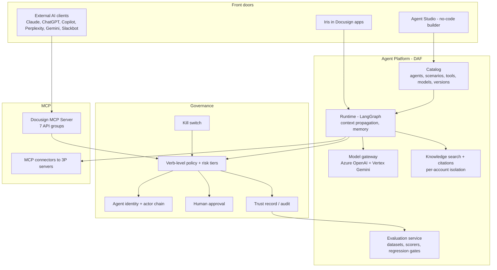
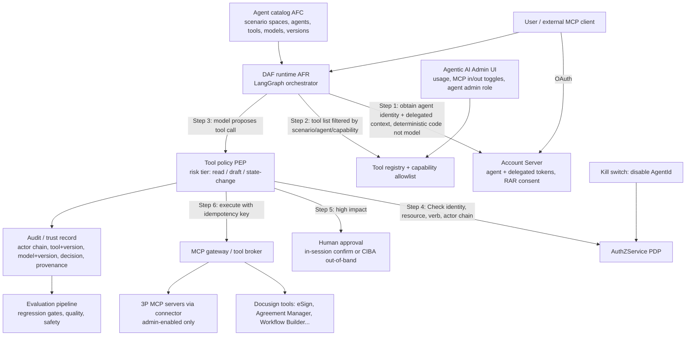
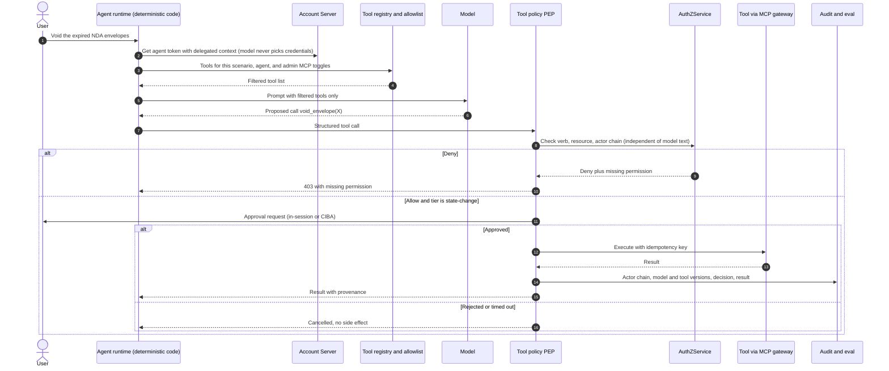
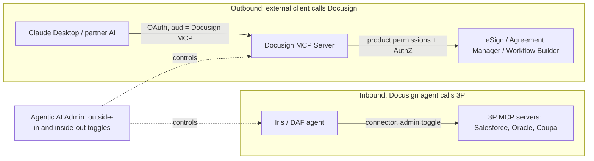
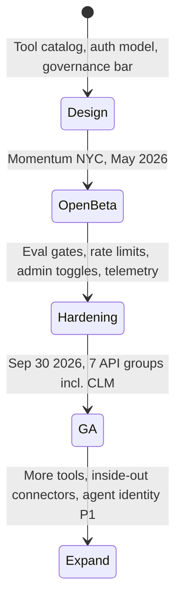

# 08 — Agent Platform and MCP Governance

> **Thesis (30 s):** I led Docusign's move from "AI that answers" to **agents that act on agreements, safely, from any AI front door**.
>
> - **Agent Platform:** a shared platform (catalog, runtime, model gateway, evaluation) that product teams build agents on.
> - **Docusign MCP Server:** taken from **Open Beta at Momentum (May 2026) to GA on Sep 30 2026**, across **7 API groups**, reachable from **Claude, ChatGPT, Microsoft Copilot, Perplexity, Gemini Enterprise and Slackbot**.
> - **Governance layer:** agent identity, verb-level permissions, pre-prompt tool filtering, human approval for consequential actions, idempotency, an audit trust record, evaluation gates, and a kill switch.
>
> Teams ship agents in weeks instead of building their own stacks, and every agent action is attributable and revocable.

---

## 1. Context and problem

- **Market shift.** Customers expected to work with their agreements from wherever they already were (Claude, ChatGPT, Copilot, Slack), not only inside Docusign. Competitors were moving fast.
- **Agent sprawl risk.** Several product teams (Agreement Desk, Agent Studio, IAM, Platform) wanted agents. Each was about to build its own runtime, model integration, tool wiring, evaluation, and permission model.
- **Assets at stake:**
  - **300M+** agreements in Agreement Manager ✅.
  - **40K** IAM customers and **$350M+** IAM ARR ✅.
  - **1.1B+** signatures in FY26 ✅.
- **Governance gaps:**
  - Prompt injection could expand what an agent did.
  - Agents were flattened into users, which lost attribution.
  - Per-tool allow-lists diverged across agent tools, REST, and MCP.
  - Admins had no visibility or control.
  - Retries could duplicate state changes.
  - There was no way to stop one misbehaving agent.
  - The early AI frontend was protected only by a client allowlist ([ClientIdAllowListAuthorizationModule.cs](C:/docusign_source/Core/VNext/API.AIFrontend/src/API.AIFrontend.Web/Authorization/ClientIdAllowListAuthorizationModule.cs)).

## 2. What I owned (program scope)
1. **Platform direction for Docusign Agent Fabric (DAF):**
   - catalog (agents, scenarios, tools, models, versions);
   - runtime;
   - model gateway (Azure OpenAI and Vertex/Gemini behind one interface);
   - standardizing new agents on **LangGraph**;
   - automatic context propagation;
   - per-account knowledge search with a **citation engine**;
   - Agent Studio for no-code building.
2. **The MCP program, both directions:**
   - the outbound **Docusign MCP Server** (beta → GA);
   - inbound **MCP connectors**, so Iris and our agents can call third-party MCP servers such as Salesforce, Oracle and Coupa.
3. **Governance and trust:**
   - identity and actor chain;
   - one verb-level permission model across agent tools, REST and MCP;
   - risk-tiered tool policy;
   - human-in-the-loop (HITL) approval;
   - idempotency;
   - an audit trust record;
   - kill switch;
   - the **production-readiness checklist** every agent ships against.
4. **Quality and operations:**
   - evaluation (golden datasets, single- and multi-turn scorers, regression gates);
   - latency and SLA tracking;
   - runbooks.
5. **Admin controls:** usage dashboard, global MCP **outside-in** and **inside-out** toggles, and an agent-admin role.

Partners: Agreement Desk, Agent Studio, IAM product, Identity/AuthZ, Developer Platform, Security, and Product.

---

## 3. Architecture

### Platform layers

### Governed execution path

### Tool risk tiers

| Tier | Examples | Controls |
|---|---|---|
| **Read** | get agreement, search, list envelopes | AuthZ check. Bounded degradation allowed. |
| **Draft** | prepare an envelope draft, draft a clause | AuthZ check. Output is reviewable and not externally visible. |
| **State-change** | send or void an envelope, start a workflow, share | AuthZ check, **human approval**, **idempotency key**, **fail closed**, narrow RAR scope |

### Key flows

**A. Governed tool call with human approval for a state change**

**B. Two MCP directions (always clarify which one before discussing security)**

**C. MCP Server program timeline**

---

## 4. Key decisions and trade-offs

| # | Decision | Alternatives | Choice and rationale |
|---|---|---|---|
| D1 | **One shared agent platform** | Each team builds its own stack | Shared catalog, runtime, gateway, eval and governance. Teams own agents, the platform owns safety and operations. |
| D2 | **Runtime: standardize on LangGraph** | Stay on Microsoft Agent Framework | MAF had become a ceiling on agent patterns and velocity. LangGraph is open, has a larger ecosystem, and avoids lock-in to a single vendor's roadmap. Migrated existing agents and made LangGraph the default for new ones. |
| D3 | **Multi-model via a gateway** | One provider | Azure OpenAI + Vertex (Gemini) behind one interface: resilience to provider outages, per-task cost and quality routing. |
| D4 | **MCP is the integration layer, not the authorization model** | Treat tool exposure as permission | Product permissions plus AuthZService decide. MCP only makes the capability reachable. |
| D5 | **Allow-list verbs, not tools** | Per-tool allow-lists | One canonical permission governs agent tools, REST and MCP. New tools inherit governance automatically. |
| D6 | **Filter tools before the model sees them** | Let the model discover everything | Shrinks the prompt-injection blast radius. |
| D7 | **The model only proposes; deterministic code authorizes** | Model chooses credentials or mode | Prevents privilege escalation through model text. |
| D8 | **Risk-tiered HITL** | Approve everything / nothing | Reads flow freely. Drafts are reviewable. State changes need approval plus idempotency and fail closed. |
| D9 | **Ship the MCP Server as Open Beta first** | Wait for full GA scope | Beta at Momentum (May) to learn from real clients, then harden. **GA in ~4.5 months** with 7 API groups. |
| D10 | **Citations on every grounded answer** | Plain answers | Legal content needs verifiability. It reduces hallucination risk and creates an audit trail. |
| D11 | **Evaluation as a release gate** | Dashboards only | Datasets, scorers and regression gates per agent version. Proposed bar: **95%+ task success vs. an 80% baseline**. |
| D12 | **Central trust record + product history** | Only product-owned logs | One place for actor chain, decisions and versions across all agents. |

### Failure modes

| Failure | Behavior | Design reason |
|---|---|---|
| PDP unavailable | Fail closed for state-change tools; bounded degradation for reads | Consequential actions never run unauthorized |
| Approval not answered | Times out to cancel, no side effect | Silence is not consent |
| Tool times out after a side effect | Retry with the same idempotency key, deduped | At-most-once state changes |
| Prompt injection inside a document | Can't add tools (pre-filtered) or change credentials; PDP decides on verified facts | The model never authorizes |
| Compromised agent | Kill switch on AgentId + token revocation | Stop one agent, not the account |
| Third-party MCP server misbehaves | Admin inside-out toggle off | Customer control over outbound reach |
| Model provider outage | Route through the gateway to an alternate model, or degrade to read-only | Multi-model by design |
| Eval regression on a new version | Promotion blocked | Quality is a release gate |
| Latency spike | Alert when average chat response is **> 60 s**; runbook | Customer-impact guardrail |

## 5. Production-readiness checklist (I authored and enforce this bar)
- [ ] Stable **agent identity** (AgentId) and a named owner/DRI
- [ ] **Audience-bound** tokens; proof-of-possession for sensitive tiers
- [ ] **Capability and tool allow-lists** per scenario; admin MCP toggles honored
- [ ] **Tenant isolation tests** (per-account knowledge index, cross-account negative tests)
- [ ] **Human approval** for state-change tools
- [ ] **Structured audit** with full actor chain and model/tool versions
- [ ] Prompt and tool **input validation**; output schemas
- [ ] **Idempotent** state-changing tools
- [ ] **Kill switch** and per-agent revocation tested
- [ ] **Evaluation set + regression gates** (task success ≥ 95% target)
- [ ] **SLOs** (time to first token, end-to-end success, cost per run)
- [ ] Denial contract (403 + missing permission) for self-recovery

---

## 6. Results and impact

> ✅ = actual (sourced) · 📈 = projected or target (basis given). Say projections out loud as "projected" or "on track to"; bar raisers accept projections, not invented actuals.

| Metric | Value | Type |
|---|---|---|
| Docusign MCP Server | **Open Beta May 2026 → GA Sep 30 2026 (~4.5 months)** | ✅ GA announcement |
| MCP surface | **7 API groups** (eSignature, Agreement Manager, Workflow Builder, Connected Fields, Data Verification, Authentication, CLM) | ✅ developer docs |
| AI front doors supported | **6 named** (Claude, ChatGPT, Microsoft Copilot, Perplexity, Gemini Enterprise, Slackbot) + any MCP client | ✅ GA announcement |
| Agents shipped on the shared platform | **5+ production agents** (Agreement Desk, AIAR, IRIS Supervisor, Analysis, NLP) + **3 Agreement Desk intake agents** across **4 teams** | ✅ DAF newsletter / FAQ |
| User productivity | Complex MNDA summarization **50% faster** with Iris | ✅ EAP research study (Aug 2026) |
| Runtime | Existing agents migrated **MAF → LangGraph**; LangGraph is the default for new agents | ✅ |
| Addressable data | **300M+** agreements; **40K** IAM customers; **$350M+** IAM ARR | ✅ company data |
| Permission models across agent tools / REST / MCP | **3 → 1** (verbs, not tools) | ✅ design |
| Tool calls authorized from model text | **0** | ✅ by construction |
| State-changing tools behind approval + idempotency | **100%** | 📈 checklist gate |
| Agent task success | **95%+ vs. 80% baseline** release bar | 📈 proposed eval gate |
| Time for a new team to ship an agent | Build-your-own (quarter) → **weeks** on the platform + Agent Studio | 📈 |
| Latency guardrails | **2 s** average design target; alert at **> 60 s** | ✅ |

**Scope I led:** platform direction, the MCP program (beta → GA), and governance across Agreement Desk, Agent Studio, IAM, Platform, Identity/AuthZ, Developer Platform, Security and Product.

---

## 7. Amazon Leadership Principles from this program

| LP | Story |
|---|---|
| **Think Big** | Every AI front door reaches Docusign agreements (MCP to 6 clients), and every agent runs on one governed platform. |
| **Customer Obsession** | Customers work where they already are (Claude, ChatGPT, Copilot, Slack). Citations make legal answers verifiable; tasks run 50% faster. |
| **Bias for Action** | Open Beta at Momentum to learn from real usage, GA in ~4.5 months instead of waiting for full scope. |
| **Are Right, A Lot** | MAF → LangGraph; multi-model gateway; MCP is not authorization. |
| **Insist on the Highest Standards** | Readiness checklist + eval gates (95% vs. 80% baseline); no state change without approval and idempotency. |
| **Invent and Simplify** | Verb-level permissions + pre-prompt filtering replaced per-tool allow-lists; Agent Studio for no-code building. |
| **Deliver Results** | MCP GA on Sep 30 with 7 API groups; 5+ agents across 4 teams on the shared platform. |
| **Dive Deep** | Prompt-injection paths: the model proposes, deterministic code decides credentials and tools, the PDP decides on verified facts. |
| **Earn Trust** | Clear outbound vs. inbound MCP terminology for Sales, CS and engineering; honest P1 limits. |
| **Learn and Be Curious** | MCP spec, OAuth step-up for MCP, CIBA, RAR, LangGraph patterns, eval methodology. |
| **Success and Scale Bring Broad Responsibility** | Agents act on legal agreements: HITL, attribution and a kill switch are obligations. |
| **Frugality** | One platform instead of N team stacks; reused AuthZService, Account Server and DUCS; per-task model routing for cost. |

---

## 8. Deep-dive Q&A
1. **Why build a shared platform instead of letting teams use vendor SDKs directly?** Every team would otherwise re-solve identity, permissions, eval, model access and operations. One platform makes safety the default and gives teams speed.
2. **Why LangGraph?** MAF limited agent patterns and velocity. LangGraph is open, widely adopted, and gives us control of our roadmap. We migrated existing agents rather than running two runtimes.
3. **How do you stop prompt injection from expanding permissions?** Pre-prompt tool filtering, deterministic credential and mode selection, and the PDP authorizing only from the structured call plus the verified token.
4. **How do you secure external MCP clients?** OAuth with audience-bound tokens, the same product permissions and AuthZ, admin outside-in toggle, rate limits, and audit.
5. **How do you decide what needs human approval?** State-change verbs (send, void, share, delete, start workflow), anything with legal or financial effect. Configurable per tenant.
6. **How do you evaluate agents?** Golden datasets per scenario, single- and multi-turn scorers, tool-call correctness, citation faithfulness, a red-team safety set, and regression gates per version (95% vs. 80% baseline).
7. **How do you revoke one agent?** Kill-switch fact + token revocation (story 02). Other agents and the user's session keep working.
8. **How do you handle retries and duplicates?** Idempotency keys on state changes, dedupe, compensating actions.
9. **What do you measure?** Task success, approval and escalation rate, denial rate and auto-recovery, time to first token and end-to-end latency, cost per run, eval scores, incidents.
10. **Why open beta first?** Real client behavior (tool selection, payload shapes, auth flows) only shows up in use. Beta at Momentum gave signal; GA followed in about 4.5 months.

## 9. Coinbase angle
Coinbase CX is deploying AI support agents that read and act on customer accounts. This is the same problem:
- one governed agent platform;
- reachable from many front doors;
- least privilege and approval for money-moving actions;
- citations and audit;
- evaluation gates;
- a kill switch.

Values: **Repeated innovation**, **Customer focus**, **Act like an owner**.
