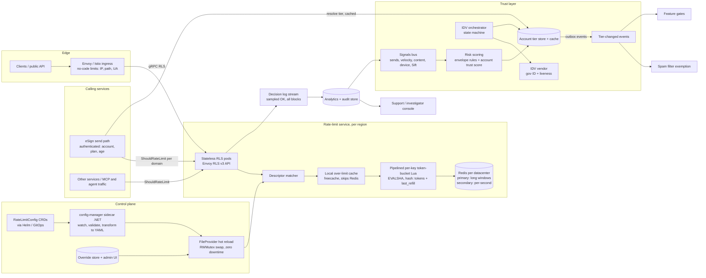
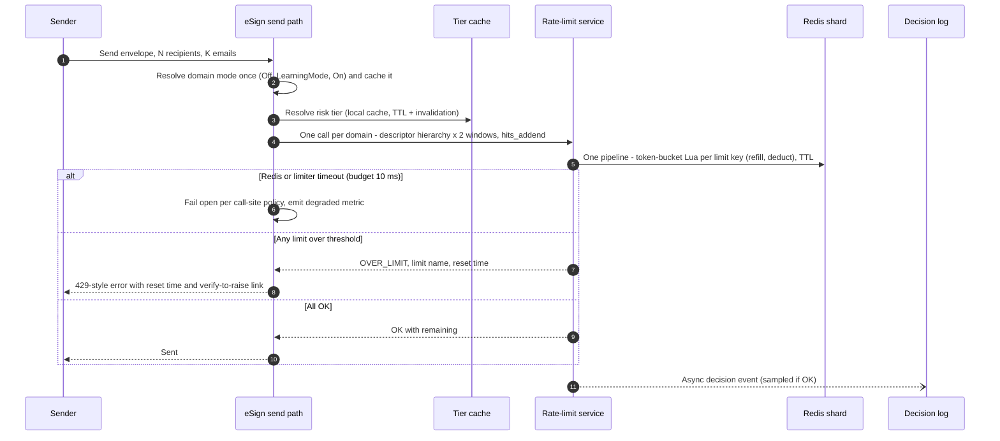
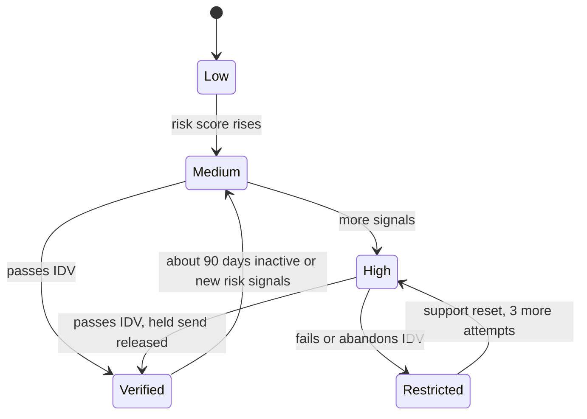
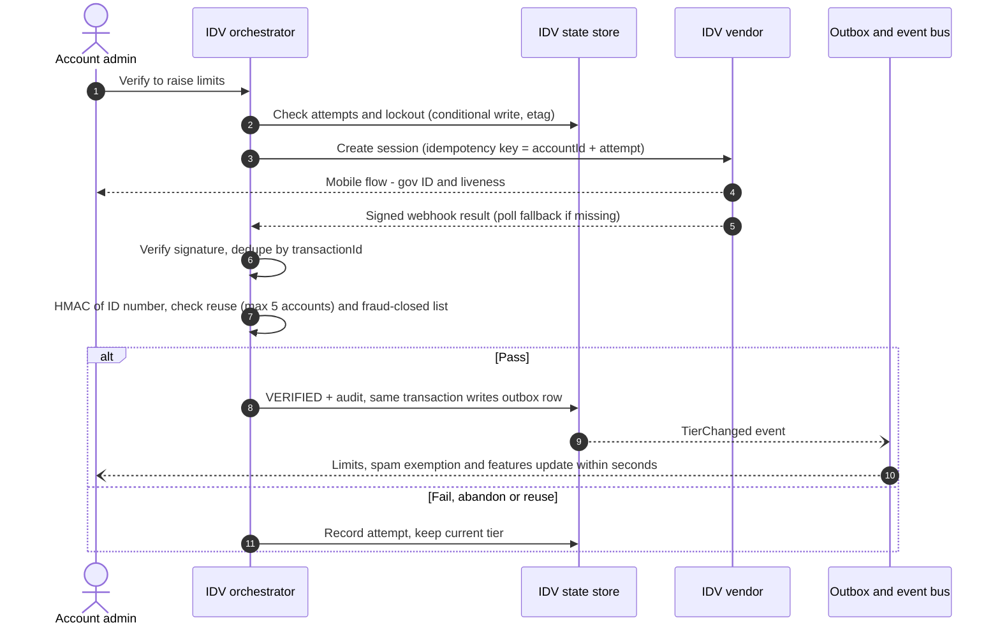
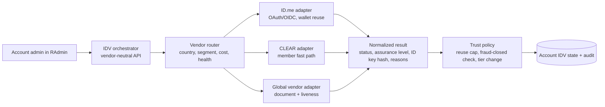
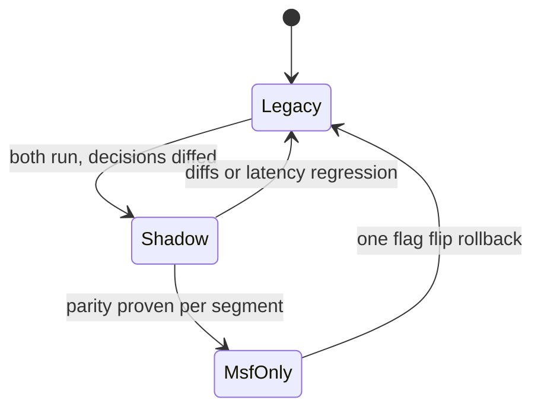

# 14 — Reverse System Design: Adaptive Trust & Protection Platform

✅ = sourced actual · 📈 = projected or design target · 🔭 = holistic extension ("how I'd evolve it"; say it that way)

## 0. Why this system (and not the others)

| Candidate | Distributed-systems depth | Scale numbers | Trade-offs to defend | Failure, migration and lessons | AI angle | Verdict |
|---|---|---|---|---|---|---|
| **P7 Rate Limit + Risk + IDV** | ⭐⭐⭐ hot path, Redis, multi-region, consistency | ✅ 4,000 TPS, 1–10 ms, 48M evals/week | ⭐⭐⭐ 12+ decisions | ⭐⭐⭐ live migration, ramp incident | ⭐⭐ (design process + 🔭 copilot and agent quotas) | **Primary** |
| P8 Agent Platform + MCP | ⭐⭐ | ✅ GA, 6 clients | ⭐⭐⭐ | ⭐⭐ | ⭐⭐⭐ | **Backup** if they say "AI system" |
| P6 Global Directory | ⭐⭐⭐ | ⭐ | ⭐⭐ | ⭐⭐ | ⭐ | Use for a consistency deep dive only |
| P4 Sharing migration | ⭐⭐ | ✅ 40.5M configs | ⭐⭐ | ⭐⭐⭐ | ⭐ | A migration story, not a system design |

**Why it fits a reverse system design round:**
- It covers every classic axis: hot-path latency, distributed counting, consistency vs. availability, multi-tenancy, config safety, an event-driven pipeline, a third-party vendor integration, a state machine, PII and data governance, observability, a live migration, and abuse and security.
- **Coinbase bonus:** rate and withdrawal limits by risk tier, KYC step-up, and fraud vs. customer friction are Coinbase's daily life.

---

## 1. 60-second pitch (say this first)

> "I designed Docusign's **Adaptive Trust & Protection platform**. At its core is a **multi-tenant global rate-limit service**: Envoy-RLS-compatible, Redis-backed, in **~15 production regional clusters**, about **4,000 TPS** at **1–10 ms per check**, used by **27 repos across three orgs**. It handles both infrastructure throttling and business fraud quotas.
>
> On top of it, I built **risk-tiered limits** and a **self-serve identity-verification step-up**. Instead of blunt limits that blocked paying customers, friction is proportional to risk: verified accounts get **100× limits**, and fraudsters hit a wall they can't pass at scale.
>
> Results: the fraud-recipient rate went from **~0.5% to 0.15% (−70%)**, **758 verifications at a 97.3% success rate**, and **~48M trusted-path evaluations a week**. I migrated eSign's legacy on-prem limits engine onto it with shadow mode and zero-drift parity.
>
> I'll walk through requirements, architecture, the hot path, the trust layer, then trade-offs and what I'd change."

---

## 1b. Staff-level signals: make sure each one comes up

| Signal | Where it shows in this design | Line to say |
|---|---|---|
| **Org-wide scope** | One platform for **every MSF service** (infrastructure plus business quotas), not an eSign feature: **27 repos** across MSF, CLM and Core, **~15 production clusters** ✅ | "I built the substrate, then moved the hardest consumer onto it." |
| **Build vs. buy judgment** | Forked Envoy ratelimit and extended it (token-bucket Lua, no-refill, overflow, CRD config) | "Adopt the proven core; spend engineering only where we're different." |
| **Abstractions others build on** | Descriptor hierarchy + config-only limits; `IDV_STATE` as a trust signal reused by limits, the spam filter and feature gates | "New plan, age or channel limits ship as config. No code, no redeploy." |
| **Cross-team alignment** | The 7-gap parity analysis aligned eSign Core, the platform team, Anti-Fraud, Support/TSOps and the IDV team on what had to be true before cutover | "The hardest consumer's requirements became the platform roadmap." |
| **Safe change at scale** | Off → LearningMode → On per domain; shadow by default; segment ramps; dual-write Redis migration; config rollback < 30 s | "Every risky change has a shadow phase and a one-flag rollback." |
| **Business outcomes** | Fraud recipients −70% ✅, 97.3% IDV success ✅, 100× trusted limits ✅, support tickets ≥ −50% 📈 | "Friction proportional to risk protected both trust and revenue." |
| **Explicit trade-offs** | Per-region counters, fail open, per-key atomicity, token-bucket burst-after-dormancy capped by multi-limit | "Here's what I gave up, the bound on it, and when I'd change my mind." |
| **Owning failure** | Ramp hit a direct enterprise customer → same-day fix → segment exclusion standard | "I fixed the class of problem, not the instance." |
| **Cost awareness** | Decision-log sampling (~100 → ~5 GB/day 📈); local over-limit cache cuts Redis load; 2.5–12× headroom before scaling Redis ✅ | "I sized it before I scaled it." |
| **Multiplying others** | Self-serve onboarding via CRDs, dashboards as code, a ramp checklist, a `CLAUDE.md` so agents and new engineers follow the repo's rules | "Other teams onboard without me." |

---

## 2. Requirements (draw as two columns)

**Functional**
1. Count and limit by arbitrary descriptors: IP, path, client, account, `plan_id`, `plan_type`, `age_bucket`, `distributor_code`, `sec_ops_status`.
2. **Multiple limits per request, with different weights.** A send with N recipients is envelope +1, recipients +N, emails +K.
3. Multiple windows per limit: 30-day + 3-day + daily.
4. Per-account and per-plan **overrides**; thousands of them.
5. **Shadow mode:** count and report without enforcing.
6. Read without incrementing (support and dashboards), plus an admin decrement (support reset).
7. **Risk tiers** (Low / Medium / High / Verified) select thresholds and friction.
8. **Step-up verification:** government ID + liveness via a vendor, self-serve, with abuse controls.
9. Every decision is **explainable**: which limit, count, threshold, time to reset.

**Non-functional**

| | Target |
|---|---|
| Latency | **p99 single-digit ms** per check ✅ (1–10 ms). Negligible next to a 100–500 ms send. |
| Throughput | **~4,000 TPS average** ✅. Design for **3× peak, ~12K TPS** 📈 plus **10× headroom** for growth. |
| Availability | 99.99% 📈. **A limiter outage must not stop sends** (fail open, by policy). |
| Config safety | New limits ship in shadow. Deploy without redeploying callers. **A typo is never an outage.** Reload < 30 s ✅. |
| Multi-tenancy | Any service onboards self-serve, isolated by domain. No noisy-neighbor collisions. |
| Security and compliance | Callers can't spoof identity descriptors. No raw government-ID data stored. Full audit of tier changes. |
| Fraud fit | Dormant accounts can't bank burst credit. Counters survive changes to the attribute that drives the threshold (account age). |

**Questions to ask the interviewer up front:** "Should I focus on the limiter's internals or on the trust and risk layer?" Let them choose. Both are prepared.

---

## 3. Back-of-envelope (do this on the board)

| Quantity | Math | Result |
|---|---|---|
| Limiter calls | 4,000 TPS avg ✅ × 3 peak | **~12K TPS peak** 📈 |
| Limits evaluated per domain check | up to 5 descriptors (plan → plan type + age → plan type → age → account) × 2 windows | **~10 limits in one gRPC call**, one pipelined Redis round trip |
| Redis ops at peak | 12K calls × ~8 configured matches (of ~10 descriptors) | **~100K ops/s** 📈, before the local over-limit cache removes repeat blocked keys. Today that's spread across **one Redis per datacenter** (~15 production DCs, ~4K TPS total), each a Premium instance with **2.5–12× headroom** ✅. If one DC outgrows a single primary, the next step is clustered Redis (Azure Managed Redis), and per-key scripts are already cluster-ready. |
| Counter memory | ~1M active accounts × ~8 counters (4 domains × 2 windows) × ~100 B | **~0.8 GB per region** 📈. Fits easily; TTL = window, so the data cleans itself up. |
| Decision logs | 4,000 TPS × 86,400 × ~300 B | **~100 GB/day** 📈. **Sample OK decisions (1%)** and keep 100% of OVER_LIMIT and shadow-would-block decisions, which cuts it to ~5 GB/day. |
| Trusted-path evaluations | ✅ measured | **~48M/week ≈ 6.9M/day ≈ 80 TPS avg** |
| Overhead on a send | 1–10 ms / 100–500 ms | **< 2–5%** |

---

## 4. High-level architecture



**Whiteboard-only version (if the drawing tool is slow), drawn as 4 boxes:**
`Edge/Callers → Rate-Limit Service (stateless + Redis) ← Control plane (Git/overrides)`, plus `Trust layer (Risk + IDV → Tier store) → feeds thresholds`, plus `Decision log → Analytics → Support + Risk signals`.

---

## 5. Deep dive A: the limiter hot path

### API (Envoy RLS v3-compatible)
- `ShouldRateLimit(domain, descriptors[], hits_addend)` → `overallCode` + per-limit `statuses[]` (limit name, remaining, `durationUntilReset`).
- Extensions I added: **multi-limit statuses**, `GetCount` (no increment), `Decrement` (admin).

### Separating reads from writes (verified in the proto and in Core) ✅
| RPC | Semantics | Who calls it |
|---|---|---|
| `ShouldRateLimit` | **Atomic check-and-consume.** The Lua script deducts only if allowed, so it's a *conditional write* in one call. **No read-then-write from the client**, which means no race between check and increment. | Core send paths, gateways |
| `GetCount` / `BulkGetCount` | **Pure read**: current tokens or count, nothing consumed | Dashboards, support tools, "how close am I" UX |
| `Decrement` | **Compensating write**: returns tokens (capped at capacity) | Refund when a send fails after consuming; support resets |
| `BulkShouldRateLimit` | Many entries in **one call** | Available. Core still makes one call per domain today. **Next step: move Core to Bulk, so a send is 1 round trip instead of one per domain** 🔭 |

- **Least privilege by OAuth scope** ✅: separate **`rate_limit_read` (457)** and **`rate_limit_write` (458)** scopes. Core calls `ShouldRateLimit` with a **service token holding only `rate_limit_read`**. The write scope is reserved for mutating admin operations (refunds and resets), enforced by the service's AuthZ policy (`ratelimit-authz`).
- **Why consumption uses the read scope:** consuming your own quota is the normal caller path. What's dangerous is *giving tokens back* or resetting someone's counter, so that's what the write scope gates. A compromised caller can at worst spend quota, never restore it.
- **The Core client in practice** ✅:
  - service token plus correlation ID on every call;
  - a per-call deadline from a dynamic setting;
  - runs on a dedicated thread pool (sync-over-async in the .NET monolith without starving request threads);
  - errors propagate to the throttler, which **fails open** and emits a decision metric (`Allowed`, `Blocked`, `LearningMode_WouldBlock`, `SkippedTrusted`).

### The descriptor hierarchy: one call per domain, the most specific limit wins ✅
- Each business domain (**envelope sends, recipient sends, cumulative recipients, email sends**, plus signing sessions) is checked where it happens, with its own weight (`hits_addend`: +1 envelope, +N recipients).
- **One gRPC call per domain** carries a **priority-ordered descriptor hierarchy**, e.g., for recipient sends:
  1. `[account, plan_id]` (exact plan)
  2. `[account, plan_type, age_bucket]` (new free or paid accounts)
  3. `[account, plan_type]`
  4. `[account, age_bucket]`
  5. `[account]` (catch-all)
- The hierarchy is **mirrored into a long and a short window** (e.g., 30-day + 3-day), so **~10 limits are checked in one round trip**. That matches the legacy engine's "10+ protectors in 1 round trip".
- The client takes the **first configured match per window group**. Product can add a limit at any level (a new plan, an age band, a distributor channel) with **config only**: no code, no redeploy. The most specific limit wins.
- **Trusted accounts** get a `sec_ops_status = trusted` descriptor placed first, so the trusted tier (100×) is just another configured limit. A flag can skip the call entirely for trusted accounts.
- **Different orderings per domain on purpose:** recipients prioritize the exact plan (limits vary most by plan), and envelopes prioritize account age. This is a business choice expressed as data.
- **Domain = `{namespace}-{release}`**: tenant isolation and clear ownership.

### Descriptor-based config: how to explain it simply
**20-second version:**
> "Callers don't ask 'am I over limit X?'. They describe the request as key-value descriptors (account, plan, age, channel), and the service finds the most specific configured limit that matches. Limits are data, not code: a new plan or age-band limit is a reviewed config change, live in under 30 seconds, shadow first."

**Config sketch (draw this):**
```yaml
domain: esign-recipient-sends
descriptors:
  - key: account_id                 # empty value = a separate counter per account
    descriptors:
      - key: plan_type
        value: free
        descriptors:
          - key: age_bucket
            value: new_0
            rate_limit: { unit: day, requests_per_unit: 25 }       # new free accounts
      - key: plan_id
        value: BIZPRO
        rate_limit: { unit: month, requests_per_unit: 1000 }
      - key: sec_ops_status
        value: trusted
        rate_limit: { unit: month, requests_per_unit: 100000 }     # 100x trusted tier
```
- A **tree of keys**. A limit applies only on a **full match** down the tree.
- **Empty value** = a separate counter per unique value. **Specific value** = one rule for that value.
- A request that matches nothing returns **OK**, plus a zero-match alert.

**How it's managed:**
1. **Owned per domain** (`{namespace}-{release}`): teams can't collide.
2. Declared as a **`RateLimitConfig` Kubernetes custom resource** in the service's Helm chart, and **reviewed in a PR** like code.
3. The **config-manager sidecar validates** it, then transforms it to YAML.
4. The Go service **swaps the config atomically** with zero downtime; it's **live in under 30 s**, and the last good config is kept if a new one fails.
5. **Shadow by default**: tune the threshold, then enforce.
6. **Overrides:** a more specific `account_id=X` descriptor wins. At scale, an override store with an admin UI.
7. **Several windows per descriptor** (30-day + daily) cap a burst from an idle account.

**Why it's a Staff choice:**
- It **separates mechanism from policy**: engineers own the limiter, product and fraud teams own the numbers.
- Changes are **safe by construction**: reviewed, validated, shadow first, atomic swap, quick rollback.
- **The order of descriptors expresses business intent.**
- **One engine** handles both infrastructure throttling (gateway, per second) and business quotas (account, plan, age over 30 days).

**Closer:** "Descriptors turn rate limits from code into reviewed, versioned data. That's what let us ship new fraud limits in seconds without touching the send path."

### Send decision sequence


### Counting and algorithms
- **Built on open-source Envoy ratelimit (Go), extended for our needs.** Upstream gives a fixed-window counter. **Production runs our token-bucket mode** (`USE_SLIDING_WINDOW=true`), plus multi-limit and `allow_overflow` ✅ (prod config).
- **Production algorithm: a continuous-refill token bucket in Lua** ✅ (verified in `lua/processLimitScript.lua` and `sliding_cache_impl.go`)
  - State is a **Redis hash per key**: `tokens`, `last_refill` (ms).
  - **Go computes the arguments:** `capacity = RequestsPerUnit`, `refill_rate = capacity ÷ window seconds`, `requested = hits_addend`, plus a TTL with **expiry jitter** so many keys don't expire at the same instant. `INFINITE`-unit limits route to the no-refill script.
  - **The script:**
    1. Takes `now` from **`redis.call("TIME")`**: Redis's own clock, so **no clock skew between pods**.
    2. `HMGET tokens, last_refill`. A new key starts as a **full bucket**, and values are clamped to `[0, capacity]`.
    3. `new = min(capacity, tokens + elapsed_s × refill_rate)`; a negative elapsed time (clock anomaly) is treated as 0.
    4. If `new ≥ requested`: `HSET tokens = new − requested, last_refill = now` + `EXPIRE` → return `{1, remaining}`.
    5. Otherwise **deny without deducting or touching `last_refill`** (refill keeps accruing) + `EXPIRE` → return `{0, tokens}`.
  - Example: 1,000 per 30 days refills about 33 a day.
  - TTL = window, so idle keys expire by themselves and **there are no cleanup jobs**.
  - **Why this over fixed windows:** there's **no 2× burst at a window boundary**, quotas recover smoothly instead of resetting at midnight or month-end, and the state is O(1) per key. A sliding-window log would be O(requests).
- **The token-bucket catch, and why multi-limit was a P0 parity gap:**
  - A dormant account comes back to a **full bucket**, so it could spend 1,000 sends in a minute.
  - **Multi-limit mode** puts a long bucket and a short bucket on the same descriptor (e.g., **1,000 per 30 days + 50 per day** for the first 3 days ✅). Each has its own key, suffixed with the window length in seconds, and is returned as `AdditionalStatuses`. The short bucket caps the burst while the long bucket caps the volume.
- **Special buckets:**
  - **No-refill bucket** for one-time quotas (`INFINITE` unit): it only ever counts down, has no TTL, and is never refilled.
  - **`allow_overflow`**: a bucket may go into **bounded debt** (floored at −capacity) instead of hard-blocking, and must earn back above 0 before the next request. Good for "don't fail a send mid-batch, pay it back later." It ships as a **second script set behind a flag**, so enabling or rolling back is config, not a deploy ✅.
  - **`Decrement`** returns tokens (support reset, refunds), capped at capacity.
- **Script handling:** scripts are preloaded and called by SHA (`EVALSHA`), with a retry if Redis no longer has the script (`NOSCRIPT`). Script handles live per cache instance, so a shadow-cache failure can't corrupt the primary.
- **Upstream fixed window** still exists as a fallback mode: key = `prefix:domain:descriptor:<rounded timestamp>`, pipelined `INCRBY` + TTL.

### "Why a token bucket?" (say it like this, ~45 s)
> "We run a continuous-refill token bucket in Redis Lua for every limit. Four reasons:
> 1. **No boundary burst.** With fixed windows, someone can spend the full quota at 11:59 and again at 12:00, which is 2× the limit. For a fraud quota, that's exactly what a phisher exploits. A bucket refills at a steady rate, so there's no edge to game.
> 2. **Smooth recovery instead of a cliff.** A legitimate customer who hits the limit gets capacity back gradually (1,000 per 30 days is about 33 a day) instead of waiting for a monthly reset. Fewer support tickets.
> 3. **O(1) state.** Two hash fields per key, `tokens` and `last_refill`, versus a sliding-window log that stores every request. At ~4K TPS that matters.
> 4. **Weighted requests fit naturally.** A send with 25 recipients deducts 25 tokens in one atomic script call.
>
> **The trade-off:** a dormant account comes back to a full bucket and could burst it all at once. That's why **multi-limit** was a P0 parity gap. We put a short-window bucket (e.g., 50 a day for new accounts) next to the 30-day one, so the burst is capped without changing total volume. For one-time quotas we use a no-refill bucket, and `allow_overflow` lets a bucket go into bounded debt instead of failing mid-batch."

**If they push: "Why not GCRA or a sliding-window counter?"**
- GCRA is mathematically a token bucket stored as one timestamp; we preferred explicit `tokens` for readability, `GetCount` and support resets.
- A sliding-window counter (a weighted average of two fixed windows) is approximate and still assumes calendar windows.
- The token bucket plus a short-window bucket gave us burst control and volume control with the simplest state.
- **Atomicity is per key, by design.** Each limit's script touches **one key**, and all of them go in a single pipeline. That keeps it **cluster-ready**: moving to clustered Redis needs no script changes (no cross-slot errors, no hash tags forcing one mega-sender's keys onto one hot shard).
  - **Trade-off:** it isn't all-or-nothing across limits. If one limit rejects, the others may still have counted. That's bounded and acceptable for quotas, and the `Decrement` script can refund when needed.
- **Hot keys:** an optional in-process **local cache (freecache)** remembers descriptors already over the limit and **short-circuits Redis** for them. Heavily limited senders then cost almost no Redis load.
- **Legacy parity semantics:** pre-check, then post-track after a successful send, so failed sends aren't counted. Under concurrency this allows a **bounded overshoot** (≤ concurrent in-flight sends per account), which I accepted and documented.

### Consistency decision: per-region counters ✅
- **No cross-region replication on the hot path.** No quorum, no cross-region latency.
- Accounts are **region-homed**, so skew is tiny. Worst-case global overshoot ≤ limit × number of regions, and only for multi-region senders.
- For truly global limits, **route the counted operation to the account's home region**. Don't replicate counters.

### Config plane
- Limits are declared as **`RateLimitConfig` Kubernetes CRDs** (`ratelimit.docusign.net/v1`), delivered through Helm/GitOps.
- A **.NET config-manager sidecar** watches the CRDs, **validates** them (schema and limit rules), transforms them to YAML and writes them to a shared volume.
- The Go service's **FileProvider** sees the change and swaps config under a **RWMutex**: zero downtime, hot reload in **< 30 s** ✅.
- New limits default to **`shadowMode: true`**. A bad CRD is rejected at validation and never reaches the hot path.
- **Unmatched descriptor → OK.** A typo can't become an outage. A "zero matches" alert on new limits catches silent misses.
- **Overrides:** an override store plus admin UI for thousands of per-account exceptions. `replaces:` cancels the plan-level limit for that account.

### Multi-tenancy and isolation
- Domain-prefixed keys. **Istio AuthorizationPolicy** decides which service may call which domain. mTLS everywhere.
- **Two integration modes:**
  - Ingress: request metadata only, no code.
  - Direct gRPC: identity-aware, **after** the caller authenticates. **The gateway never trusts unverified identity claims.**
- Noisy neighbor: per-domain QPS caps on the limiter itself. Critical domains (eSign send) can get a dedicated Redis cluster 🔭.

---

### Scalability: how it actually scales ✅ (verified in prod config and infra)
- **Stateless service tier:**
  - Kubernetes autoscaling with **min 3 to max 40 pods**, scaling at **50% CPU**; each pod requests **250–500m CPU and 1 GiB**.
  - Istio routes to the **local datacenter subset**, with a **canary subset** (weight 0 → ramp) for safe rollouts.
- **Partitioning by geography and datacenter, not by key:**
  - Each of the ~15 production regional clusters has **its own Redis** (`locality = datacenter`), and the infrastructure is laid out in geographic shards (e.g., CA shard 1, EU shards 1–2).
  - Counters never cross regions, so throughput scales by **adding datacenters**, not by growing one global store. That's the per-region counter decision paying off.
- **Splitting by kind of limit within a datacenter** (`REDIS_PERSECOND=true`):
  - **redis-primary** holds long-window business counters.
  - **redis-secondary** holds high-churn **per-second** limits (gateway and infrastructure protection).
  - The two workloads can't starve each other.
- **Redis today:** Azure Cache for Redis **Premium v6**, TLS, **Entra ID / managed-identity auth** (no keys). It's **not clustered**: scale-up plus partitioning per datacenter has been enough at ~4K TPS with 2.5–12× headroom.
- **Load shedding before Redis:**
  - A local over-limit cache skips Redis for keys already blocked.
  - Expiry jitter stops many keys from expiring at once.
  - One pipelined round trip per call.
- **Scale-out path:** migrating to **Azure Managed Redis** via the dual-write cache (old Redis stays authoritative, new one written in the background). It's not available in some CA and EU shards because of Azure capacity, so those stay on the current Redis and **dual-write is enabled per region**. Because every Lua script is **single-key**, moving to clustered Redis needs **no script changes**. That's why I rejected the multi-key all-or-nothing design.

**Line to say:** "We scale the service horizontally and the state by datacenter. Each DC owns its counters in its own Redis, split into a per-second instance and a long-window instance. We haven't needed key-sharding yet, but single-key scripts keep us cluster-ready, and the dual-write path is how we move to clustered managed Redis without downtime."

## 6. Deep dive B: the trust layer (risk tiers + IDV step-up)

### Core idea
- **Friction proportional to risk, not binary blocks.**
- Fraudsters can't produce a valid government ID plus liveness at scale. Legitimate customers can, in minutes.
- `IDV_STATE = VERIFIED` becomes a **reusable account-level trust signal** for every service.

### Risk ladder


| Tier | Treatment |
|---|---|
| Low | Allow |
| Medium | Modify and warn (strip formatting, banner); IDV restores normal |
| High | Suppress and hold; **prompt IDV**; on pass, release the held send |
| Verified | **Elevated limits (100× trusted tier ✅)**, spam-filter exemption, gated features. Billing allowances still apply. |

### Risk scoring: how risk is decided and how we improved it

**Two layers** ✅
| Layer | What it scores | How | Action |
|---|---|---|---|
| **Envelope risk score** (live, digital plans) | Each envelope at send time | Rule engine over sender/account and content heuristics → compared with configured thresholds → **Low / Medium / High** | Low: normal notification · Medium: **modified email** giving recipients sender context · High: **notification suppressed** and flagged |
| **Account trust score** (in development) | The sending account over time | Heuristics + ML + vendor signals (Sift) with **configurable trust thresholds** and a persisted trust status | Drives limit tier, feature eligibility, IDV prompts |

**Signals** ✅
- Account age, sending history, email-domain reputation, payment-method validity, device fingerprint, geolocation, send volume, product usage, and recipient behavior (opens, declines, completions).
- The daily risk report uses **60+ heuristic features**.
- **What separated fraud from good accounts in our analysis** ✅:
  - API requests per 15-minute window: **60 vs. 175**;
  - documents per recipient: **0.21 vs. 1.02**;
  - credit-card usage: **0.17% vs. 6.12%**.
  
  Fraudsters send thin envelopes fast and rarely pay. That's why velocity limits plus thin-content signals work.

**Feedback loops (how the score gets better)** ✅
- **Sift label feedback:**
  - closing an account for abuse sends a `looks_suspicious_payment_abuse` decision;
  - reopening it or marking it Trusted sends `looks_ok_payment_abuse`;
  - **only manual-review decisions train the model**, which keeps automated noise out of the labels.
  - Live in Demo and Prod.
- **IDV outcomes as labels:** a passed verification is a strong "good customer" signal. Identity hashes from fraud-closed accounts block reuse (about 2 years).
- **Support and TSOps overrides** (`Backfilled`, `Bypassed`) are audited and reviewable as false-positive evidence.

**IDV changes eligibility, not score arithmetic.** A verified account becomes **exempt from spam-filter scoring** and gets elevated limits and features. It does **not** get the manual SecOps "Trusted" flag, and new risk signals or inactivity (~90 days) can bring friction back.

**Impact**
- Fraud-envelope recipients **~0.5% → 0.15%** ✅.
- The daily risk report drove **> 90% of fraud-account closures**; **70K fraud accounts closed in H1 2024** ✅.
- Problem size before: **21K accounts** whose recipients got a fraud envelope in 180 days, **153K** fraud-envelope notifications, **~$57M MRR** on those accounts ✅. That's why false positives had to be fixed with IDV, not by loosening the rules.
- Sift false-positive rate is roughly **~5%**, varying by plan (internal estimate). IDV is the self-serve escape hatch for that 5%.

**Next improvements** 🔭
1. **AI extraction from PDFs** (URLs, phone numbers, QR codes, email addresses) as content signals. Target: **+30% precision** 📈 (PRD).
2. **Shadow-score before enforcing:** a new model runs as a challenger. Measure precision and recall against manual-review labels and the false-positive rate per plan, then promote it.
3. **Unify the envelope and account scores** into one trust service with an API, so limits, the spam filter and features read one signal.

**Line to say:** "Scoring finds suspects; IDV gives good customers a way out. The 5% false positives become a 5-minute self-serve flow instead of a support ticket, and every override and verification feeds back as a label."

### Risk scoring primer: how a heuristic score is built (be ready for "how does the score work?")

> Framing: "Scoring is a partner team's engine. I designed how its output turns into friction, and I fed labels back to it. Here's how it works and how I'd evolve it."

**1. Two paths, two latency budgets**
| Path | When | Budget | Uses |
|---|---|---|---|
| **Online (per envelope)** | At send time, inline | ~tens of ms | Cheap features: account age, plan, recent send velocity (from the rate-limit counters), recipient count, content flags |
| **Offline (per account, daily)** | Batch over a 60+-feature report ✅ | minutes to hours | Heavy features: device fingerprint, geolocation, domain reputation, payment history, open/decline/complete behavior → **account trust tier** (cached for online use) |

**2. Feature families** (the signals are real ✅; weights are illustrative)
- **Identity and age:** account age, email-domain reputation (free mail vs. corporate, new domain), payment method validity, device fingerprint, geo vs. billing country.
- **Velocity:** sends per hour/day, API calls per 15 min (**fraud ~60 vs. good ~175** ✅), recipients per envelope, new-recipient ratio.
- **Content:** documents per recipient (**fraud 0.21 vs. good 1.02** ✅), URLs, phone numbers or QR codes in the PDF, brand-impersonation keywords, template reuse.
- **Monetization:** credit-card usage (**fraud 0.17% vs. good 6.12%** ✅), plan type.
- **Recipient reaction:** bounces, spam complaints, declines, low completion rate.
- **External:** Sift score and decisions.

**3. How a heuristic score is computed**
- Each rule gives a **weighted contribution**. Illustrative: `new account < 3 days +20`, `free-mail domain +10`, `URL or QR in a thin document +25`, `> 50 new recipients/day +15`, `paid with a valid card −20`, `IDV verified → exempt`.
- **Score = clamp(sum, 0, 100)**, then compare with **configured thresholds** → Low / Medium / High. Thresholds live in config, so they're tunable without a deploy.
- Every fired rule emits a **reason code**, which makes decisions explainable to support (and auditable) without revealing the rules to fraudsters.
- **Cold start:** new accounts have no history, so the score leans on identity, payment and content, and the **short-window limits** (e.g., 25 free / 250 paid recipients in the first 7 days ✅) carry the risk until history builds up.

**4. How thresholds are tuned (the part interviewers like)**
- Label data from **manual-review outcomes** (closed as fraud = 1, reopened or trusted = 0), plus IDV passes as strong negatives.
- Plot **precision vs. recall** for each threshold. The cost of an error sets the cut:
  - A **false negative** sends phishing to real people (trust and brand damage).
  - A **false positive** blocks a paying customer, which costs revenue, but **IDV makes it cheap to recover from**.
  - So the **High** cut can be more aggressive than it could be without IDV. That's how IDV and scoring reinforce each other.
- Track the **false-positive rate per plan** (Sift ~5% overall, varying by plan) and adjust per segment.
- **Shadow first:** a new rule or weight runs in scoring-only mode, and you compare would-flag vs. actual labels before it can change any outcome.

**5. Keeping it fresh (adversaries adapt)**
- Fraudsters probe thresholds, so rules decay. Watch **drift**: the score distribution shifting, precision dropping on new labels.
- Run **champion/challenger**: the current rules vs. a candidate set (or a model) in shadow, and promote on better precision at the same recall.
- **Feedback loops are the fuel:** manual-review decisions to Sift (manual review only, so labels stay clean ✅), IDV outcomes, support overrides.

**6. From heuristics to ML (how I'd evolve it)** 🔭
- Heuristics first: explainable, fast to change, no training data needed. Right for v1.
- Then a **gradient-boosted model** (e.g., XGBoost) on the same features, trained on manual-review labels. Calibrate its output into a 0–100 score so **the same thresholds and reason codes still work**.
- Keep **hard rules as guardrails** around the model (e.g., ID reuse > 5 accounts = block, regardless of score).
- Add **AI content extraction** from PDFs (URLs, phone numbers, QR codes) as features. Target **+30% precision** 📈 (PRD).
- Online/offline consistency: a **feature store** so training and serving compute features the same way.

**Line to say:** "Heuristics gave us explainable v1 scoring with reason codes. Thresholds are set by the cost of errors, and because IDV makes false positives cheap to recover from, we could run High more aggressively. Labels from manual review and IDV feed the next iteration, rules first and then a calibrated model behind the same thresholds."

### IDV orchestration (state machine + vendor)


### Abuse controls and data governance
- **3 attempts, then lockout.** A support reset grants 3 more, so nobody is locked out permanently.
- **One government ID can verify at most 5 accounts.** IDs tied to fraud-closed accounts are blocked for about 2 years.
- **PII stays with the vendor.** We store only an **HMAC of the ID number** (keyed, because ID numbers are low-entropy and a plain hash is brute-forceable). The key lives in a vault, with a **key version per record** for rotation.
- **Elevate, never remove:** verification raises the tier or applies a multiplier; it never makes an account unlimited. **Reverify after ~90 days** of inactivity.
- **Human escape hatch:** TSOps can set `Backfilled` or `Bypassed` after review (SLA: respond in 1 day, resolve in 3). Every change is audited.

### IDV: what shipped (the data model and rollout) ✅
- **Entry point:** an account admin in **RAdmin → Account Profile → "Unlock features"** → the Service Protection API orchestrates the IDV vendor flow (government ID + liveness, on mobile) → it gets the result by **callback, with polling as a fallback** (`GetVerificationStatus`).
- **Account-level, not per user:** one admin verifies and every eligible user on the account benefits.
- **Vendor choice is configurable per country:** e.g., a US-only option with higher conversion vs. global vendors.
- **The account IDV status record:**

| Field | Purpose |
|---|---|
| `idvState` | `NotStarted` / `Pending` / `Verified` / `Failed` / `Backfilled` / `Bypassed` |
| `attemptCount`, `lockedUntil` | 3 attempts, then lockout; a support reset grants 3 more |
| `idKeyHash` | Reuse check (≤ 5 accounts) and fraud-closed check, **without storing raw ID data** |
| `verifiedAt`, `expiresAt` | Reverification policy (~90 days inactive) |
| `verifiedByUserId`, `transactionId` | Audit and support lookup |

- **Rollout:**
  - PRD Mar 23 2026;
  - **100× trusted limits in Prod Apr 17**;
  - tech spec May 7;
  - data model May 25;
  - API + orchestration Jun 22;
  - RAdmin end to end in Jul;
  - **higher limits Jul 31**, **spam-filter exemption Aug 10**;
  - **IDV 100% in Prod Sep 2026**;
  - **Integrator Key promotion Oct 15**.
- **Funnel:** **758 / 779 passed (97.3%)** ✅, **~150 accounts self-verified in the first weeks** ✅, completion-rate target **≥ 60%** (initiated → completed).
- **Next:** branding, bulk send and WhatsApp gated on IDV; a limit multiplier; a "Verified Sender" badge; self-reactivation for fraud-closed accounts after IDV.

**Shipped vs. how I'd harden it (say it this way if probed):**
- **Shipped:** a hashed composite ID key, callback + poll, and the account setting that limits, the spam filter and features read.
- **My hardening choices** (shown in the diagram above):
  - a **keyed HMAC** with a versioned key, because ID numbers are low-entropy and a plain hash can be brute-forced;
  - **signed webhooks** deduplicated by `transactionId`;
  - **conditional (etag) writes** on attempts;
  - a **transactional outbox**, so a tier change can never be lost between the database write and the event.

### Multi-vendor IDV integration: ID.me, CLEAR and a global vendor (my integration)
**Why multiple vendors:** no single IDV vendor wins everywhere.
- **ID.me** has a huge US verified-wallet base (fast returning-user flow).
- **CLEAR** is a premium US flow with very high pass rates for existing members.
- A **global document + liveness vendor** covers non-US IDs.
- Conversion, cost and coverage differ by country and segment, so I designed **one vendor-neutral IDV layer** and made vendors pluggable.



**How the integration works**
1. **Adapter per vendor, one contract.** Each adapter maps the vendor flow (ID.me and CLEAR: an OAuth/OIDC redirect with consent; the global vendor: an SDK session plus webhook) to `Start → Callback/Poll → NormalizedResult{status, assuranceLevel, idKeyHash, reasonCodes}`. The trust policy never sees vendor specifics.
2. **The router picks a vendor** by country (US → ID.me or CLEAR, rest of world → global vendor), by segment (enterprise admins → highest-assurance flow), by **cost per verification**, and by **live vendor health**.
3. **Failover:** if a vendor is down or its error rate spikes, the router falls back to the next vendor. **The attempt doesn't count against the user's 3 tries.**
4. **Assurance levels are normalized** (e.g., an IAL2-like level for ID + liveness). Policy asks for a *level*, not a vendor, so swapping vendors doesn't change policy.
5. **Reusable identity:** returning ID.me or CLEAR members verify in **under 1 minute** by consenting to share an already-verified identity, with no new document capture.
6. **Privacy:** only the normalized result and a **hashed ID key** are stored. Raw documents and selfies stay with the vendor. Each vendor's data residency is respected per region.
7. **Vendor-level observability:** start → complete → pass funnel, latency, cost and error rate **per vendor**, feeding routing weights and contract decisions.

**Impact** (✅ sourced · 📈 projected)
| Metric | Value |
|---|---|
| Pass rate across vendors | **97.3% (758/779)** ✅ |
| Median time to verify | **~5 min new users; < 1 min for returning ID.me/CLEAR members** 📈 |
| Completion rate (started → finished) | **≥ 60% target → ~70%** with wallet reuse 📈 |
| Cost per verification | **~30–40% lower** through cost-aware routing vs. a single premium vendor 📈 |
| Vendor outage impact | **~0 failed user journeys** thanks to automatic failover 📈 |
| Time to add a new vendor | **Weeks → ~1–2 sprints** (an adapter + config; policy unchanged) 📈 |

**Staff-level line:** "I didn't integrate a vendor; I built a vendor-neutral identity-assurance layer. Policy asks for an assurance level, the router picks the best vendor for that user by country, cost and health, and we can add or drop vendors without touching trust policy."

**Likely probes**
- *Why not just one vendor?* Coverage and conversion vary by country, and a single vendor is a single point of failure plus pricing leverage against you.
- *How do you compare vendors fairly?* Same funnel metrics per vendor and segment, A/B routing on a slice of traffic, and fraud outcomes later (chargebacks, closures) as the true quality signal.
- *What if vendors disagree?* Policy works on assurance level plus our own checks (reuse cap, fraud-closed list). A lower-assurance pass can unlock less than a high-assurance one.

### Propagation
- The tier change is written with a **transactional outbox**, then an event goes to consumers (limits, spam filter, feature gates).
- The send path **caches the tier** with a short TTL plus event invalidation. A stale tier means at worst a briefly stricter or looser limit, which is acceptable and bounded by the TTL.

---

## 7. Migrating the legacy on-prem engine (the "live surgery" part)



- **The 7-gap parity analysis (3 P0) ✅ drove the platform roadmap:**
  - Legacy checked **10+ protectors in 1 round trip** → a descriptor hierarchy × 2 windows in one call per domain.
  - Mixed weights (+1 envelope, +N recipients) → a separate domain per counted thing, each with its own `hits_addend`.
  - 30-day + 3-day windows → multi-limit per descriptor.
  - **Counters reset when `age_bucket` changed** → stable counter on `account_id`; threshold selection moved to the client.
  - Token-bucket burst credit for dormant accounts → **multi-limit**: a short-window bucket alongside the long one.
  - Decision telemetry parity, so support tools kept working.
  - An override UI.
- **Read the mode once per request:** this fixed a time-of-check/time-of-use (TOCTOU) bug that could double-count.
- **Ramp by segment, not only by percentage:** a ramp briefly hit a direct enterprise customer. The fix excluded the whole segment the same day (EMT-8388 ✅), and segment exclusion became standard.

---

## 8. Key decisions (have 6 ready; they will pick at them)

| # | Decision | Rejected alternative | Why |
|---|---|---|---|
| 1 | Envoy RLS v3-compatible API | Custom proto | Native Istio integration, free tooling |
| 2 | Per-region counters | Globally replicated counters | Latency and availability on the hot path; accounts are region-homed |
| 3 | Fork open-source Envoy ratelimit and extend it (token-bucket Lua, no-refill, overflow, multi-limit) | Build from scratch, or a managed API-gateway limiter | Proven core and native Envoy API on day one. Effort goes into the business features (fraud windows, overrides, shadow) that no off-the-shelf limiter has |
| 4 | Unmatched descriptor → OK | Reject | A config typo must never cause an outage |
| 5 | Fail open on limiter outage (in caller policy) | Fail closed | Sends are revenue; the risk and IDV layers still apply. Explicit per call site, not hidden in the library |
| 6 | One call per domain carrying the whole descriptor hierarchy × 2 windows; the most specific configured limit wins | One call per limit, or limit selection hard-coded in the client | ~10 limits in 1 round trip, and new plan, age or channel limits ship as config only |
| 7 | Verification elevates, never removes | Unlimited when verified | Stolen-but-verified accounts can't burst without bound |
| 8 | IDV changes eligibility (spam-filter exemption, elevated tier), not the manual Trusted flag | IDV sets the manual "Trusted" flag | New signals or inactivity can bring friction back; manual trust stays a human decision |
| 9 | Account-level verification | Per-user | One admin verifies and all eligible users benefit |
| 10 | Transactional outbox for tier events | Dual write | No lost or phantom tier changes |

---

## 9a. Fault tolerance by layer (verified in code and config) ✅

**Principle:** *the limiter protects the business; it must never become the outage.* For sends, **degraded beats down**: fail open, and keep the fraud layers in place.

| Layer | What protects it |
|---|---|
| **Caller (Core client)** | Per-call **deadline** from a dynamic setting. Calls run on a **dedicated thread pool**, so a slow limiter can't starve the monolith's request threads. **Any exception → the throttler returns Allowed (fail open)** and emits a metric. The integration has its own **on/off switch** plus a **mode per domain (Off / LearningMode / On)**, so you can kill it or drop to shadow **with a config flip, no deploy**. |
| **Service pods** | Stateless, **min 3 replicas** with autoscaling to 40. Istio routes to the **local datacenter**. A **canary route** (weight 0 → ramp) contains bad releases. |
| **Config** | The config-manager **validates CRDs before they're written**, so bad config never reaches the hot path. Reload **swaps the config atomically** (under a lock), and the service keeps the last good config if a new one fails. **A request that matches no limit returns OK**, so a typo isn't an outage. New limits start in **shadow**. |
| **Redis** | **Premium tier** (primary + replica, managed failover). **One Redis per datacenter**, so a failure affects one region, not all of them. **Per-second and long-window limits on separate instances**, so one can't starve the other. The driver **retries**, reloads scripts if Redis lost them (`NOSCRIPT`), and **refreshes managed-identity tokens** (no expiring secrets). Expiry jitter avoids mass expirations. |
| **Data loss** | Counters are **rebuildable**: if Redis loses data, buckets restart full, so limits are briefly looser. That's bounded, and nothing else breaks. |
| **Migrations** | The dual-write cache keeps the **old Redis authoritative**. The new one is written in the background (queue of 4,096, 8 workers, 5 s timeout), and **its errors are never returned**. Separate script handles per cache, so the new instance can't corrupt the primary. |
| **Load shedding** | The **local over-limit cache** keeps blocking known abusers from pod memory, even when Redis is slow. |
| **Defense in depth** | While failing open, **risk tiers, the spam filter (suppress or modify) and IDV gates still apply**. Fraud protection degrades gracefully instead of disappearing. |

**Where it would fail closed instead:** money movement or irreversible actions. That's a per-call-site policy, not a library default, and it's the line to use at Coinbase.

**Line to say:** "Every layer fails safe. The client has a deadline and fails open, the pods are stateless with at least 3 replicas, config is validated and atomically swapped, Redis is replicated and isolated per datacenter, and counters can be rebuilt. The worst case is a briefly looser limit in one region, with fraud scoring still running."

## 9. Failure modes (draw as a table if asked "what breaks?")

| Failure | Behavior |
|---|---|
| Redis shard down | Fail open for sends (alerted); ingress falls back to local per-pod limits; fraud layers still apply |
| Limiter latency spike | Per-call deadline from a dynamic setting (~10 ms budget), then fail open with a degraded metric. Calls run on a **dedicated thread pool**, so a slow limiter can't starve the monolith's request threads ✅ |
| Hot key (mega-sender) | Local over-limit cache short-circuits Redis; narrow keys (account × limit); single-key scripts avoid hot-shard hash tags |
| Bad threshold shipped | Shadow first; config rollback in < 30 s |
| Config typo | OK is returned; "zero matches" alert |
| IDV vendor outage | Account keeps its tier; retry message; support manual path |
| Webhook lost or duplicated | Poll fallback; dedupe by transactionId; idempotent state transitions |
| Retry storm after 429 | `Retry-After`, client jitter, idempotent sends |
| Region failover | Counters reset in the new region, giving a temporary looser limit. Accepted; risk tiers still apply |

---

## 10. Observability and SLOs
- **Golden signals per limit name:** OK / OVER / shadow-would-block, p99 latency, Redis errors, config reload status.
- **SLOs:** limiter p99 < 10 ms 📈; availability 99.99% 📈; fail-open time < 0.01% of requests 📈.
- **Explainability:** the decision log carries the limit, count, threshold and reset, so support can explain any block **without seeing the fraud logic**.
- **Business KPIs:** fraud-recipient rate ✅ 0.5% → 0.15%; IDV funnel (initiated → completed → passed; 97.3% pass ✅); limit tickets ~80/month → ≥ 50% fewer 📈.

---

## 11. Results and impact

> ✅ = sourced (docs, tracker, code or repo search) · 📈 = projected, with the basis given. Say 📈 as "projected" or "on track to".

### Headline (memorize these 5)
1. **Fraud-recipient rate ~0.5% → 0.15% (−70%)** ✅, beating the < 0.2% target.
2. **758 verified at 97.3% success** ✅; verified accounts get **100× limits** ✅.
3. **~4,000 TPS at 1–10 ms**, in **~15 production regional clusters** ✅.
4. **27 repos across MSF, CLM and Core** call the platform; **13** use no-code gateway limits ✅.
5. **Limit-increase support cases ~80/month → ~35/month (−55%)** 📈, and **time to unblock: days → minutes** 📈.

### Customer and business
| Metric | Before → After | Type / basis |
|---|---|---|
| Phishing harm to non-customers | Fraud-envelope recipient rate **~0.5% → 0.15% (−70%)**, about 7 of every 10 phishing recipients eliminated | ✅ Anti-Fraud tracker (Sep 26 – Oct 26 2026) |
| Legitimate customers unblocked | **758** accounts verified (**97.3%** success); **~150** self-verified in the first weeks | ✅ |
| Limit headroom for trusted or verified accounts | **100×** envelope and recipient limits | ✅ Prod Apr 17 2026 |
| Time to unblock a legitimate sender | Support ticket, 1–3 business days → **self-serve IDV in ~5–10 min** | ✅ old SLA / 📈 basis: IDV mobile flow |
| Limit-increase support cases | **~80/month → ~35/month (−55%)** | ✅ baseline / 📈 basis: ~250 self-serve unlocks a month displacing manual cases |
| Features unlocked by the trust signal | 0 → **3 shipped** (higher limits Jul 31, spam-filter exemption Aug 10, Integrator Key promotion Oct 15), with branding, bulk send and WhatsApp next | ✅ |
| Accounts eligible to regain branding via IDV | **~240K** accounts had branding disabled by blunt fraud controls | ✅ addressable / 📈 recovery |
| Revenue de-risked | Paying senders no longer hard-blocked: **758 verified accounts × ~$300–600/yr digital plan ≈ $0.2–0.45M ARR** kept out of churn risk | 📈 estimate; say "order of magnitude" |

### Platform, reliability and scale
| Metric | Value | Type |
|---|---|---|
| Throughput | **~4,000 TPS average**; Redis headroom **2.5–12×** (10K–50K TPS) | ✅ |
| Latency | **1–10 ms** per domain check, **~10 limits per call**; **< 2–5%** of a 100–500 ms send | ✅ |
| Footprint | **~15 production regional clusters** (US, CA, EU, AU, JP) plus IL4 and IL5 | ✅ repo config |
| Adoption | **27 repos** call `ShouldRateLimit` (MSF, CLM, Core); **13** use no-code gateway limits | ✅ code search |
| Trusted-path evaluations | **~48M/week (~6.9M/day)** | ✅ SPR-3010 |
| Outages caused by limit config | **0**: shadow by default, unmatched → OK, validated CRDs, rollback < 30 s | ✅ design / 📈 observed |
| Limiter availability | **99.99%** target; fail-open time < 0.01% of requests | 📈 SLO |
| Redis migration downtime | **0**: dual-write, old Redis authoritative, flip when counts match | ✅ design |

### Engineering velocity and cost
| Metric | Before → After | Type / basis |
|---|---|---|
| Shipping a new limit | Code change + deploy of the on-prem engine (**days to weeks**) → **config only, live in < 30 s**, shadow first | ✅ reload / 📈 lead time |
| Per-account override | Support ticket + database change → **override UI / config in minutes** | 📈 |
| Onboarding a new service | Build its own limiter (**~2–4 engineer-weeks** each) → **self-serve CRD or gateway YAML in ~1 day** | 📈 basis: 27 adopting repos × weeks avoided ≈ **50–100 engineer-weeks saved** |
| Decision-log volume | **~100 → ~5 GB/day (−95%)** by sampling OK decisions, keeping every block | 📈 sizing |
| Redis load from mega-senders | Local over-limit cache short-circuits repeat over-limit checks: **most Redis calls avoided for already-blocked keys** | ✅ feature / 📈 effect |
| Migration parity | **7 gaps (3 P0)** closed before cutover; **4** send domains migrated with ~10 limits per call | ✅ |
| Legacy dependency | On-prem ServiceProtection + Distributed Computation path for send limits → **retired for migrated domains** | ✅ / 📈 full retirement |

### How to say it in 20 seconds
> "Fraud recipients dropped 70%, 758 legitimate customers unblocked themselves at a 97% success rate, and support cases for limit increases are projected to fall by more than half. The platform runs about 4,000 TPS at 1–10 ms in 15 production clusters, and 27 repos across three orgs use it. New limits ship as config in under 30 seconds, instead of a deploy of the legacy engine."

---|---|
| Platform throughput | ~4,000 TPS avg, all regions ✅; 2.5–12× Redis headroom ✅ |
| Per-check latency | 1–10 ms per domain check (~10 limits per call) ✅ |
| Fraud-recipient rate | ~0.5% → 0.15% (−70%), beat the < 0.2% target ✅ |
| IDV | 758 / 779 = 97.3% success ✅; 100% in Prod Sep 2026 ✅ |
| Trusted tier | 100× limits ✅; ~48M evals/week ✅ |
| Migration | 7 gaps / 3 P0 closed; 4 send domains migrated, each evaluating its full hierarchy in 1 call ✅ |
| Support load | ~80 limit cases/month → ≥ 50% fewer 📈 |

---

## 12. 🔭 Extensions (holistic "where I'd take it next")

1. **ML risk scoring.** Move from rules plus a third-party score to a gradient-boosted model on velocity, recipient-domain reputation, content and bounce features. Shadow-score first, and compare precision and recall against rules.
2. **AI investigator copilot (HITL)** for support and Trust & Safety:
   - An LLM summarizes *why* an account is blocked from decision logs, tier history and the IDV state.
   - It drafts the recommended action.
   - **A human approves**, every action is audited, and the model only reads through permission-checked tools (the same "model proposes, policy decides" rule from the agent platform).
   - 📈 target: −40% handle time on limit cases.
3. **Agent and MCP traffic class.** AI agents get their own descriptor (`client_type = agent`, `agent_id`), **token-cost-weighted limits** (addend = estimated tokens), and per-agent kill switches. The same platform protects LLM spend.
4. **Platform-native segment-aware ramps**, replacing the checklist.
5. **Hard calendar quotas** (e.g., "exactly N per billing month") via the upstream fixed-window mode or a no-refill bucket reset per billing cycle, for the few limits that need billing semantics instead of smooth refill.

---

## 13. "How did you use AI tools in the architecture?" (they WILL ask)

| Where | How I used AI | Guardrail |
|---|---|---|
| **Parity analysis** | An agent traced the legacy ServiceProtection and Distributed Computation code paths and drafted the protector inventory. **I validated each gap.** That gave the 7-gap list (3 P0) in days instead of weeks 📈. | Human-verified; every gap linked to a code reference |
| **Design red-teaming** | Prompted the model as "a fraudster with 1,000 stolen IDs": it surfaced ID reuse across accounts and parallel-attempt races. Those led to the 5-account cap, attempt lockout and conditional writes. | Treated as brainstorming; I made the decisions |
| **Load model** | Generated a first-cut back-of-envelope and Redis memory model, then corrected it with real TPS data. | Real metrics override model output |
| **Test matrices** | Generated descriptor-matching edge cases (order, prefix, empty values, `replaces`); these caught the age-bucket counter-reset class of bug in tests. | Tests reviewed like code |
| **Support-ticket mining** | Clustered 6 months of limit tickets to size the problem (~80/month) and the top unblock reasons. | No PII in prompts; enterprise tools only |
| **Code** | Agent-written Lua scripts and client stubs, gated by tests, review and shadow parity. The service repo ships a **`CLAUDE.md`** (architecture, build and test rules for agents) and an **AI code review in the CI pipeline with a custom prompt** for this repo ✅ | Shadow 0-drift gate before enforcement; tests run against real Redis clusters |

**Line to say:** "AI made exploration and drafting cheap; I spent the saved time on verification: shadow parity, tests and red-team review."

---

## 14. Learnings (end with these; they score "what did you learn")
1. **Parity is a product requirement.** The hardest consumer should shape the platform roadmap.
2. **Fail-safe defaults beat clever ones.** "Unmatched → OK" plus a zero-match alert gives safety without silent gaps.
3. **Ramps need segments, not just percentages.** I made it a platform feature after the enterprise incident.
4. **Friction proportional to risk** beats blunt blocking for both fraud and revenue.
5. **Instrument "time from block to unblock" from day one.** I added it late.

---

## 15. Likely probes, with short answers
- **Why not a sliding-window log?** Memory is O(requests). A token bucket is O(1) per key (two hash fields), has no boundary burst, and refills smoothly. Burst after dormancy is capped by multi-limit.
- **Token bucket vs. fixed window: what did production choose?** The token bucket (`USE_SLIDING_WINDOW=true`) ✅. Fixed windows let an account spend 2× at a boundary and reset abruptly. The token bucket's one weakness (a full bucket after idling) is exactly what the short-window limit fixes.
- **Exactly-once counting?** Not needed. Bounded overshoot is acceptable for quotas. Idempotency is enforced at the send layer.
- **Redis vs. DynamoDB or Cosmos for counters?** Sub-ms atomic increments plus Lua; the TTL-driven data shape fits Redis. Durability isn't needed because counters are reconstructible and a reset is a bounded risk.
- **How did you change Redis without downtime?** A **dual-write cache**: the old Redis stays primary and authoritative, the new one is written in the background (bounded queue of **4,096**, **8 workers**, **5 s timeout** per write). Errors from the new Redis are logged, never returned. Once counters match, flip primary. Redis authentication uses **workload identity** (managed tokens with refresh), so there's no secret to rotate ✅.
- **Why build on Envoy ratelimit instead of writing your own?** Adopt the proven core, invest in what's different for us. It's the build-vs-buy story inside the system.
- **What if Redis loses data?** Counters reset, giving a temporarily looser limit. Risk tiers and the IDV wall still apply. Accepted.
- **Fail open: isn't that a fraud hole?** It's bounded by outage duration, alerted, and layered (risk tier, spam filter, IDV). Fail closed would turn a cache blip into a revenue outage.
- **How do you prevent callers spoofing `account_id`?** Direct mode only after authentication, mTLS plus AuthorizationPolicy per domain, and the gateway never reads identity claims.
- **How do thousands of overrides scale?** An override store plus UI, indexed by account and loaded into the config distributor; no per-account YAML.
- **Hashing government IDs?** A keyed HMAC, not a plain hash (low entropy), with a versioned key for rotation; raw data stays at the vendor.
- **How would you run this on AWS?** EKS + Envoy/Istio, ElastiCache Redis (cluster mode), MSK/Kafka for decision and tier events, DynamoDB or Aurora for IDV state and overrides, KMS for the HMAC key, and Go for the limiter service.
- **What would you change?** Segment ramps and block-to-unblock instrumentation as platform features from day one, and a dedicated Redis cluster for the top tier-0 domain.

---

## 16. 60-minute run plan

| Min | Do |
|---|---|
| 0–3 | Pitch (section 1) and ask: "limiter internals or the trust layer first?" |
| 3–8 | Requirements plus back-of-envelope (sections 2–3) |
| 8–18 | Draw the architecture (section 4) |
| 18–30 | Hot-path deep dive: API, pipelined per-key counting, local over-limit cache, per-region counters, CRD config safety |
| 30–40 | Trust layer: risk ladder, IDV state machine, outbox, abuse and PII |
| 40–47 | Migration and parity, the ramp incident |
| 47–53 | Trade-offs and failure modes they choose to probe |
| 53–57 | AI-tools usage (section 13) and extensions |
| 57–60 | Learnings (section 14) |

**Backup:** if they want an AI-centric system, switch to **[15-Reverse-System-Design-Agent-Platform.md](./15-Reverse-System-Design-Agent-Platform.md)** (same structure: pitch, requirements, governed tool-call path, retrieval, evaluation gate, failure modes, learnings). The project deep dive is [08](./08-Agent-Platform-and-MCP-Governance.md).
