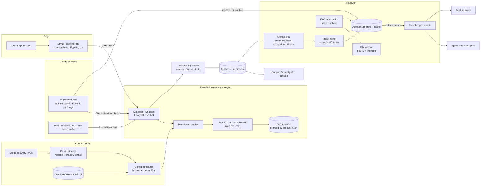
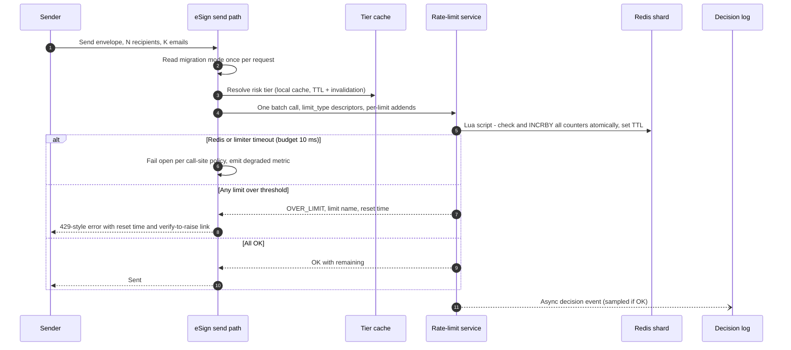
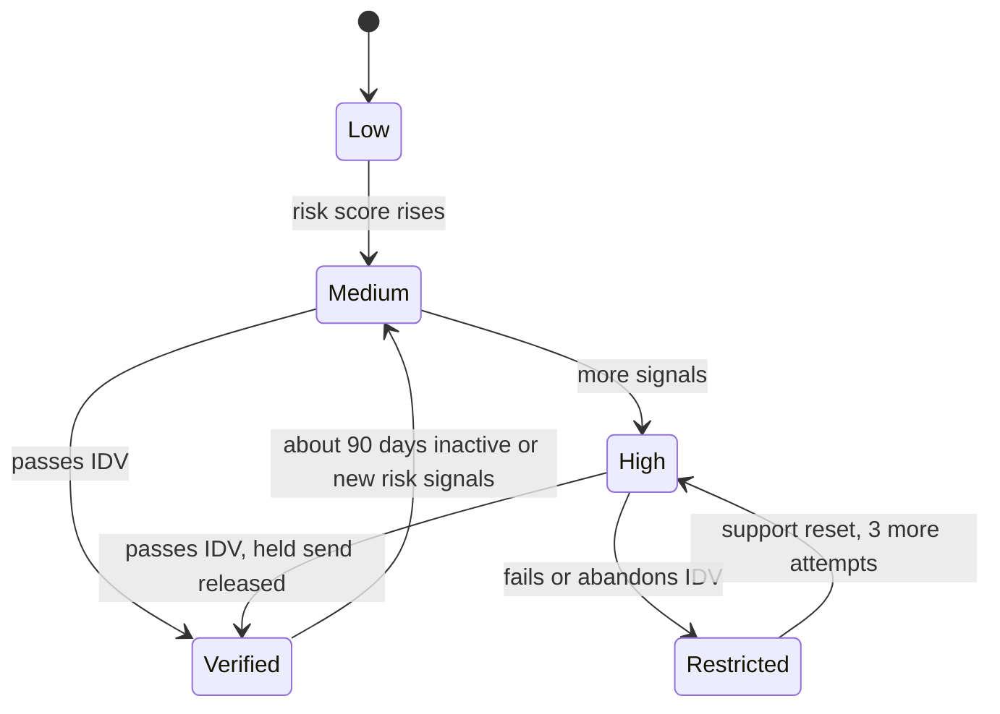
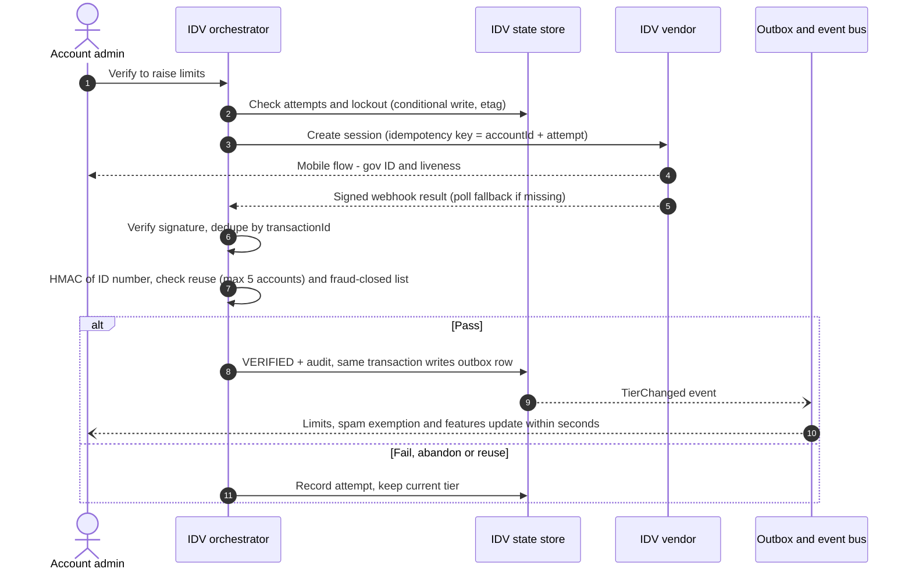
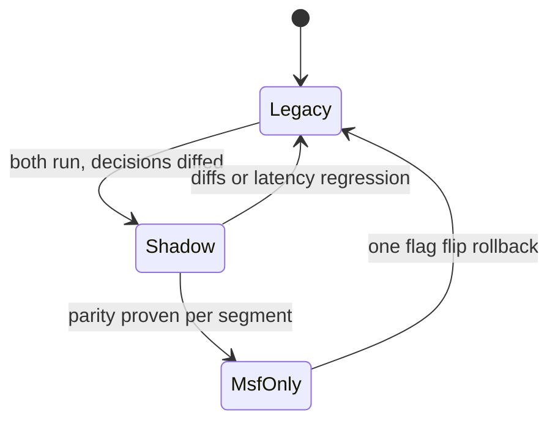

# 14 — Reverse System Design: Adaptive Trust & Protection Platform

✅ = sourced actual · 📈 = projected or design target · 🔭 = holistic extension ("how I'd evolve it"; say it that way)

## 0. Why this system (and not the others)

| Candidate | Distributed-systems depth | Scale numbers | Trade-offs to defend | Failure, migration and lessons | AI angle | Verdict |
|---|---|---|---|---|---|---|
| **P7 Rate Limit + Risk + IDV** | ⭐⭐⭐ hot path, Redis, multi-region, consistency | ✅ 4,000 TPS, 1–10 ms, 48M evals/week | ⭐⭐⭐ 12+ decisions | ⭐⭐⭐ live migration, ramp incident | ⭐⭐ (design process + 🔭 copilot and agent quotas) | **Primary** |
| P8 Agent Platform + MCP | ⭐⭐ | ✅ GA, 6 clients | ⭐⭐⭐ | ⭐⭐ | ⭐⭐⭐ | **Backup** if they say "AI system" |
| P6 Global Directory | ⭐⭐⭐ | ⭐ | ⭐⭐ | ⭐⭐ | ⭐ | Use for a consistency deep dive only |
| P4 Sharing migration | ⭐⭐ | ✅ 40.5M configs | ⭐⭐ | ⭐⭐⭐ | ⭐ | A migration story, not a system design |

**Why it fits a reverse system design round:**
- It covers every classic axis: hot-path latency, distributed counting, consistency vs. availability, multi-tenancy, config safety, an event-driven pipeline, a third-party vendor integration, a state machine, PII and data governance, observability, a live migration, and abuse and security.
- **Coinbase bonus:** rate and withdrawal limits by risk tier, KYC step-up, and fraud vs. customer friction are Coinbase's daily life.

---

## 1. 60-second pitch (say this first)

> "I designed Docusign's **Adaptive Trust & Protection platform**. At its core is a **multi-tenant global rate-limit service**: Envoy-RLS-compatible, Redis-backed, in every region, about **4,000 TPS** at **1–10 ms per check**. It handles both infrastructure throttling and business fraud quotas.
>
> On top of it, I built **risk-tiered limits** and a **self-serve identity-verification step-up**. Instead of blunt limits that blocked paying customers, friction is proportional to risk: verified accounts get **100× limits**, and fraudsters hit a wall they can't pass at scale.
>
> Results: the fraud-recipient rate went from **~0.5% to 0.15% (−70%)**, **758 verifications at a 97.3% success rate**, and **~48M trusted-path evaluations a week**. I migrated eSign's legacy on-prem limits engine onto it with shadow mode and zero-drift parity.
>
> I'll walk through requirements, architecture, the hot path, the trust layer, then trade-offs and what I'd change."

---

## 2. Requirements (draw as two columns)

**Functional**
1. Count and limit by arbitrary descriptors: IP, path, client, account, plan, account age, `limit_type`.
2. **Multiple limits per request, with different weights.** A send with N recipients is envelope +1, recipients +N, emails +K.
3. Multiple windows per limit: 30-day + 3-day + daily.
4. Per-account and per-plan **overrides**; thousands of them.
5. **Shadow mode:** count and report without enforcing.
6. Read without incrementing (support and dashboards), plus an admin decrement (support reset).
7. **Risk tiers** (Low / Medium / High / Verified) select thresholds and friction.
8. **Step-up verification:** government ID + liveness via a vendor, self-serve, with abuse controls.
9. Every decision is **explainable**: which limit, count, threshold, time to reset.

**Non-functional**

| | Target |
|---|---|
| Latency | **p99 single-digit ms** per check ✅ (1–10 ms). Negligible next to a 100–500 ms send. |
| Throughput | **~4,000 TPS average** ✅. Design for **3× peak, ~12K TPS** 📈 plus **10× headroom** for growth. |
| Availability | 99.99% 📈. **A limiter outage must not stop sends** (fail open, by policy). |
| Config safety | New limits ship in shadow. Deploy without redeploying callers. **A typo is never an outage.** Reload < 30 s ✅. |
| Multi-tenancy | Any service onboards self-serve, isolated by domain. No noisy-neighbor collisions. |
| Security and compliance | Callers can't spoof identity descriptors. No raw government-ID data stored. Full audit of tier changes. |
| Fraud fit | Dormant accounts can't bank burst credit. Counters survive changes to the attribute that drives the threshold (account age). |

**Questions to ask the interviewer up front:** "Should I focus on the limiter's internals or on the trust and risk layer?" Let them choose. Both are prepared.

---

## 3. Back-of-envelope (do this on the board)

| Quantity | Math | Result |
|---|---|---|
| Limiter calls | 4,000 TPS avg ✅ × 3 peak | **~12K TPS peak** 📈 |
| Counters touched per send | 4 domains × ~2 windows | **~8 counter updates**, but **1 network round trip** (batched, one Lua script) |
| Redis ops at peak | 12K × 8 | **~100K ops/s** 📈. A single Redis primary handles ~100K+ simple ops/s, so shard by `hash(account_id)` across 3–6 shards per region for headroom. |
| Counter memory | ~1M active accounts × 8 counters × ~100 B | **~0.8 GB per region** 📈. Fits easily; TTL = window, so the data cleans itself up. |
| Decision logs | 4,000 TPS × 86,400 × ~300 B | **~100 GB/day** 📈. **Sample OK decisions (1%)** and keep 100% of OVER_LIMIT and shadow-would-block decisions, which cuts it to ~5 GB/day. |
| Trusted-path evaluations | ✅ measured | **~48M/week ≈ 6.9M/day ≈ 80 TPS avg** |
| Overhead on a send | 1–10 ms / 100–500 ms | **< 2–5%** |

---

## 4. High-level architecture

**Whiteboard-only version (if the drawing tool is slow), drawn as 4 boxes:**
`Edge/Callers → Rate-Limit Service (stateless + Redis) ← Control plane (Git/overrides)`, plus `Trust layer (Risk + IDV → Tier store) → feeds thresholds`, plus `Decision log → Analytics → Support + Risk signals`.

---

## 5. Deep dive A: the limiter hot path

### API (Envoy RLS v3-compatible)
- `ShouldRateLimit(domain, descriptors[], hits_addend)` → `overallCode` + per-limit `statuses[]` (limit name, remaining, `durationUntilReset`).
- Extensions I added: **per-limit addends**, **multi-limit statuses**, `GetCount` (no increment), `Decrement` (admin).
- **Domain = `{namespace}-{release}`**: tenant isolation and clear ownership.

### Send decision sequence

### Counting and algorithms
- **Key** = `domain | descriptor path | window start`, **TTL = window**. No cleanup jobs.
- **Per-limit algorithm choice:**
  - **Token bucket** for infrastructure: smooth, tolerates bursts.
  - **Fixed windows + multi-limit** (30-day + 3-day + daily) for fraud: dormant accounts can't bank a burst.
- **Boundary burst** (2× at a window edge): acceptable for fraud quotas because the shorter windows cap it. If exact rolling windows are needed, use **N sub-buckets** (e.g., 30 daily keys) summed in Lua, which costs one MGET 🔭.
- **Atomicity:** one Lua script checks all limits, then increments only if all pass ("all or nothing"). This avoids partial counting when one limit rejects.
- **Redis Cluster detail:** multi-key Lua only works when the keys share a hash slot, so keys use a **hash tag**: `rl:{account_id}:limit:window`. All of an account's counters sit on one shard, the atomic check keeps working, and sharding still spreads accounts evenly.
- **Legacy parity semantics:** pre-check, then post-track after a successful send, so failed sends aren't counted. Under concurrency this allows a **bounded overshoot** (≤ concurrent in-flight sends per account), which I accepted and documented.

### Consistency decision: per-region counters ✅
- **No cross-region replication on the hot path.** No quorum, no cross-region latency.
- Accounts are **region-homed**, so skew is tiny. Worst-case global overshoot ≤ limit × number of regions, and only for multi-region senders.
- For truly global limits, **route the counted operation to the account's home region**. Don't replicate counters.

### Config plane
- Limits live as **YAML in each service repo**. A config-only pipeline validates schema, **defaults to `shadowMode: true`**, and distributes with hot reload in **< 30 s** ✅.
- **Unmatched descriptor → OK.** A typo can't become an outage. A "zero matches" alert on new limits catches silent misses.
- **Overrides:** an override store plus admin UI for thousands of per-account exceptions. `replaces:` cancels the plan-level limit for that account.

### Multi-tenancy and isolation
- Domain-prefixed keys. **Istio AuthorizationPolicy** decides which service may call which domain. mTLS everywhere.
- **Two integration modes:**
  - Ingress: request metadata only, no code.
  - Direct gRPC: identity-aware, **after** the caller authenticates. **The gateway never trusts unverified identity claims.**
- Noisy neighbor: per-domain QPS caps on the limiter itself. Critical domains (eSign send) can get a dedicated Redis cluster 🔭.

---

## 6. Deep dive B: the trust layer (risk tiers + IDV step-up)

### Core idea
- **Friction proportional to risk, not binary blocks.**
- Fraudsters can't produce a valid government ID plus liveness at scale. Legitimate customers can, in minutes.
- `IDV_STATE = VERIFIED` becomes a **reusable account-level trust signal** for every service.

### Risk ladder

| Tier | Treatment |
|---|---|
| Low | Allow |
| Medium | Modify and warn (strip formatting, banner); IDV restores normal |
| High | Suppress and hold; **prompt IDV**; on pass, release the held send |
| Verified | **Elevated limits (100× trusted tier ✅)**, spam-filter exemption, gated features. Billing allowances still apply. |

### IDV orchestration (state machine + vendor)

### Abuse controls and data governance
- **3 attempts, then lockout.** A support reset grants 3 more, so nobody is locked out permanently.
- **One government ID can verify at most 5 accounts.** IDs tied to fraud-closed accounts are blocked for about 2 years.
- **PII stays with the vendor.** We store only an **HMAC of the ID number** (keyed, because ID numbers are low-entropy and a plain hash is brute-forceable). The key lives in a vault, with a **key version per record** for rotation.
- **Elevate, never remove:** verification raises the tier or applies a multiplier; it never makes an account unlimited. **Reverify after ~90 days** of inactivity.
- **Human escape hatch:** TSOps can set `Backfilled` or `Bypassed` after review (SLA: respond in 1 day, resolve in 3). Every change is audited.

### Propagation
- The tier change is written with a **transactional outbox**, then an event goes to consumers (limits, spam filter, feature gates).
- The send path **caches the tier** with a short TTL plus event invalidation. A stale tier means at worst a briefly stricter or looser limit, which is acceptable and bounded by the TTL.

---

## 7. Migrating the legacy on-prem engine (the "live surgery" part)

- **The 7-gap parity analysis (3 P0) ✅ drove the platform roadmap:**
  - Legacy checked **10+ protectors in 1 round trip** → batch multi-limit evaluation.
  - Mixed weights → per-limit addends.
  - 30-day + 3-day windows → multi-limit per descriptor.
  - **Counters reset when `age_bucket` changed** → stable counter on `account_id`; threshold selection moved to the client.
  - Token-bucket burst credit → fixed windows for fraud.
  - Decision telemetry parity, so support tools kept working.
  - An override UI.
- **Read the mode once per request:** this fixed a time-of-check/time-of-use (TOCTOU) bug that could double-count.
- **Ramp by segment, not only by percentage:** a ramp briefly hit a direct enterprise customer. The fix excluded the whole segment the same day (EMT-8388 ✅), and segment exclusion became standard.

---

## 8. Key decisions (have 6 ready; they will pick at them)

| # | Decision | Rejected alternative | Why |
|---|---|---|---|
| 1 | Envoy RLS v3-compatible API | Custom proto | Native Istio integration, free tooling |
| 2 | Per-region counters | Globally replicated counters | Latency and availability on the hot path; accounts are region-homed |
| 3 | Algorithm chosen per limit | One algorithm | Infrastructure wants smoothing; fraud wants no banked bursts |
| 4 | Unmatched descriptor → OK | Reject | A config typo must never cause an outage |
| 5 | Fail open on limiter outage (in caller policy) | Fail closed | Sends are revenue; the risk and IDV layers still apply. Explicit per call site, not hidden in the library |
| 6 | One batched call + per-limit addends | One call per limit | 1 RTT instead of 8–10 |
| 7 | Verification elevates, never removes | Unlimited when verified | Stolen-but-verified accounts can't burst without bound |
| 8 | IDV lowers the risk score | IDV sets the manual "Trusted" flag | Other signals can raise risk again; manual trust stays a human decision |
| 9 | Account-level verification | Per-user | One admin verifies and all eligible users benefit |
| 10 | Transactional outbox for tier events | Dual write | No lost or phantom tier changes |

---

## 9. Failure modes (draw as a table if asked "what breaks?")

| Failure | Behavior |
|---|---|
| Redis shard down | Fail open for sends (alerted); ingress falls back to local per-pod limits; fraud layers still apply |
| Limiter latency spike | 10 ms client budget, then fail open with a degraded metric; circuit breaker |
| Hot key (mega-sender) | Narrow keys (account × limit); time-bucket suffix sharding for extreme senders |
| Bad threshold shipped | Shadow first; config rollback in < 30 s |
| Config typo | OK is returned; "zero matches" alert |
| IDV vendor outage | Account keeps its tier; retry message; support manual path |
| Webhook lost or duplicated | Poll fallback; dedupe by transactionId; idempotent state transitions |
| Retry storm after 429 | `Retry-After`, client jitter, idempotent sends |
| Region failover | Counters reset in the new region, giving a temporary looser limit. Accepted; risk tiers still apply |

---

## 10. Observability and SLOs
- **Golden signals per limit name:** OK / OVER / shadow-would-block, p99 latency, Redis errors, config reload status.
- **SLOs:** limiter p99 < 10 ms 📈; availability 99.99% 📈; fail-open time < 0.01% of requests 📈.
- **Explainability:** the decision log carries the limit, count, threshold and reset, so support can explain any block **without seeing the fraud logic**.
- **Business KPIs:** fraud-recipient rate ✅ 0.5% → 0.15%; IDV funnel (initiated → completed → passed; 97.3% pass ✅); limit tickets ~80/month → ≥ 50% fewer 📈.

---

## 11. Results

| Metric | Value |
|---|---|
| Platform throughput | ~4,000 TPS avg, all regions ✅; 2.5–12× Redis headroom ✅ |
| Per-check latency | 1–10 ms, 1 call per send ✅ |
| Fraud-recipient rate | ~0.5% → 0.15% (−70%), beat the < 0.2% target ✅ |
| IDV | 758 / 779 = 97.3% success ✅; 100% in Prod Sep 2026 ✅ |
| Trusted tier | 100× limits ✅; ~48M evals/week ✅ |
| Migration | 7 gaps / 3 P0 closed; 4 domains in 1 call ✅ |
| Support load | ~80 limit cases/month → ≥ 50% fewer 📈 |

---

## 12. 🔭 Extensions (holistic "where I'd take it next")

1. **ML risk scoring.** Move from rules plus a third-party score to a gradient-boosted model on velocity, recipient-domain reputation, content and bounce features. Shadow-score first, and compare precision and recall against rules.
2. **AI investigator copilot (HITL)** for support and Trust & Safety:
   - An LLM summarizes *why* an account is blocked from decision logs, tier history and the IDV state.
   - It drafts the recommended action.
   - **A human approves**, every action is audited, and the model only reads through permission-checked tools (the same "model proposes, policy decides" rule from the agent platform).
   - 📈 target: −40% handle time on limit cases.
3. **Agent and MCP traffic class.** AI agents get their own descriptor (`client_type = agent`, `agent_id`), **token-cost-weighted limits** (addend = estimated tokens), and per-agent kill switches. The same platform protects LLM spend.
4. **Platform-native segment-aware ramps**, replacing the checklist.
5. **Exact rolling windows** via sub-bucket summation for the few limits that need them.

---

## 13. "How did you use AI tools in the architecture?" (they WILL ask)

| Where | How I used AI | Guardrail |
|---|---|---|
| **Parity analysis** | An agent traced the legacy ServiceProtection and Distributed Computation code paths and drafted the protector inventory. **I validated each gap.** That gave the 7-gap list (3 P0) in days instead of weeks 📈. | Human-verified; every gap linked to a code reference |
| **Design red-teaming** | Prompted the model as "a fraudster with 1,000 stolen IDs": it surfaced ID reuse across accounts and parallel-attempt races. Those led to the 5-account cap, attempt lockout and conditional writes. | Treated as brainstorming; I made the decisions |
| **Load model** | Generated a first-cut back-of-envelope and Redis memory model, then corrected it with real TPS data. | Real metrics override model output |
| **Test matrices** | Generated descriptor-matching edge cases (order, prefix, empty values, `replaces`); these caught the age-bucket counter-reset class of bug in tests. | Tests reviewed like code |
| **Support-ticket mining** | Clustered 6 months of limit tickets to size the problem (~80/month) and the top unblock reasons. | No PII in prompts; enterprise tools only |
| **Code** | Agent-written Lua scripts and client stubs, gated by tests, review and shadow parity | Shadow 0-drift gate before enforcement |

**Line to say:** "AI made exploration and drafting cheap; I spent the saved time on verification: shadow parity, tests and red-team review."

---

## 14. Learnings (end with these; they score "what did you learn")
1. **Parity is a product requirement.** The hardest consumer should shape the platform roadmap.
2. **Fail-safe defaults beat clever ones.** "Unmatched → OK" plus a zero-match alert gives safety without silent gaps.
3. **Ramps need segments, not just percentages.** I made it a platform feature after the enterprise incident.
4. **Friction proportional to risk** beats blunt blocking for both fraud and revenue.
5. **Instrument "time from block to unblock" from day one.** I added it late.

---

## 15. Likely probes, with short answers
- **Why not a sliding-window log?** Memory is O(requests). Fixed windows plus multi-limit, or sub-buckets, give O(1) per counter.
- **Exactly-once counting?** Not needed. Bounded overshoot is acceptable for quotas. Idempotency is enforced at the send layer.
- **Redis vs. DynamoDB or Cosmos for counters?** Sub-ms atomic increments plus Lua; the TTL-driven data shape fits Redis. Durability isn't needed because counters are reconstructible and a reset is a bounded risk.
- **What if Redis loses data?** Counters reset, giving a temporarily looser limit. Risk tiers and the IDV wall still apply. Accepted.
- **Fail open: isn't that a fraud hole?** It's bounded by outage duration, alerted, and layered (risk tier, spam filter, IDV). Fail closed would turn a cache blip into a revenue outage.
- **How do you prevent callers spoofing `account_id`?** Direct mode only after authentication, mTLS plus AuthorizationPolicy per domain, and the gateway never reads identity claims.
- **How do thousands of overrides scale?** An override store plus UI, indexed by account and loaded into the config distributor; no per-account YAML.
- **Hashing government IDs?** A keyed HMAC, not a plain hash (low entropy), with a versioned key for rotation; raw data stays at the vendor.
- **How would you run this on AWS?** EKS + Envoy/Istio, ElastiCache Redis (cluster mode), MSK/Kafka for decision and tier events, DynamoDB or Aurora for IDV state and overrides, KMS for the HMAC key, and Go for the limiter service.
- **What would you change?** Segment ramps and block-to-unblock instrumentation as platform features from day one, and a dedicated Redis cluster for the top tier-0 domain.

---

## 16. 60-minute run plan

| Min | Do |
|---|---|
| 0–3 | Pitch (section 1) and ask: "limiter internals or the trust layer first?" |
| 3–8 | Requirements plus back-of-envelope (sections 2–3) |
| 8–18 | Draw the architecture (section 4) |
| 18–30 | Hot-path deep dive: API, Lua atomicity, per-region counters, config safety |
| 30–40 | Trust layer: risk ladder, IDV state machine, outbox, abuse and PII |
| 40–47 | Migration and parity, the ramp incident |
| 47–53 | Trade-offs and failure modes they choose to probe |
| 53–57 | AI-tools usage (section 13) and extensions |
| 57–60 | Learnings (section 14) |

**Backup:** if they want an AI-centric system, switch to **[15-Reverse-System-Design-Agent-Platform.md](./15-Reverse-System-Design-Agent-Platform.md)** (same structure: pitch, requirements, governed tool-call path, retrieval, evaluation gate, failure modes, learnings). The project deep dive is [08](./08-Agent-Platform-and-MCP-Governance.md).
