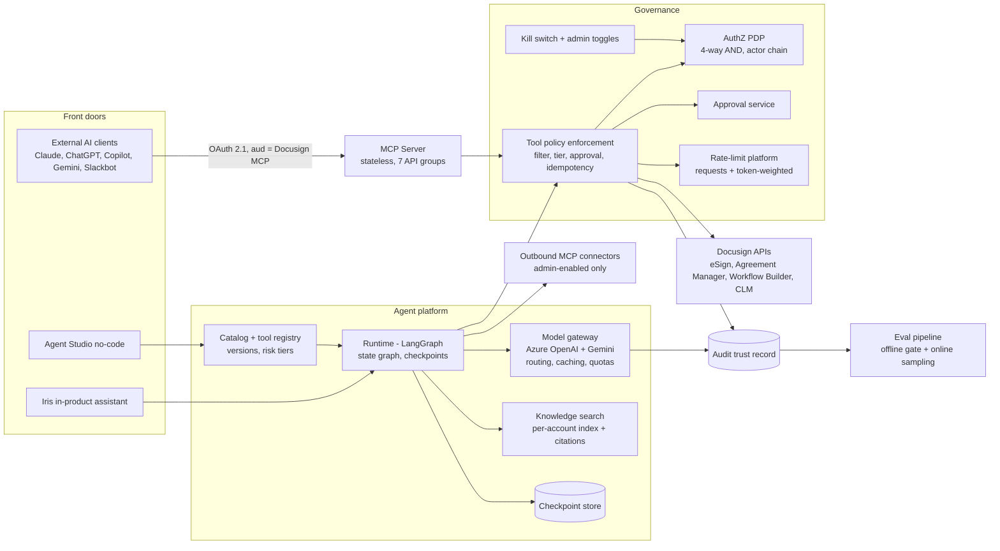
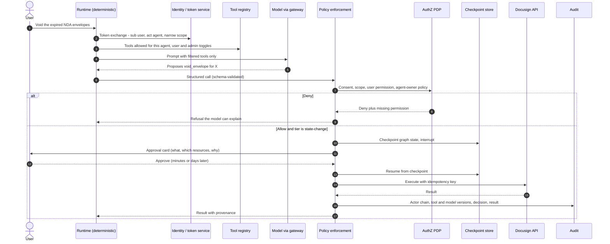
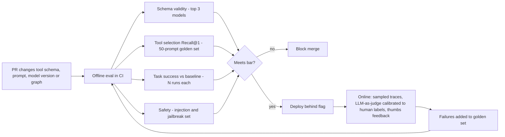

# 15 — Reverse System Design (Backup): Governed Agent Platform + MCP

✅ = sourced actual · 📈 = projected or design target · 🔭 = holistic extension ("how I'd evolve it"; say it that way)

## 0. When to use this instead of 14
- **Lead with 14 (Trust & Protection)** by default. It has the deepest classic distributed-systems content.
- **Switch to this one** if the interviewer says "an AI or agentic system", or if after 14 they ask "anything with LLMs or MCP?" It also matches the Coinbase job's MCP, LLM orchestration, RAG, HITL, eval and guardrail keywords one for one.
- You can bridge the two: "the agent platform uses the same rate-limit platform for token-weighted quotas" (14 §12).

---

## 1. 60-second pitch

> "I led Docusign's **governed agent platform**: the shared runtime, model gateway, knowledge search and evaluation that product teams build agents on, plus the **Docusign MCP Server**, so customers can act on agreements from Claude, ChatGPT, Copilot and other assistants.
>
> The core design principle is **the model proposes, deterministic policy decides**:
> - tools are filtered before the model sees them;
> - every call is authorized by our AuthZ service with the full actor chain (user plus agent);
> - state changes need human approval and idempotency;
> - everything is audited and revocable per agent.
>
> We went from **Open Beta in May 2026 to GA on Sep 30**, about 4.5 months, across **7 API groups and 6 AI clients**, with **5+ agents from 4 teams** on one platform and **50% faster** NDA summarization in a customer study.
>
> I'll cover requirements, architecture, the governed tool-call path, retrieval, evaluation, then trade-offs and lessons."

---

## 2. Requirements

**Functional**
1. **Many front doors:**
   - **Inbound MCP:** external AI clients call Docusign tools.
   - In-product assistant (Iris).
   - No-code Agent Studio.
   - **Outbound MCP connectors:** our agents call third-party MCP servers such as Salesforce.
2. **Agent runtime:** multi-step orchestration, memory, **pause for human approval and resume later**.
3. **Tools:** a versioned registry with risk tiers: Read / Draft / State-change.
4. **Knowledge:** retrieval over 300M+ agreements ✅, **permission-aware**, with citations.
5. **Models:** several providers (Azure OpenAI, Vertex Gemini) behind one gateway.
6. **Governance:**
   - agent identity and actor chain;
   - one permission model across agent tools, REST and MCP;
   - HITL approval;
   - audit;
   - kill switch;
   - admin toggles.
7. **Evaluation:** offline release gate plus online quality monitoring.

**Non-functional**

| | Target |
|---|---|
| Platform overhead per tool call (excluding the LLM) | < 100 ms p99 📈. AuthZ check < 10 ms 📈. |
| Turn latency | **2 s average** design target ✅; alert at **> 60 s** ✅; **30 s** agent timeout with fallback to manual ✅ |
| Quality bar | Schema validity **100%** on the top 3 models; tool selection **Recall@1 > 90%**; task success **≥ 95% vs. 80% baseline** ✅ targets |
| Safety | **0 tool calls authorized by model text** ✅ by construction; 100% of state changes behind approval and idempotency 📈 |
| Revocation | Kill one agent immediately; token exposure ≤ 1 access-token lifetime ✅; < 5 s with real-time revocation events (SSF) 📈 |
| Abuse and cost | **60 requests/min/account** per agent endpoint ✅; per-tenant token budgets 📈 |
| Compliance | Per-account data isolation, data residency, PII redaction in traces, audit retention |

**Question to ask up front:** "Should I go deeper on the MCP and security path, or on orchestration and evaluation?"

---

## 3. Back-of-envelope (📈 illustrative; state your assumptions)

| Quantity | Math | Result |
|---|---|---|
| Agent and MCP sessions | ~100K/day across 40K IAM customers ✅ base | **100K sessions/day** 📈 |
| Tool calls | 100K × ~5 | **~500K/day ≈ 6 TPS avg, ~60 TPS peak** 📈. Platform throughput is easy; **LLM latency and cost dominate.** |
| LLM calls | ~3 per tool call (plan, call, summarize) | **~1.5M/day** 📈 |
| Input tokens | 1.5M × ~3K | **~4.5B/day** 📈. That's why tool-schema trimming (−40%), **prompt caching** of system prompts and tool lists, and routing simple steps to small models matter. |
| AuthZ checks | 1 per tool call + 1 per retrieval batch | **~1M/day**, cached decisions, < 10 ms |
| Audit record | 500K × ~2 KB | **~1 GB/day** (tool, actor chain, decision) |
| Full traces | 1.5M × ~20 KB | **~30 GB/day** → PII-redacted, short hot retention (14–30 days), sampled for evaluation |
| Checkpoints (HITL pauses) | ~5% of sessions pause, ~50 KB of state each | **~250 MB/day**, TTL 7 days |

---

## 4. High-level architecture

**Whiteboard 4-box version:** `Front doors → (MCP Server | Runtime) → Policy layer (PEP→PDP, HITL, rate limits) → Tools`, plus `Model gateway` and `Knowledge search` beside the runtime, and `Audit → Eval` underneath.

---

## 5. Deep dive A: the governed tool call (the heart of it)

**Rule:** the LLM is an untrusted planner. Deterministic code obtains credentials, filters tools, authorizes, asks for approval, and executes.

**Points to defend:**
- **Tool filtering before the prompt:** an injected "admin export" can't be called because the tool isn't in context. It also cuts tokens.
- **4-way AND** in the PDP: user consent ∧ token scope ∧ user's own permission ∧ agent-owner policy. **An agent can never exceed its user.**
- **Actor chain in the token:** `sub` = user, `act` = agent, via OAuth token exchange. Audit shows *who* and *what agent*; revocation can target **one agent** instead of the whole app ✅.
- **Checkpointed interrupts:** approval can take days. LangGraph state goes to a durable store, so pods stay stateless and a resume works on any pod.
- **Idempotency key** = hash(session, step, tool, args): model retries and resumes can't double-send.
- **Fail closed** for state-change tools when the PDP is unavailable. Read tools may use a short-TTL cached allow.

### MCP Server specifics
- **Stateless** behind the gateway. Streamable HTTP; sessions are keyed but state lives outside the pod.
- **OAuth 2.1 + PKCE**, and tokens **audience-bound to the MCP server**. No token passthrough to downstream APIs; the server exchanges for a downstream token, which prevents the confused-deputy problem.
- **"MCP is transport and discovery, not authorization":** every MCP call takes the same PEP→PDP path as internal agents. That gave **one permission model across agent tools, REST and MCP (3 → 1)** ✅.
- **7 task-shaped API groups** ✅ instead of one tool per REST endpoint: better tool selection and fewer tokens.
- **Admin toggles:** outside-in (external clients may call us) and inside-out (our agents may call third-party MCP servers), per account.

---

## 6. Deep dive B: orchestration, model gateway, retrieval

### Runtime
- **Standardized on LangGraph** (migrated from MAF ✅): explicit state graph, retries and timeouts per node, human-approval nodes, checkpointing.
- **30 s agent timeout** falls back to the manual flow ✅. The agent is an accelerator, never a single point of failure.

### Model gateway
- One interface over **Azure OpenAI + Vertex Gemini** ✅.
- **Routing:** small or cheap models for classification and routing steps; large models for reasoning.
- **Version pinning**, and roll forward only after evals pass.
- **Provider failover** on 5xx or latency.
- **Prompt caching** for system prompts and tool lists.
- **Per-tenant token quotas** via the rate-limit platform with `addend = tokens` 🔭.
- Low temperature (e.g., 0.2) for factual extraction ✅ (POC).

### Retrieval (RAG) over agreements: permission-aware

```mermaid
flowchart LR
  Q[User question] --> RW[Query rewrite - small model]
  RW --> IDX[Per-account vector + keyword index<br/>ACL fields stored on chunks]
  IDX -->|pre-filter by account + ACL groups| TOPK[Top-k candidates]
  TOPK --> RECHK[Fetch-time AuthZ re-check<br/>PDP batch]
  RECHK --> RR[Re-rank]
  RR --> CTX[Context with chunk ids]
  CTX --> LLM[Model answers]
  LLM --> CIT[Citation engine<br/>every claim maps to a chunk]
  CIT --> OUT[Answer or refuse if unsupported]
```

- **Per-account index isolation** (a hard tenant boundary) plus **ACL pre-filtering**. Post-filtering alone would starve the top-k results and could leak that a document exists.
- **Fetch-time re-check:** ACLs change (sharing revoked), so pre-filtering alone is stale. A batched PDP call per retrieval keeps cost bounded.
- **Citations required:** an unsupported claim means refuse or say "not found". That's the hallucination control.
- **Index freshness:** change events from eSign/Agreement Manager feed incremental re-indexing; ACL changes propagate on the same event path.

---

## 7. Deep dive C: evaluation and guardrails

- **Bars** ✅ (targets): 100% schema validity, Recall@1 > 90%, task success ≥ 95% vs. 80% baseline.
- **Non-determinism:** score pass rates over N runs; never judge on a single sample.
- **Scoring:** deterministic scoring for tool choice and arguments; **LLM-as-judge** only for reference-free qualities (completeness, faithfulness), calibrated against human labels.
- **Guardrails are layered:**
  - Content filtering screens inputs for jailbreaks and injection.
  - Output schema validation.
  - PII redaction in traces.
  - The PDP plus approval bounds the damage. **A successful injection has nothing to escalate to.**

---

## 8. Key decisions

| # | Decision | Rejected alternative | Why |
|---|---|---|---|
| 1 | The model proposes, the PDP decides | Let the model reason about permissions (system prompt) | Prompts are guidance, not enforcement; injected text shares the context window |
| 2 | Filter tools before the prompt | Expose all tools, deny later | Smaller attack surface, fewer tokens, better selection |
| 3 | Actor-chain tokens (`sub` user, `act` agent) | A broad service credential, or impersonating the user | Attribution and per-agent revocation; least privilege |
| 4 | One permission model for agents, REST and MCP | A separate allowlist per surface | Three surfaces were drifting apart (3 → 1 ✅) |
| 5 | LangGraph as the standard runtime | Each team builds its own; MAF | Checkpointed HITL, explicit state, ecosystem; teams ship in weeks |
| 6 | Multi-provider model gateway | Single provider | Failover, cost routing, version pinning, no lock-in |
| 7 | Task-shaped tools (7 groups) | 1:1 REST mirrors | Selection accuracy and token cost |
| 8 | Eval as a CI gate | Manual prompt testing | Model and prompt changes regress silently otherwise |
| 9 | Open Beta first, then GA | Wait for full scope | Real client traffic shaped tool design; GA in ~4.5 months ✅ |
| 10 | Fail closed for writes, bounded degradation for reads | Uniform policy | Read availability vs. write safety |
| 11 | Deferred real-time revocation (SSF/CAEP) and out-of-band approval (CIBA) | Build everything now | Fit 4–5 engineers; honest residual ≤ 1 token lifetime ✅ |

---

## 9. Failure modes

| Failure | Behavior |
|---|---|
| Model provider outage or latency | Gateway fails over to another provider; 30 s timeout → manual flow ✅ |
| Model returns invalid tool JSON | Schema validation, one repair retry, then a graceful refusal |
| Prompt injection in a document | Tool not in context, or PDP deny, or approval rejected; content filter logs it |
| PDP unavailable | Writes fail closed; reads use a short-TTL cached allow |
| Approval never arrives | Checkpoint TTL (7 days) expires and the session closes with no side effect |
| Duplicate execution on retry or resume | Idempotency key dedupes at the API |
| Rogue or compromised agent | Kill switch denies at the PDP immediately; tokens are bounded by lifetime |
| Third-party MCP server misbehaves | Admin toggle off; its responses are treated as untrusted content, never as privilege |
| Cost runaway (loops) | Max steps per graph, per-tenant token quotas, 60 requests/min/account ✅ |
| Eval regression after a provider model update | Pinned versions; roll forward only after the gate passes |

---

## 10. Observability and SLOs
- **Per agent, tool and model:** latency (turn and tool), errors, token use, cost, PDP denies, approval rate and approval latency, fallback-to-manual rate.
- **SLOs:** 2 s average turn latency ✅ target; > 60 s alert ✅; platform overhead < 100 ms p99 📈; task success ≥ 95% online sample 📈.
- **The audit trust record** per action: actor chain, agent version, tool version, model version, PDP decision, approval, result, citations.

---

## 11. Results

| Metric | Value |
|---|---|
| MCP Server | Open Beta May 2026 → **GA Sep 30 2026 (~4.5 months)** ✅ |
| Surface | **7 API groups**, **6 AI clients** ✅ |
| Platform adoption | **5+ agents across 4 teams**, plus **3 Agreement Desk intake agents** ✅ |
| User impact | **50% faster** complex NDA summarization (customer research study) ✅ |
| Permission models | **3 → 1** ✅ |
| Tool calls authorized by model text | **0** ✅ by construction |
| Time for a team to ship an agent | A quarter (build your own) → **weeks** 📈 |
| Tool-schema tokens | **~−40%** from consolidation 📈 |

---

## 12. 🔭 Extensions
1. **Real-time revocation (SSF/CAEP):** revoke an agent in < 5 s 📈 instead of within one token lifetime.
2. **Out-of-band approval (CIBA)** for agents running without the user present.
3. **Semantic caching** of frequent read answers per account, invalidated on change events.
4. **Agent-to-agent delegation** with nested actor chains and narrowing scope at every hop.
5. **An investigator copilot pattern** for support and Trust & Safety: read-only tools, citations required, every suggested action goes through HITL. This is where it meets 14.

---

## 13. How I used AI tools in the design (they will ask)

| Where | How | Guardrail |
|---|---|---|
| Tool design | Asked several models to choose tools for 50 vague prompts against draft schemas; **the model's confusion showed which tools to merge** into the 7 groups | Measured with Recall@1, not opinion |
| Threat modeling | Red-team prompts ("you are a malicious contract") against the design; this produced the tool-filtering and attachment-isolation rules | Design decisions stayed human |
| Golden set | The LLM drafted variations of real customer asks; humans labeled the expected tool and arguments | Human-labeled ground truth |
| Code | Agents generated tool wrappers, schemas and contract tests | CI eval gate + review |
| Docs and spec comparison | Summarized the MCP, OAuth and token-exchange specs and compared options | Verified against the spec text |

**Line to say:** "I use AI to explore and generate; I use evaluations, tests and policy to decide."

---

## 14. Learnings
1. **Tool descriptions are prompts;** version and evaluate them like code.
2. **You can't solve prompt injection inside the model.** Design so a successful injection has nothing to escalate to.
3. **MCP isn't authorization;** one permission model across every surface.
4. **Ship beta to real clients early;** real traffic reshaped the tool catalog.
5. **Evals must be a gate,** or quality regresses silently with every model update.

---

## 15. Likely probes, with short answers
- **Why not fine-tune?** The problem was tool selection and grounding; tool design plus RAG plus evals is cheaper, model-agnostic and reversible.
- **How do you stop data leaking between tenants in RAG?** A per-account index, ACL pre-filtering, a fetch-time PDP re-check, and citations mapped to permitted chunks only.
- **How do you handle long-running approvals?** Checkpointed graph state in a durable store, an interrupt and resume on any pod, a TTL, and an idempotent execute.
- **What if the model is right but the user can't approve in time?** The agent never blocks the business: timeout → manual flow ✅.
- **How do you measure quality in production?** Sampled traces, a calibrated LLM-as-judge, user feedback, and failure-to-golden-set loops.
- **Cost control?** Smaller tool schemas, prompt caching, model routing, step caps, and token quotas on the shared rate-limit platform.
- **On AWS?** EKS, Bedrock plus external providers behind the gateway, OpenSearch or pgvector for retrieval, DynamoDB for checkpoints, MSK/Kafka for audit and events, and services in Go.

---

## 16. 60-minute run plan

| Min | Do |
|---|---|
| 0–3 | Pitch, then ask "security path or orchestration and evals first?" |
| 3–8 | Requirements + back-of-envelope (LLM cost dominates, not TPS) |
| 8–18 | Architecture |
| 18–30 | Governed tool call: filtering, PDP 4-way AND, actor chain, HITL checkpoint, idempotency, MCP auth |
| 30–38 | Permission-aware retrieval + model gateway |
| 38–45 | Evaluation gate + guardrails |
| 45–52 | Trade-offs and failure modes they choose |
| 52–57 | AI-tools usage (section 13) + extensions |
| 57–60 | Learnings |
