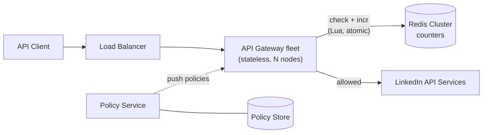
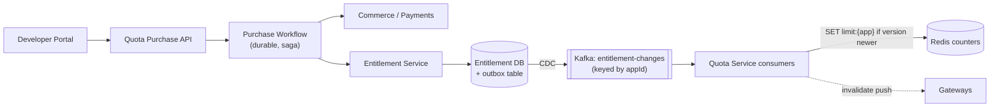
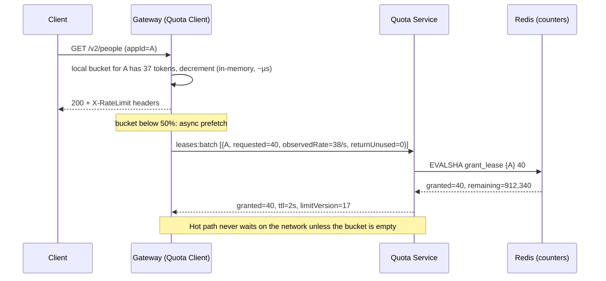
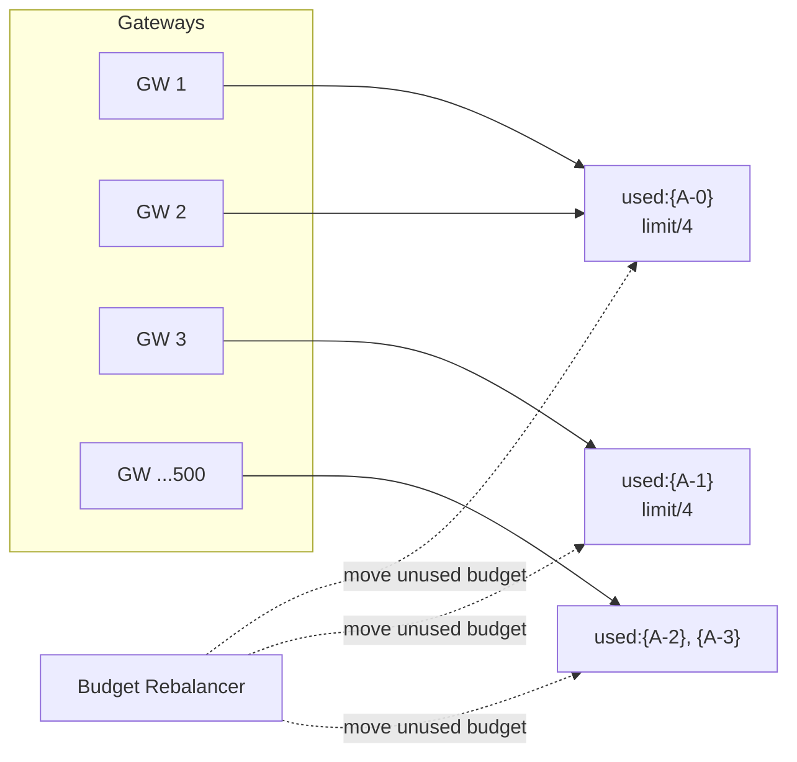
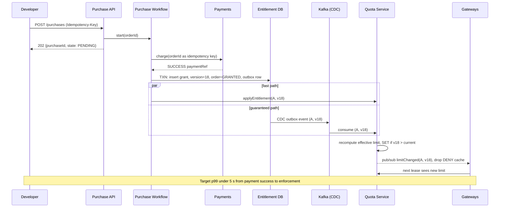
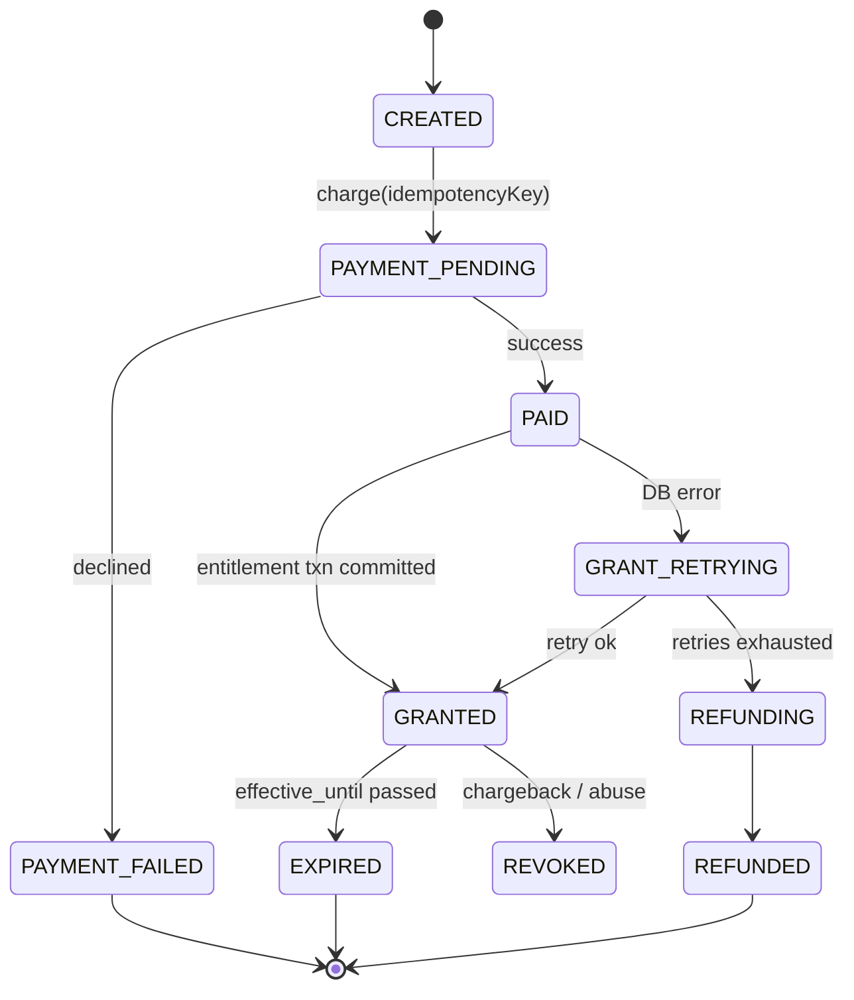
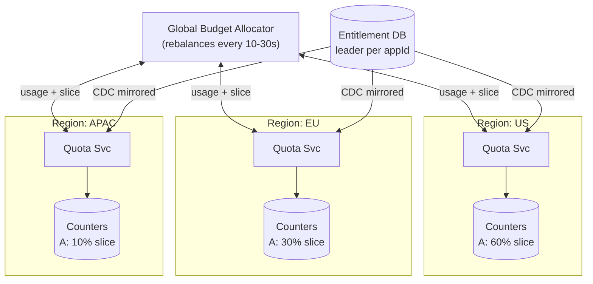
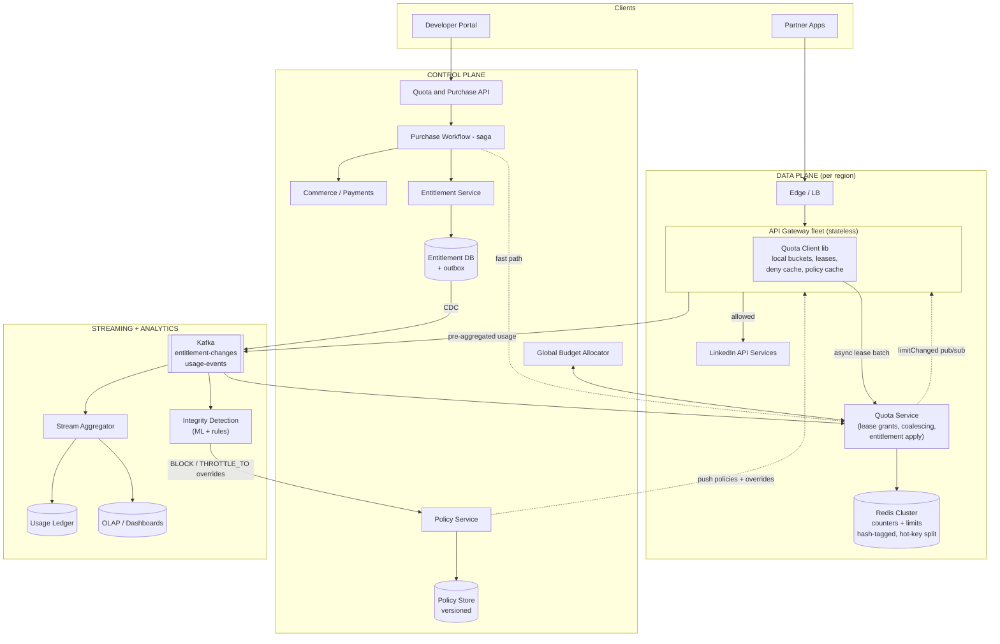

# LinkedIn API Quota Manager: Staff-Level System Design

> **Prompt:** Design a quota management system for LinkedIn's API. It must enforce rate limits the same way across all clients, and it must let users buy more quota when they need it.
>
> **Role context:** Staff Software Engineer, Marketplace Integrity. Expect the interviewer to push on **abuse prevention, hot keys, consistency of paid quota, and operability**, not only on the rate-limit algorithm.

This doc follows the **Hello Interview delivery format**: Requirements, Core Entities, API, High-Level Design, Deep Dives. Every stage includes the lines to say out loud.

All numbers are **design assumptions** made for the interview. They are not LinkedIn internals. Items marked **[?]** are things I'm not certain about publicly. Bring them up as assumptions, not facts.

---

## Table of Contents

0. [How to Run This in the Interview](#0-how-to-run-this-in-the-interview)
1. [The 60-Second Framing](#1-the-60-second-framing)
2. [Requirements](#2-requirements)
3. [Capacity Estimates](#3-capacity-estimates)
4. [Core Entities](#4-core-entities)
5. [API / System Interface](#5-api--system-interface)
6. [High-Level Design](#6-high-level-design)
7. [Deep Dives](#7-deep-dives)
8. [Final Architecture Diagram](#8-final-architecture-diagram)
9. [Failure Modes Table](#9-failure-modes-table)
10. [Trade-offs I Made (and Would Revisit)](#10-trade-offs-i-made-and-would-revisit)
11. [Interviewer Follow-up Bank](#11-interviewer-follow-up-bank)
12. [What Separates Senior from Staff Here](#12-what-separates-senior-from-staff-here)
13. [Tie-ins to Your Experience](#13-tie-ins-to-your-experience)

---

## 0. How to Run This in the Interview

**Timing for a 45 to 60 minute round:**

| Minutes | Hello Interview step | What's on the board |
|---|---|---|
| 0 to 5 | Requirements (functional, non-functional, out of scope) | Text lists |
| 5 to 7 | Capacity estimates (only the numbers that drive design) | 4 numbers |
| 7 to 9 | Core entities | 6 nouns |
| 9 to 13 | API | Data plane call + 3 public endpoints + headers |
| 13 to 28 | High-level design, one functional requirement at a time | HLD diagram |
| 28 to 50 | Deep dives (lead with DD1 and DD3, offer DD2 and DD7) | Annotate the HLD |
| 50 to 55 | Failure modes, trade-offs, what I'd build next | Final diagram |

**Rules:**
- First make the HLD **simple and correct**: every request goes to central Redis. Then **break it on purpose** in the deep dives (latency, hot keys) and evolve it. That's the Hello Interview pattern, and showing the evolution is the staff signal.
- Each change gets one sentence: **"This fixes X, and it costs us Y."**
- From the first minute, keep two ideas apart: **rate limits** (they protect the system) and **quotas** (they are commercial entitlements). Most of the design follows from that split.

---

## 1. The 60-Second Framing

Say this right after clarifying:

> "I see two different problems sharing one name. **Rate limiting** protects our infrastructure. It uses short windows, can be approximate, and should fail open. **Quota** is a commercial entitlement. It uses long windows, people pay for it, so it has to be accurate and auditable, and a purchase has to show up within seconds. Hard parts: (1) enforcing a global limit from hundreds of stateless gateways without adding a network hop to every request, (2) hot keys from big partners and scrapers, (3) getting a purchase from the payment system to every gateway quickly and exactly once, and (4) for an integrity team, stopping clients who spread their traffic across many identities to dodge limits."

**Priority order (say it):** availability of the API > enforcement latency > never over-grant paid quota > fast purchase propagation > exact accuracy of protective rate limits.

---

## 2. Requirements

### 2.1 Functional (keep it to 4 on the board)

1. **Enforce limits on every API call:** rate limits (per second or minute) and quotas (per day or month). They apply per **application**, per **member + application**, and per **endpoint**. Expensive endpoints cost more units.
2. **Self-serve purchase:** a developer buys more quota (an add-on pack or a tier upgrade), and the new limit takes effect **within seconds**.
3. **Visibility:** clients see their limit, what's left, and when it resets, through response headers and a dashboard. Rejections return `429` with `Retry-After`.
4. **Policy management:** admins define tiers, per-endpoint costs, and overrides. Trust/Integrity can **tighten or block** a client within seconds.

### 2.2 Non-functional

| Property | Target | Why |
|---|---|---|
| Added latency on hot path | **p99 < 1 ms** (decision is in-process) | The limiter sits in front of every API call |
| Availability of enforcement | 99.99%+, and **the API must work even if the limiter is down** | A limiter outage must not become a LinkedIn API outage |
| Paid quota accuracy | **Never over-grant** beyond a small, bounded tolerance; never lose a purchase | It's money and contracts |
| Rate limit accuracy | Within about 5 to 10% | It's protection, not billing |
| Purchase propagation | **p99 < 5 to 10 s** from payment success to enforcement | "Instantly increases your limits" |
| Scale | About 1M RPS at peak, about 1M apps, about 100M active member-app keys per day | See estimates |
| Auditability | Every limit change and purchase is versioned and traceable | Support, disputes, integrity investigations |

### 2.3 Out of scope (say it, so the interviewer can pull something back in)

- Payment processing internals. We call an existing Commerce/Payments service.
- OAuth and app registration. We assume an authenticated `appId` and `memberId` reach the gateway.
- The API gateway's routing itself. We plug into it.

### 2.4 Clarifying questions to ask

- "Is quota global across regions, or per region?" (Assume **global per app**, which makes the problem harder.)
- "What's the reset semantics: calendar day UTC, or rolling 24h?" (LinkedIn's public developer docs describe daily app-level and member-level limits that reset at midnight UTC **[?] check the current docs**. Assume calendar windows, which match billing.)
- "Do purchased packs expire, roll over, or recur?" (Assume time-bounded grants: `effective_from` / `effective_until`.)
- "Hard stop at the limit, or allow paid overage?" (Assume hard stop by default and overage as a per-plan flag.)

---

## 3. Capacity Estimates

Only compute what changes the design:

| Quantity | Estimate | Design consequence |
|---|---|---|
| Peak API traffic | ~1M RPS **[assumption]** | A central check on every request means ~1M+ remote ops/s |
| Dimensions checked per request | ~3 (app, member-app, endpoint/org) | ~3M counter ops/s if fully central. **Too much for one hop per call.** |
| Active counter keys | ~100M member-app + ~1M app keys | ~100 B each, so **~10 to 30 GB**. That fits in a sharded in-memory store. |
| Traffic skew | Top 1% of apps produce most of the traffic **[assumption]** | **Hot keys.** One partner at 50K RPS overloads one shard. |
| Gateways | ~500 to 1,000 stateless nodes across regions | Local-only counting is wrong by a factor of N |
| Purchases | Tens per minute | Write volume is trivial. **Correctness is the hard part**, not throughput. |
| Usage events | 1M RPS × ~200 B = ~200 MB/s raw | Pre-aggregate per key per second at the gateway before Kafka |

> **Say:** "The number that matters is 3M checks per second against a skewed key distribution. That rules out a naive remote call per request, and it tells me the design has to be about **amortizing coordination**."

---

## 4. Core Entities

| Entity | Key fields | Source of truth |
|---|---|---|
| **Application (Client)** | `appId`, `developerOrgId`, `planId`, `status` (active/suspended) | App registry (existing) |
| **Plan / Tier** | `planId`, default limits per dimension and window | Policy store |
| **Policy** | `policyId`, `dimension` (app, member-app, endpoint, org, ip), `window` (1s, 1m, 1d, 30d), `algorithm`, `endpointCost{}`, `version` | Policy store (versioned config) |
| **Entitlement** | `appId`, `grants[]` (base plan, add-on packs, overrides), each with `units`, `window`, `effective_from/until`, plus a monotonic `version` | **Entitlement DB** (strongly consistent) |
| **Purchase / Order** | `orderId`, `appId`, `sku`, `idempotencyKey`, `state`, `paymentRef` | Entitlement DB (same transaction boundary) |
| **Usage Counter** | `key = {dim}:{id}:{windowStart}`, `used`, `limit`, `limitVersion` | Counter store (Redis), approximate. Durable truth is the usage log. |
| **Lease** | `key`, `gatewayId`, `tokens`, `expiresAt` | Counter store (ephemeral) |

> **Say:** "The **effective limit** is derived, not stored: `base plan + sum of active add-ons + overrides`. The Entitlement DB is the truth, and everything downstream is a versioned cache of it."

---

## 5. API / System Interface

### 5.1 Data plane (internal, on the hot path)

The gateway embeds a **Quota Client library**. The hot path makes no remote call:

```
decision = quotaClient.tryAcquire(ctx{appId, memberId, endpoint, ip}, cost)
  -> { allowed: bool, remaining: int, resetAt: ts, retryAfterMs: int, reason }
```

Gateway to Quota Service (async and batched, off the hot path):

```
POST /internal/leases:batch
  [{ key, requested, observedRate, returnUnused }]  ->  [{ key, granted, ttlMs, limitVersion, remainingApprox }]
```

### 5.2 Response contract for API consumers

```
HTTP 200
X-RateLimit-Limit: 100000
X-RateLimit-Remaining: 41230
X-RateLimit-Reset: 1763942400

HTTP 429 Too Many Requests
Retry-After: 37
{ "error": "QUOTA_EXHAUSTED", "dimension": "app_daily", "upgradeUrl": "https://developer.linkedin.com/..." }
```

The `upgradeUrl` in the 429 is where monetization enters the product. Rejection becomes a sales funnel.

### 5.3 Developer-facing (control plane)

```
GET  /v1/apps/{appId}/quota                     -> limits, usage, resets per dimension
GET  /v1/plans                                   -> purchasable SKUs
POST /v1/apps/{appId}/quota/purchases            -> 202 { purchaseId, state }
     Header: Idempotency-Key: <uuid>
     Body:   { sku: "DAILY_CALLS_+100K", quantity: 1 }
GET  /v1/apps/{appId}/quota/purchases/{id}       -> { state, effectiveAt, entitlementVersion }
```

### 5.4 Admin / Integrity

```
PUT  /v1/policies/{policyId}                     (versioned, supports dryRun / shadow mode)
POST /v1/overrides  { target: appId|orgId|ip, action: BLOCK|THROTTLE_TO(n), ttl, reason }
```

> **Say:** "`appId` always comes from the auth token, never from the body. A client can't claim someone else's quota."

---

## 6. High-Level Design

Build one functional requirement at a time.

### 6.1 FR1: Enforce limits on every call (start simple)



**Flow:**
1. The gateway authenticates and gets `appId` and `memberId`.
2. It resolves the applicable policies from its **local policy cache**, which the Policy Service pushes.
3. It runs one atomic Redis Lua script per request that checks and increments every dimension at once.
4. It allows the request, or returns 429 with headers.

**Algorithm choice (pick per window, and explain it):**

| Algorithm | Memory | Accuracy | Use it for |
|---|---|---|---|
| Fixed window counter | O(1) | 2× burst at the boundary | **Daily/monthly quotas.** Matches calendar billing. The per-second limit caps the boundary burst. |
| Sliding window log | O(requests) | Exact | Nothing at this scale |
| Sliding window counter | O(1) | ~1% error | Per-minute limits |
| **Token bucket / GCRA** | O(1) | Exact, allows bursts | **Per-second rate limits.** Lets clients burst, which is what developers expect. |

> **Say:** "Quotas use fixed calendar windows because billing is calendar-based and the reset time is easy to explain. Rate limits use token buckets because they allow controlled bursts. I'm deliberately not using the same algorithm for both."

**Name the problems with this design (this sets up DD1 and DD2):**
- A Redis round trip on **every request** (~0.5 to 1 ms, worse at p99), at 3M ops/s.
- **Hot keys:** a 50K RPS partner lands on one Redis shard.
- If Redis is down, does the API go down?

### 6.2 FR2: Purchase more quota



**Flow:**
1. `POST /purchases` with an `Idempotency-Key` creates the order `CREATED`.
2. The workflow charges payment with the same idempotency key.
3. On success, **one DB transaction** writes the entitlement grant, bumps `entitlement.version`, sets the order to `GRANTED`, and inserts an **outbox** row.
4. CDC (Brooklin at LinkedIn **[?]**, or Debezium) publishes to Kafka. The Quota Service recomputes the effective limit and writes `limit:{app}` **only if the version is newer**.
5. It pushes an invalidation so gateways drop any cached "exhausted" state for that app.

### 6.3 FR3: Visibility

- **Headers:** computed at the gateway from the last lease response (`remainingApprox`) minus what has been used locally since. They're approximate, so say so in the docs.
- **Dashboard:** gateways emit **pre-aggregated** usage (per key per second) to Kafka. A stream job (Samza/Flink) writes to an OLAP store (Pinot at LinkedIn **[?]**) for charts. The authoritative "remaining" comes from the Quota Service.

### 6.4 FR4: Policies and integrity overrides

- The Policy Service stores **versioned** policy documents and pushes them to gateways (long-poll/stream). Gateways keep the last good version on disk.
- **Shadow mode:** a new policy logs "would have throttled" without enforcing it. Roll out only after you see how much legitimate traffic it would hit.
- **Overrides** (BLOCK / THROTTLE_TO) take the same push path at higher priority, so they land in seconds.

```yaml
# example policy document
policyId: partner-tier-gold
version: 42
limits:
  - dimension: app
    window: 1d
    units: 5_000_000
  - dimension: member_app
    window: 1d
    units: 500
  - dimension: app
    window: 1s
    algorithm: token_bucket
    rate: 2000
    burst: 4000
endpointCost:
  /v2/search/people: 10
  /v2/me: 1
```

---

## 7. Deep Dives

Lead with **DD1** (enforcement) and **DD3** (propagation). Those are the core of the prompt. Offer DD2 (hot keys) and DD7 (integrity) because they fit this role.

### DD1. How do we enforce a global limit across hundreds of stateless gateways with sub-ms latency?

#### Bad: local counters only

Each gateway enforces `limit / N` in memory.
- **Problem:** the load balancer doesn't spread one client's traffic evenly. With sticky connections, one gateway can carry 80% of a client's traffic and throttle it at 1/N of the limit while the rest of the budget sits unused elsewhere. When N changes (autoscaling, deploys), everyone's effective limit changes. It can be wrong by a factor of N in either direction.

#### Good: central counter on every request (the HLD)

Run an atomic Lua check-and-increment in Redis on every call.
- **Fixes:** exact global accuracy.
- **Costs:** a network hop per request, 3M ops/s, hot-shard meltdown, and the API depends on Redis availability.

#### Great: token leasing (local enforcement, central budget)

Each gateway **leases a chunk of tokens** from the central budget and spends them locally in memory. It refills asynchronously **before** it runs out.



**Lease grant script (atomic in Redis, hash-tagged so all of an app's keys share a slot):**

```lua
-- KEYS[1] = used:{A}:2026-11-23   KEYS[2] = limit:{A}:daily
-- ARGV[1] = requested             ARGV[2] = returned_unused   ARGV[3] = ttl_seconds
local limit = tonumber(redis.call('GET', KEYS[2]) or '0')
local used  = tonumber(redis.call('GET', KEYS[1]) or '0') - tonumber(ARGV[2])
local remaining = limit - used
if remaining <= 0 then
  redis.call('SET', KEYS[1], used, 'EX', ARGV[3])
  return {0, 0}
end
local grant = math.min(tonumber(ARGV[1]), remaining)
redis.call('SET', KEYS[1], used + grant, 'EX', ARGV[3])
return {grant, remaining - grant}
```

**Key property (say it):**
> "Granted tokens count as used **when they're granted**, not when they're spent. So the system **can't over-grant**. The sum of all leases can never exceed the limit. The failure mode moves from 'over-grant' (a money problem) to 'tokens stranded on an idle gateway' (a small, temporary under-serve). Unused tokens come back on the next renewal or when the lease expires."

**Lease sizing (adaptive):**

```
lease = clamp( observedRateOnThisGateway * refillHorizon,       // ~1 s of traffic
               min = 1,
               max = remainingGlobal / (k * activeGatewaysForKey) ) // k ~ 4
```

| Scenario | Numbers | Result |
|---|---|---|
| Hot partner | 20K RPS over 500 gateways = 40 RPS each | Lease of ~40 per second per gateway. **Central ops drop from 20K/s to ~500/s (40×).** |
| Long-tail app | 0.2 RPS total | Lease of 1 to 5. Central ops are tiny anyway. |
| **Endgame** (remaining < 4 × outstanding leases) | Approaching the daily limit | Leases shrink to 1, so effectively a **central check per request** for that key. Accuracy goes up exactly when it matters. |

**Per-second rate limits** use the same mechanism with a GCRA/token bucket in Redis that refills at `R/s` and short leases (~100 to 200 ms). **Global service-protection limits** (per-endpoint capacity) aren't coordinated at all: each gateway runs local adaptive concurrency limits and load shedding. You don't need global agreement to protect a backend.

**Multiple dimensions:** a request must pass app, member-app, and endpoint. Check the local buckets for all of them. Debit only if **all** pass, so a rejection on one dimension doesn't burn tokens on the others.

**Member-app keys (100M keys, low rate each):** most are tiny and cold. Don't keep leases for them on every gateway. Use **consistent-hash routing by `memberId`** at the LB tier where possible, so one member's traffic tends to hit a few gateways. Otherwise do a direct central check with batching (coalesce checks into 1 to 2 ms micro-batches per Redis shard).

---

### DD2. Hot keys: one partner or one scraper at 50K+ RPS

Leasing already cuts central ops by roughly the lease size. For the extreme tail:

1. **Key splitting:** shard the counter into `used:{A#0}` through `used:{A#k}`, each holding `limit/k`, spread across Redis slots. Gateways pick a sub-key by `hash(gatewayId) % k`. A background rebalancer moves budget between sub-counters when one runs dry. (It's the same idea as leasing, one level up.)
2. **Dedicated shards** for the top ~100 partners. Isolate their blast radius from the long tail.
3. **Request coalescing in the Quota Service:** many gateways asking for the same key in the same 5 ms window get merged into one Redis call.
4. **Local deny caching:** once a key is exhausted, gateways cache `DENY until resetAt or until limitVersion changes` (see DD3). An exhausted scraper hammering us causes **zero** central load.



> **Say:** "Hot keys are where scrapers show up. For Marketplace Integrity, I'd surface the top-N keys by request rate as an **integrity signal**, not only as a performance problem."

---

### DD3. How does purchased quota reach every gateway in seconds?

#### Bad: gateways poll entitlements with a TTL cache

A 60s TTL means up to 60s of 429s after the customer paid. That's the worst moment for a bad experience. Shortening the TTL hammers the Entitlement DB.

#### Good: event-driven push (CDC to Kafka to Quota Service)

The transactional outbox guarantees the event is published if and only if the grant committed. The Quota Service updates `limit:{A}` and the next lease request sees the new limit.
- Latency: commit, CDC (~100s of ms), Kafka, apply, then the next lease renewal (≤ lease TTL of ~1 to 2 s). **p99 is a few seconds.**

#### Great: push + versioned limits + "check before reject"

1. **Monotonic versions:** every entitlement change bumps `version`. The Quota Service applies `SET limit:{A} = X` only if `version > current`. Out-of-order or replayed events are harmless (**idempotent**).
2. **Dual path:** after commit, the Entitlement Service also calls `QuotaService.applyEntitlement(A, version)` synchronously as a **best-effort fast path**. Kafka is the **guaranteed path**. Whichever arrives first wins, and the version check dedupes.
3. **Invalidate deny caches:** the Quota Service publishes `limitChanged{A, version}` on a lightweight pub/sub channel to gateways. They drop their `DENY` entry for A immediately.
4. **Check before reject:** before returning a 429 for quota exhaustion, the gateway does a cheap lookup of `limitVersion:{A}`. The 429 path is rare, so this costs almost nothing. If the version moved, it re-leases. **This closes the gap even if the pub/sub message is lost.**
5. **Increases vs decreases:** apply increases eagerly, because over-propagating more quota is safe. Apply decreases (refunds, downgrades, expiries) at window boundaries or on the next lease, and integrity blocks use the override path (DD7).



> **Say:** "I'm not using a distributed transaction across payments and quota. Payment-to-entitlement is a **saga with an outbox**. Entitlement-to-enforcement is **eventually consistent but monotonic and versioned**. The customer-visible guarantee is: once you see `GRANTED`, your limit is live within seconds."

---

### DD4. Purchase correctness: never charge without granting, never grant twice



- **Idempotency end to end:** the client `Idempotency-Key` maps to a unique `orderId` (unique index). The payment call uses `orderId`. The grant row has a unique `(orderId)` constraint. A retry at any step is safe.
- **Durable workflow** (Temporal-style or a DB-backed state machine): survives crashes and resumes from the last persisted state.
- **Reconciliation job:** a nightly diff of `payments.success` vs `entitlements.granted`. Alert on any mismatch. Defense in depth.
- **Chargebacks / revocation:** set the grant to `REVOKED`, bump the version, and the decrease takes effect on the next lease (DD3 #5).

---

### DD5. What happens when the quota system itself fails? (static stability)

| Component down | Behavior | Rationale |
|---|---|---|
| Redis shard | Gateways keep spending current leases. When a lease expires, they fall back to a **conservative local budget** (`lastKnownRate × 1.x` per gateway) and **fail open** for quotas | A limiter outage must not become an API outage. We accept bounded over-serve and reconcile usage from the log. |
| Quota Service | Same as above. The lease client has a circuit breaker and jittered retries | Same |
| Policy Service | Gateways use the **last good policy** (memory + disk) | Static stability: the data plane never needs the control plane to keep running |
| Kafka lag | Purchases still apply through the **fast path** and **check-before-reject** | DD3's dual path exists for this |
| Entitlement DB | Purchases queue in the workflow. Enforcement is unaffected | Control plane outage ≠ data plane outage |
| Integrity BLOCK list | **Fail closed.** The list is cached locally and never expires on failure | Abuse blocks are the one thing we don't drop |

> **Say:** "Fail-open vs fail-closed is decided **per limit type**: protective and commercial limits fail open with a local safety budget, and integrity blocks fail closed. That's a product decision as much as a technical one, and I'd want sign-off from the business owner."

---

### DD6. Multi-region: a global daily quota across data centers

A cross-region call per lease adds ~50 to 100 ms and couples regions. Instead:

- **Regional counter clusters.** Each region holds a **budget slice** of each app's global quota, proportional to that region's trailing traffic share.
- A **Global Budget Allocator** rebalances slices every ~10 to 30 s. A region that runs low **borrows** unused budget from the others.
- Endgame: when global remaining is small, the allocator collapses the remaining budget into the one region that serves most of the traffic.
- **Per-second rate limits stay purely regional.** Protection is local by nature.
- **Entitlements:** a single leader per `appId` partition, replicated cross-region. Purchases write to the home region, and the CDC events are mirrored to every region's Kafka.



Trade-off: a region can 429 briefly while it still has global budget left, until the rebalance runs. That's acceptable, and you can tune it with the rebalance interval and a small borrow-on-demand RPC.

---

### DD7. Abuse and integrity (lead with this for Marketplace Integrity)

Rate limits are only as good as the **identity you key them on**. Attackers rotate identities.

1. **Hierarchical keys:** enforce at `member-app`, `app`, **`developerOrg`**, and **`ip/ASN/device`** together. Spreading traffic across 50 apps owned by one org still hits the org-level budget (Sybil resistance).
2. **Cost-weighted quotas:** profile views and search cost far more units than `/me`. Scrapers burn their budget fast without hurting normal integrations.
3. **Risk-adaptive limits:** the integrity ML pipeline consumes usage events (Kafka) and emits `THROTTLE_TO(n)` / `BLOCK` overrides with a TTL. Same push path, so it lands in seconds.
4. **Pattern signals, not only volume:** sequential ID enumeration, high unique-profile-per-session ratios, and traffic aimed only at expensive endpoints. A limiter can't catch "slow and wide" scraping. A detection pipeline can.
5. **Response strategy:** a hard 429 tells the attacker the threshold. For high-confidence abuse, consider **tarpitting** (adding delay), degraded responses, or a silent shadow-throttle, combined with account action.
6. **Purchased quota is an abuse surface:** stolen cards used to buy quota for scraping. Velocity checks on purchases, holding new orgs to lower ceilings, and risk review on large packs.

> **Say:** "The quota system is the enforcement point, and integrity is the brain. I'd design a clean contract between them, overrides with a TTL and a reason code, so the integrity team can ship detection models without touching the gateway."

---

### DD8. Metering and billing accuracy

- **Enforcement counters ≠ billing ledger.** Redis counters are fast and can lose a few ms of writes on failover. Billing truth is the **usage log**.
- Gateways emit per-key, per-second aggregates to Kafka (with an event ID). A stream job aggregates exactly-once into a **usage ledger** (daily per app per SKU).
- A reconciliation job compares ledger vs counters. Persistent drift above X% raises an alert: that's either a bug or a fail-open incident to bill or credit.
- Overage billing (if enabled) reads only from the ledger.

---

### DD9. Observability and SLOs

| SLI | Target |
|---|---|
| Limiter decision latency (in-process) | p99 < 1 ms |
| Lease RPC latency | p99 < 10 ms |
| Purchase-to-enforcement lag | p99 < 5 s (measured end to end with a synthetic canary purchase every minute) |
| False 429 rate (429 while the ledger shows budget left) | < 0.1% |
| Over-grant ratio (ledger usage / limit) | < 1.01 outside fail-open incidents |
| Fail-open minutes | Tracked, alerted, and reviewed |

---

## 8. Final Architecture Diagram



---

## 9. Failure Modes Table

| Failure | Detection | Mitigation | Customer impact |
|---|---|---|---|
| Redis primary fails | Health checks, lease error rate | Replica promoted. Gateways ride on leases plus a local fail-open budget | None visible, slight over-serve possible |
| Gateway crash with leased tokens | Lease TTL expiry | Tokens stranded until TTL (~2 s), then reclaimed | Brief early 429 near the limit, very rare |
| Thundering herd at midnight UTC reset | Lease RPC spike | Jittered lease prefetch. Pre-create the next window's keys. Spread renewals | None |
| Kafka consumer lag | Lag metric, canary purchase SLO | Fast path plus check-before-reject | Purchase still effective in seconds |
| Bad policy push (limits set to 0) | Shadow mode diff, throttle-rate spike | Staged rollout by cell, **automatic rollback** if throttle rate jumps | Contained to one cell |
| Clock skew on window boundaries | NTP monitoring | Window ID computed by the **Quota Service**, not the gateway | None |
| Double charge from a client retry | Unique constraint violations | Idempotency key gives the same `orderId` and the same response | None |
| Scraper rotating apps | Org/ASN-level usage anomaly | Org-level keys plus integrity overrides | Abuser throttled |

---

## 10. Trade-offs I Made (and Would Revisit)

| Decision | Alternative | Why I chose it | When I'd switch |
|---|---|---|---|
| Token leasing | Central check per request | 40× fewer remote ops, sub-ms hot path, and **can't over-grant** | If limits were tiny (10/day) everywhere, a central check would be simpler |
| Count tokens as used at grant time | Count at spend time | Safety (no over-grant) over liveness (brief under-serve) | Never, for paid quota |
| Redis Cluster + Lua | Custom stateful counter service (in-memory, Helix-managed partitions **[?]**) | Mature, atomic scripts, fast to build | At very high scale, an owned in-memory service removes a hop and gives better hot-key control |
| Fixed calendar windows for quota | Rolling 24h | Matches billing, easy to explain, cheap | If customers complain about midnight cliffs |
| Fail open for quotas | Fail closed | API availability > exact accounting | For high-cost endpoints, consider fail-closed per endpoint |
| Regional slices + allocator | Single global counter | No cross-region latency on the hot path | If a product requires strict global hard caps |
| Saga + outbox | 2PC across payments and quota | Payments are external, so 2PC isn't realistic | Never |

---

## 11. Interviewer Follow-up Bank

**Q: How accurate is your limit, really?**
For paid quotas, we never exceed it, because tokens count as used when granted. The cost is a small under-serve: stranded tokens of at most `activeGateways × leaseSize`, which shrink to ~1 per gateway in endgame mode. The exception is fail-open incidents, which are bounded by the local fallback budget and reconciled from the ledger.

**Q: Why not just use sticky routing so each client hits one gateway?**
It breaks when gateways fail or scale. It creates hot gateways for big partners. And member-level keys don't map to app-level routing. I'd use affinity as an **optimization** for member keys, not for correctness.

**Q: A customer buys quota while already being throttled. Walk me through the next 5 seconds.**
Payment succeeds. One transaction writes the grant at v18 plus the outbox row. The fast path calls the Quota Service, which sets `limit:{A}` to v18 and publishes `limitChanged`. Gateways drop their DENY cache. The next request triggers a lease against the new limit. If pub/sub drops the message, check-before-reject on the next 429 sees v18 and re-leases. If the fast path fails, the Kafka path arrives within seconds.

**Q: How do you handle 100M member-app keys? You can't lease all of them.**
Most are cold. Use direct central checks micro-batched per shard, `memberId` affinity at the LB where possible, and TTLs on keys equal to the window, so memory stays at ~10 to 30 GB across the cluster.

**Q: What if the Quota Service sends the same entitlement event twice, or out of order?**
Version check: `apply only if version > current`. It's idempotent and order-insensitive, because the event carries the full effective limit, not a delta.

**Q: Why send the full effective limit and not "+100K"?**
Deltas aren't idempotent. A replay would double-grant. State-based events are safe to replay.

**Q: How do you roll out a new tier's limits safely?**
Shadow mode first: log would-be throttles and look at how much legitimate traffic it hits. Then stage by cell or region with automatic rollback on throttle-rate SLO breaches. Policies are versioned, so rollback means repointing to the previous version.

**Q: How would you test this?**
- Deterministic simulation of N gateways with skewed traffic, asserting `sum(granted) ≤ limit`.
- Chaos: kill Redis primaries and partition the Quota Service during a load test.
- A canary purchase every minute in production to measure propagation lag.
- Ledger vs counter reconciliation as a continuous correctness check.

**Q: What would you build first if you had one quarter?**
Month 1: central Redis enforcement plus versioned policies plus headers. Month 2: entitlements, outbox, purchase saga. Month 3: leasing for the top 1% of keys plus fail-open static stability. Hot-key splitting, multi-region slices, and integrity overrides follow, ordered by what the metrics show.

**Q: How is this different from GitHub/Twitter-style rate limiting?**
Those are mostly fixed per-tier limits. Here the limit is a **purchasable, time-bounded entitlement**, so you also need a commerce-grade write path (saga, idempotency, audit), a fast propagation path, and a ledger. The limiter is the easy half.

---

## 12. What Separates Senior from Staff Here

| Area | Senior answer | Staff answer |
|---|---|---|
| Framing | "Use a token bucket in Redis" | Separates **protection** (approximate, fail-open) from **commercial quota** (accurate, auditable) and designs each differently |
| Distribution | Central Redis per request | **Leasing** with a no-over-grant invariant, adaptive lease size, endgame mode |
| Purchases | "Update the limit in the DB" | Saga + outbox + **versioned, state-based** events + fast path + check-before-reject |
| Failure | "Redis has replicas" | **Static stability**, fail-open vs fail-closed decided per limit type, sign-off from the business owner |
| Abuse | Per-IP limits | Hierarchical identity keys, cost-weighted endpoints, an integrity override contract, purchases as an abuse surface |
| Operability | Metrics | SLOs (propagation lag, false-429, over-grant ratio), shadow mode, staged rollouts, reconciliation |
| Org | n/a | Clean ownership boundaries: the gateway team owns the client lib, the quota team owns budget/leases, integrity owns overrides, commerce owns payments |

---

## 13. Tie-ins to Your Experience

Use these as one-sentence bridges, not as stories. Keep the numbers with the right project.

- **Microsoft licensing and entitlement platform** (system-level: 100+ apps, ~1.2B requests/week, 99.99% availability, sub-100ms P99): "I've worked on an entitlement platform where the hard part was the same: a fast, cached decision path backed by a strongly consistent source of truth, with versioned propagation in between."
- **Caching work at Microsoft** (+34% throughput, -42% latency; a separate project cut datastore hits 19% on a ~80k RPS workload): use this when you defend leasing. "Cutting remote calls from the hot path is where most of the latency win comes from."
- **DocuSign abuse signals + layered actor/resource authorization:** use this in DD7. "Limits keyed on a single identity are easy to evade. Layering actor, org, and resource keys is the same idea I've applied in authorization."

Keep each one to a single sentence, then go back to the design.
