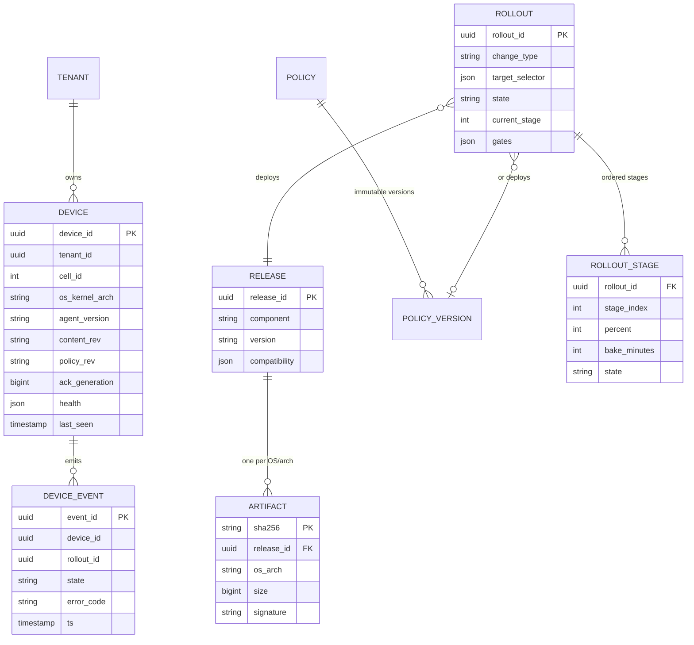
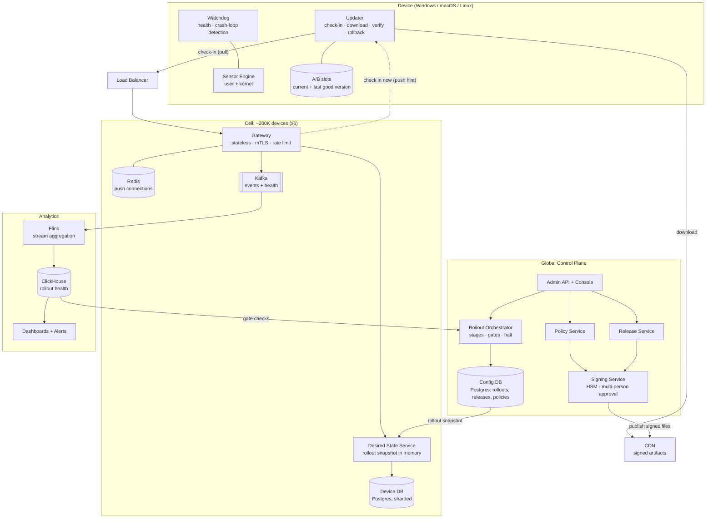
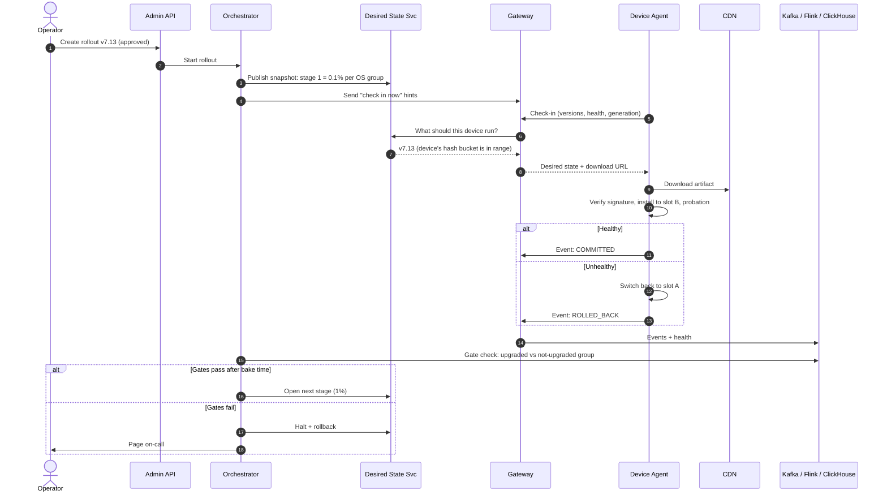
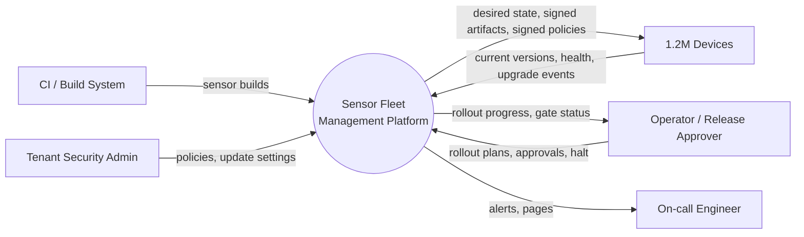
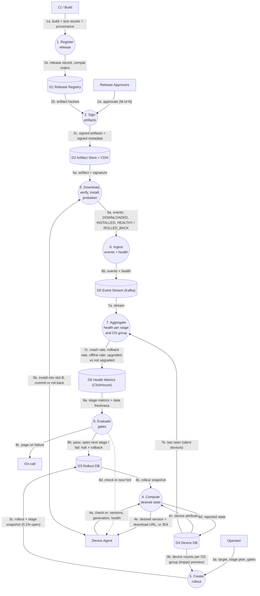
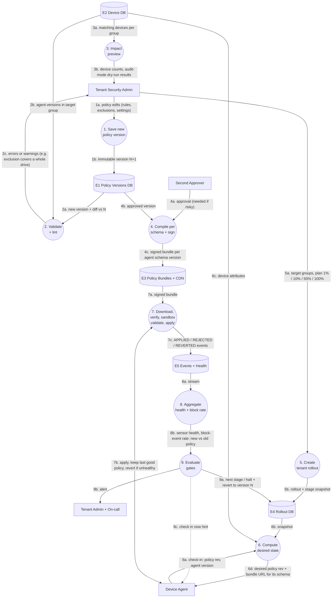
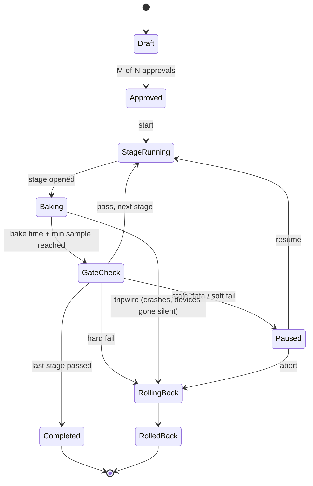

# 50-Minute Lead / Staff System Design Playbook: Sensor Fleet Management

Companion to [sensor-fleet-management-system-design.md](sensor-fleet-management-system-design.md). That doc is everything you *know*. This doc is what you *say* in 50 minutes and in what order.

Target level: **Lead (e.g. Salesforce LMTS) to Staff**.

**How this playbook is built:** it follows the **traditional system design skeleton** that interviewers score against (requirements → estimates → APIs → data model → high-level design → deep dives → scaling and bottlenecks → wrap). The Lead/Staff signal comes from *what you choose to go deep on* (rollout safety), not from skipping the basics. Cover the basics quickly and cleanly, then spend the depth on safety.

---

## The One Thing to Remember

Do the standard steps, but **name the real problem early**:

> "1.2M devices is about 4K check-ins per second and a few GB of state, which is manageable. The hard part is that we're shipping kernel-level code to 1.2M machines. One bad update can brick the fleet (the CrowdStrike July 2024 incident is the example), and whoever controls this system can run code everywhere. I'll cover the standard design first, then go deep on safe rollouts."

---

## Time Plan (50 min)

| Min | Phase | Board output |
|---|---|---|
| 0–5 | 1. Requirements | Functional + non-functional bullets |
| 5–8 | 2. Capacity estimates | 4–5 numbers |
| 8–12 | 3. API design | Device APIs + admin APIs |
| 12–16 | 4. Data model + storage choice | 5–6 tables, which DB and why |
| 16–24 | 5. High-level design + main flow | Architecture diagram + sequence of one rollout |
| 24–38 | 6. Deep dives | Rollout engine, canary groups and gates, on-device safety |
| 38–45 | 7. Scaling, bottlenecks, failures, security | Scaling table + failure table |
| 45–50 | 8. Trade-offs + wrap | 3 trade-offs, what's next |

**Clock checkpoints: 12, 24, 38, 45.**
- Behind at 24: cut deep dive C to 2 minutes.
- Behind at 38: give 4 failure one-liners and go to trade-offs.
- Ahead at 38: ask "Is there an area you'd like more depth on?"

---

## 1. Requirements (0–5 min)

Ask 4–5 questions, then **state assumptions and move on**.

1. "Vendor platform with many customer tenants, or one company's fleet?" (Assume multi-tenant.)
2. "What do we ship: agent binaries only, or also detection content and policy?" (Assume all three.)
3. "Do sensors have kernel components?" (Assume yes.)
4. "Restricted or air-gapped networks?" (Assume some.)
5. "How fast must an urgent detection update reach the fleet?" (Assume hours.)

Write on the board:

```
Functional
  - Enroll devices, keep inventory
  - Upgrade sensor software remotely
  - Distribute security policy + detection content
  - Progressive rollout with health checks, pause, rollback, kill switch
  - Devices report health
  - Dashboard for rollout progress

Non-functional
  - 1.2M devices, many OSes, unreliable networks
  - Devices stay protected even if our backend is down
  - Kill switch reaches online devices in < 60 s
  - Everything signed and authenticated
  - Offline devices catch up when they return
```

## 2. Capacity Estimates (5–8 min)

| Item | Math | Result |
|---|---|---|
| Check-in QPS | 1.2M devices / 300 s | **~4K rps** avg, design for **40K** (reconnect storm) |
| Push connections | ~75% online | **~900K** long-lived connections, ~40 gateway nodes at ~50K each with headroom |
| Device state storage | 1.2M × 4 KB | **~5 GB** |
| Health telemetry | 4K/s × 2 KB | **~8 MB/s**, ~0.7 TB/day |
| Artifact bandwidth | 80 MB × 900K devices in 1 day | **~7 Gbps**, so use a CDN |

Conclusion to say out loud: "QPS and storage are moderate. Bandwidth needs a CDN. The real risk is safety, which I'll focus on in the deep dives."

## 3. API Design (8–12 min)

**Device-facing** (mTLS, device certificate):

| API | Request | Response |
|---|---|---|
| `POST /v1/enroll` | tenant token, public key (CSR), device info | device cert, device_id, assigned cell |
| `POST /v1/checkin` | device_id, current versions (agent, content, policy), last applied generation, health summary | desired versions + download URLs + new generation, or **304 Not Modified**, plus next check-in time |
| `POST /v1/events` | batch of `{event_id, rollout_id, state, error}` | 200 (idempotent by event_id) |
| `GET cdn/sha256/{hash}` | | signed artifact (from CDN) |
| `WS /v1/notify` | | "check in now" hints only |

**Admin-facing** (SSO + role-based access, every call audited):

| API | Purpose |
|---|---|
| `POST /v1/releases` | Register a build (CI only) |
| `POST /v1/policies/{id}/versions` | New immutable policy version, returns validation + impact preview |
| `POST /v1/rollouts` | `{release or policy, target selector, stage plan, gates}` |
| `POST /v1/rollouts/{id}:approve / :pause / :resume / :rollback` | Lifecycle |
| `GET /v1/rollouts/{id}/progress` | Funnel + gate status per stage and OS group |
| `POST /v1/halt` | Kill switch |

Point to make: "Check-in uses a **generation number** like an ETag. If nothing changed, the server returns 304. That keeps 4K rps cheap."

## 4. Data Model and Storage (12–16 min)



**Which store and why:**

| Data | Store | Why | Partition / index |
|---|---|---|---|
| Rollouts, releases, policies, approvals | **Postgres** (global, HA) | Small, relational, needs transactions | Index on state, tenant |
| Devices (inventory + reported state) | **Postgres per cell**, sharded | ~5 GB total, frequent updates, ops queries | Shard by `hash(device_id)`. Index on tenant, OS group, last_seen |
| Device events + health | **Kafka → ClickHouse** | High write volume, aggregations by rollout/stage/OS | Kafka partition by device_id. ClickHouse ordered by (rollout_id, os_group, ts) |
| Artifacts | **Object storage + CDN** | Large, immutable, cached at the edge | Key = content hash |
| Push connection registry | **Redis** | Short-lived, high churn | Key = device_id → gateway node |
| Audit log | Append-only store + write-once (WORM) object storage | Tamper evidence | By time |

## 5. High-Level Design (16–24 min)

### 5.1 Architecture

Draw this:



Explain in 4 sentences:
1. "Devices **pull** their desired state through stateless gateways. Push is only a hint to check in sooner."
2. "The **Desired State Service** decides what each device should run, using an in-memory rollout snapshot. No DB write per device when a stage opens."
3. "Binaries and policies are **signed** by a separate signing service and served from a **CDN**."
4. "Health flows through **Kafka → Flink → ClickHouse**, and the **Orchestrator** uses it to advance or halt rollouts."

### 5.2 Main Flow: One Rollout



### 5.3 Data Flow Diagrams (DFD)

How to read them:

| Shape | Meaning |
|---|---|
| Rectangle | External actor (person or system outside our platform) |
| Circle | Process (something that transforms data) |
| Cylinder | Data store |
| Arrow label | The data that moves, numbered in order |

#### Level 0: Context (whole system as one box)



#### Level 1: Sensor Upgrade Data Flow



| Step | What happens |
|---|---|
| 1 | CI registers a tested build. Release record + compatibility matrix stored in D1. |
| 2 | After multi-person approval, the signing service signs artifacts and metadata, which are published to D2 (CDN). |
| 3 | Operator creates a rollout. Impact preview reads device counts from D4. Stage 1 (0.1% per OS group) is written to D3. |
| 4 | On check-in, the device sends its versions and health. The service reads the rollout snapshot (D3) and device attributes (D4), saves reported state, and returns the desired version or 304. |
| 5 | Device downloads from CDN, verifies signature and hash, installs into slot B, runs probation, then commits or switches back to slot A. |
| 6 | Device reports each step as an idempotent event. Events go to Kafka (D5). |
| 7 | Flink computes per-stage, per-OS-group health for upgraded vs not-upgraded devices. Devices that went silent count as failures. Stored in D6. |
| 8 | Orchestrator checks gates after bake time + minimum sample size. Pass: open next stage in D3. Fail: halt, rollback, page on-call, push hints. **The loop 4 → 8 repeats for every stage.** |

#### Level 1: Config / Policy Rollout Data Flow



| Step | What happens |
|---|---|
| 1 | Admin saves a policy. It becomes a new immutable version in E1. |
| 2 | Validated against the schema of **every agent version** in the target group, then linted for dangerous rules (e.g. excluding a whole drive, disabling protection). |
| 3 | Impact preview: how many devices match, and optionally a dry run in audit mode (log what *would* be blocked). |
| 4 | Risky changes need a second approver. Compiler builds one bundle per agent schema version and signs it with the policy key. Stored in E3. |
| 5 | Per-tenant rollout, faster than binaries: e.g. 1% → 10% → 50% → 100% over about an hour. |
| 6 | Device checks in and gets the policy revision + the bundle that matches its agent version. |
| 7 | Device verifies signature, validates in a sandbox, applies, keeps the previous policy as last good, reverts on its own if the sensor becomes unhealthy. |
| 8 | Flink compares sensor health and **block-event rate** for new vs old policy. A jump in blocks means the policy is probably breaking business apps. |
| 9 | Pass: next stage. Fail: halt and roll back to version N (which is just another rollout), alert tenant admin and on-call. |

#### Upgrade vs Policy: Key Differences

| | Sensor upgrade | Policy rollout |
|---|---|---|
| Who starts it | Vendor operator | Usually tenant admin |
| Scope | Whole fleet, across tenants | One tenant |
| Speed | Days to weeks | Minutes to an hour |
| Size | ~80 MB (or ~15 MB delta) | ~200 KB (deltas a few KB) |
| On device | A/B slots, may need reboot | Hot swap, keep last good policy |
| Main extra gate | Crash rate, boot failures, devices gone silent | Block-event rate (is it breaking apps?) |
| Extra checks before rollout | Test matrix on every OS/kernel | Schema check per agent version, lint, impact preview, dry run |
| Signing key | Code-signing key | Separate policy key |

In the interview, draw the **Level 1 Sensor Upgrade DFD** (or the sequence diagram, not both). For policy, say "same loop, with these differences" and use the table above.

## 6. Deep Dives (24–38 min)

Say: **"I'd like to go deep on rollout safety, since that's where the risk is. Would you rather I cover something else?"**

### A. Rollout engine (~5 min)



- Rings: lab → 0.1% → 1% → 10% → 50% → 100%.
- Durable workflow (Temporal-style), idempotent steps, one writer per rollout.
- Guardrails enforced in code: max % of fleet changing per hour, one rollout per component per OS group, freeze windows, kill switch.
- Halt = stop new devices. Rollback = new rollout to previous version. Fix-forward = most common for content.

### B. Choosing canary devices and health gates (~5 min)

- Cohort = `hash(device_id, rollout_salt) mod 10000`, **spread evenly across each OS/kernel group**. Widening only adds buckets, so devices never flip back. Rare kernels get a minimum count.
- Gates compare **upgraded vs not-upgraded devices** in the same OS group and time window. This cancels noise like Patch Tuesday.
- Advance only after **bake time AND minimum sample size**. 0.1% only catches catastrophic bugs. 1% (~12K) catches about a 2x crash increase in a day.
- **Missing data = pause, never pass.**
- **Silence after an update is a failure signal.** A crashed device can't report.

### C. On-device safety (~4 min)

- Separate processes: updater / sensor / watchdog / content validator.
- A/B slots, probation window, automatic local rollback.
- **Boot-loop counter**: 2 failed boots means the next boot loads the last good version in safe mode, and the updater stays alive. "A bricked device becomes a reachable one."
- **Validate content in a sandboxed user-mode process before kernel code reads it.** Direct lesson from CrowdStrike.

## 7. Scaling, Bottlenecks, Failures, Security (38–45 min)

### 7.1 Scaling (the traditional checklist, ~2 min)

| Concern | Solution |
|---|---|
| Check-in load | Stateless gateways behind load balancers, autoscale, 304 responses |
| Hot reads | Rollout snapshot cached in memory in every Desired State instance |
| DB scale | Shard device DB by device_id, read replicas, one DB per cell |
| Write spikes | Kafka buffers events and health |
| Bandwidth | CDN + binary deltas + on-prem relay for restricted networks |
| Reconnect storm | Random jitter, rate limiting with `429 Retry-After`, exponential backoff |
| Growth to 5M | Add cells (~200K devices each) |
| Region failure | Cells per region, failover to paired region |

### 7.2 Failures (~3 min, one line each)

| Scenario | Answer |
|---|---|
| Device offline 3 weeks | Converges to *current* desired state on return. Keeps last good policy meanwhile. |
| Backend down | Devices keep protecting. Nothing new rolls out. |
| Telemetry down | Gates can't pass, rollouts pause. |
| Bad content crashes kernel | Sandbox validation, rings, boot-loop safe mode, silence tripwire. |
| Bad policy blocks business apps | Linting, impact preview, dry run in audit mode, per-tenant rings. |
| Orchestrator crash | Durable workflow, idempotent steps. |

### 7.3 Security (~2 min)

- **Signing is separate from distribution**: HSM, multi-person approval, TUF-style metadata, root key pinned on device. "A hacked backend still can't sign code."
- mTLS with short-lived device certs, minimum-version floor against downgrade attacks, role-based access, append-only audit log.

## 8. Trade-offs and Wrap (45–50 min)

1. **Pull + push hint vs pure push:** pull works through NAT and for offline devices. Push alone isn't idempotent.
2. **Compute desired state on read vs store per device:** avoids 1.2M writes per stage. Cost: need an "explain this device's state" debug tool.
3. **Ringed content vs instant content:** costs 1–3 hours on urgent detections, prevents a CrowdStrike-style outage.
4. **Cells vs one big cluster:** more ops work, smaller blast radius.

Close: "Next I'd go into gate statistics, the policy compiler for mixed agent versions, and moving logic out of the kernel (eBPF, system extensions)."

---

## Lead vs Staff vs Senior

| Senior | Lead (LMTS) | Staff |
|---|---|---|
| Good boxes, misses APIs/data model or safety | Full standard skeleton, clean APIs and schema, clear trade-offs | Same skeleton, plus names safety as the real problem early |
| "Canary then full rollout" | Rings with health checks and rollback | Even spread across OS groups, compare against non-upgraded devices, sample size, missing data = pause |
| Server-side rollback | Device keeps old version | Device rolls back by itself, boot-loop safe mode |
| "Sign the binaries" | Signed artifacts, mTLS, role-based access | Signing separate from distribution, survives backend compromise |
| Answers questions | Drives the session, manages time | Also covers operating and evolving the platform |

For a Lead interview, **don't skip the standard steps**. Interviewers look for APIs, data model and scaling. Then add a few Staff points (safety framing, silence after an update as a failure signal, sandboxed content validation) to stand out.

---

## Likely Follow-Ups With Short Answers

**"Why Postgres for devices and not Cassandra/DynamoDB?"**
5 GB total and ~4K writes/s split across 6 cells is small. Postgres gives transactions and flexible ops queries. If writes grow 10x, move device state to a wide-column store.

**"How do you shard?"**
First by cell (~200K devices), then by `hash(device_id)` inside the cell. Kafka partitioned by device_id to keep per-device ordering.

**"What do you cache?"**
Rollout snapshots in memory (read on every check-in), 304 responses via generation numbers, artifacts on the CDN.

**"A 0-day is spreading. Content everywhere in 30 minutes?"**
Compressed rings: lab 5 min, 1% 10 min, 10% 10 min, then the rest, with only tripwire gates. Never skip rings. It's a business trade-off that should be agreed in advance.

**"How do you know an upgrade is bad if the device crashed?"**
Devices that go silent after an update. Compare their rate to devices that weren't upgraded. A spike halts the rollout.

**"Device fully bricked?"**
Boot-loop counter → safe mode with last good version → updater alive → we push a fix.

**"Admin console hacked?"**
They can't sign code (HSM + multi-person approval). Rings and rate limits are enforced in code. The audit log is tamper-evident.

**"10 versions in the field?"**
Compatibility matrix in release metadata, direct upgrade from up to 3 versions back, policy compiled per schema version.

---

## Pitfalls to Avoid

- **Skipping APIs and the data model.** Interviewers look for them even when the "interesting" part is elsewhere.
- Spending more than 5 minutes on requirements or 3 on estimates.
- Drawing 25 boxes before explaining one flow.
- Saying "canary" without saying how you pick devices and how you decide a stage passed.
- Covering only binaries and forgetting content and policy rollouts.
- Forgetting that the device must recover **without** the server.
- Not stating trade-offs. Every choice should come with "the cost is…".
- Not checking in with the interviewer at minutes 12 and 24.

---

## If the Interviewer Steers You

| They push toward | Pivot |
|---|---|
| Scale / storage | Section 7.1 table, shard key, cells. Then: "the bottleneck that matters is risk, not throughput." |
| Security | Section 7.3, plus threats: backend compromise, supply chain, downgrade attack, insider, local tampering. |
| Monitoring | Funnel (notified → downloaded → installed → healthy), per-group gates, ETA, alerts on stuck rollouts. |
| Policy | Immutable versions, compile per schema, lint dangerous rules, impact preview, dry run, per-tenant rings. |
| Product / org | Tenant update channels (early/default/late/pinned), maintenance windows, critical servers go last. |
