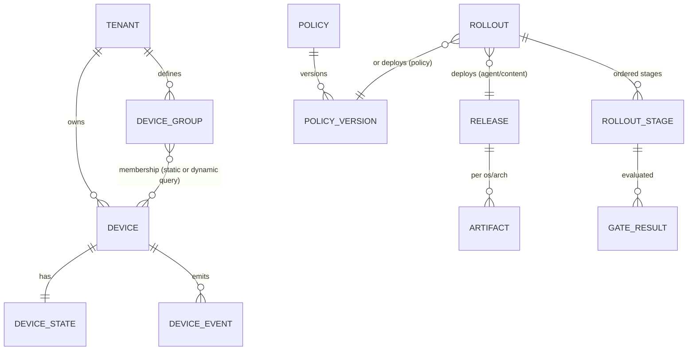
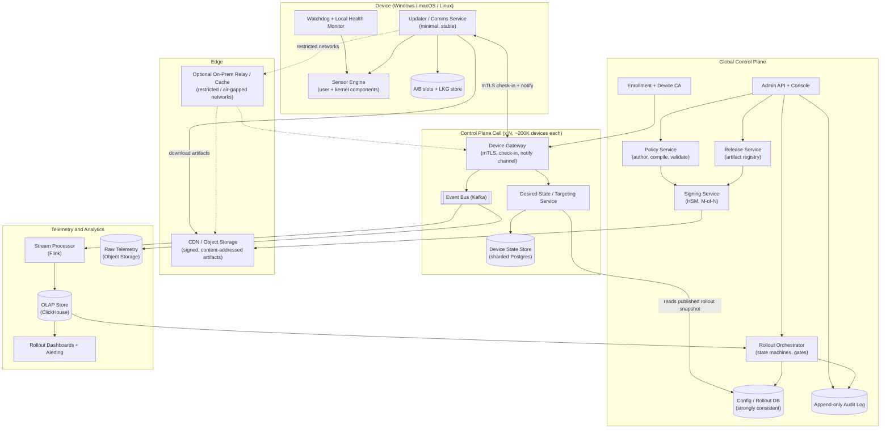
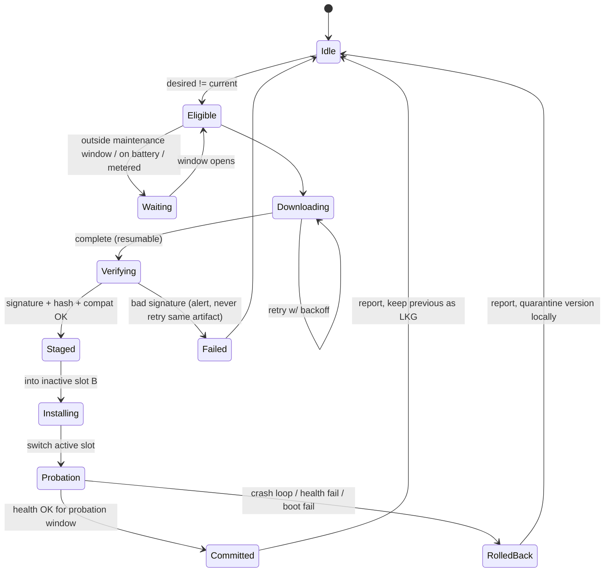
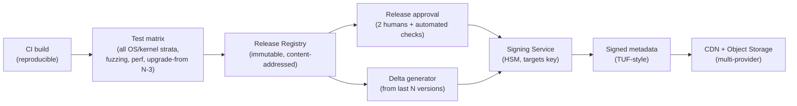
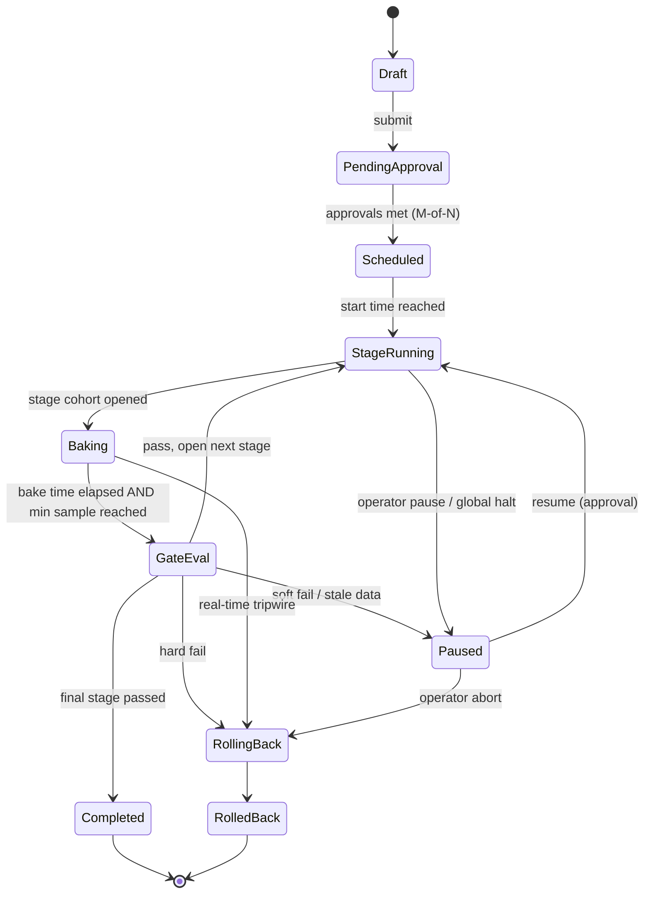
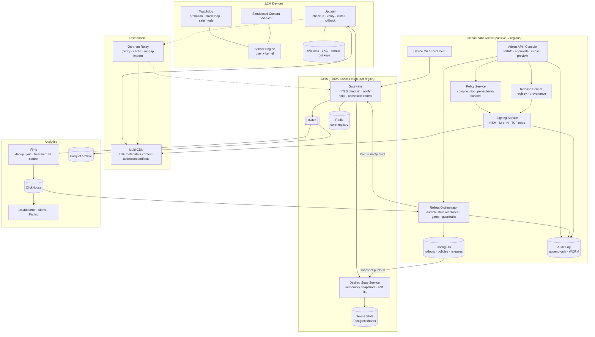

# Sensor Fleet Management Platform: Staff-Level System Design

> Centrally manage security sensors on ~1.2M devices across Windows, macOS and Linux: remote upgrades, policy distribution, progressive rollouts, device health reporting and rollout monitoring. The system must hold up when devices go offline, networks are unreliable, components fail partway, and a release or policy change turns out to be dangerous.

All capacity numbers below are **design assumptions**, not measured data. Items marked **[?]** need validation with real fleet data.

---

## Table of Contents

1. [Framing: What Makes This Hard](#1-framing-what-makes-this-hard)
2. [Requirements](#2-requirements)
3. [Assumptions and Capacity Estimates](#3-assumptions-and-capacity-estimates)
4. [Core Design Principles](#4-core-design-principles)
5. [Domain Model](#5-domain-model)
6. [High-Level Architecture](#6-high-level-architecture)
7. [Component Deep Dives](#7-component-deep-dives)
   - 7.1 On-Device Agent
   - 7.2 Enrollment and Device Identity
   - 7.3 Device Gateway and Check-In Protocol
   - 7.4 Desired State / Targeting Service
   - 7.5 Artifact Pipeline and Distribution
   - 7.6 Policy Service
   - 7.7 Rollout Orchestrator
   - 7.8 Health Telemetry Pipeline
   - 7.9 Rollout Monitoring and Analytics
8. [Progressive Rollout Design in Detail](#8-progressive-rollout-design-in-detail)
9. [Failure Modes and How We Handle Them](#9-failure-modes-and-how-we-handle-them)
10. [Security Design and Threat Model](#10-security-design-and-threat-model)
11. [Scalability, Cells and Multi-Region](#11-scalability-cells-and-multi-region)
12. [Data Storage Choices](#12-data-storage-choices)
13. [APIs](#13-apis)
14. [Consistency Model](#14-consistency-model)
15. [Observability and SLOs](#15-observability-and-slos)
16. [Key Trade-offs and Alternatives Considered](#16-key-trade-offs-and-alternatives-considered)
17. [Operating the Platform Itself](#17-operating-the-platform-itself)
18. [Phased Delivery Plan](#18-phased-delivery-plan)
19. [Open Questions](#19-open-questions)
20. [Final System Design](#20-final-system-design)

---

## 1. Framing: What Makes This Hard

At 1.2M devices, **raw throughput is not the hard part**. A few thousand requests per second and a device table of a few GB are both well within reach of standard infrastructure. The hard parts are:

1. **The blast radius is huge.** Security sensors often run with kernel privileges. One bad sensor binary or content/policy file can crash or brick a large share of the fleet within minutes. The July 2024 CrowdStrike Channel File 291 incident is the reference case: one content update, pushed to the whole fleet at once, crashed millions of Windows hosts, and many could only be fixed by hand. **Safety is the main design driver.**
2. **The control plane can run code on 1.2M machines.** It is a very attractive target for attackers. If it is compromised, it becomes a fleet-wide malware delivery system.
3. **The fleet is heterogeneous and only eventually reachable.** It spans many OSes, OS versions, kernels, hardware, proxies, NATs, air-gapped segments, laptops that sleep for weeks, and servers with strict change windows. A "deployment" never finishes at one instant. It converges over time.
4. **Recovery has to work when things are already broken.** If a bad update kills the component that receives fixes, we can no longer fix the device remotely.

So the design optimizes for, in order: **safety (do no harm) > security > availability of protection > convergence speed > cost**.

---

## 2. Requirements

### 2.1 Functional

| # | Requirement |
|---|---|
| F1 | Enroll devices securely and keep a live inventory (OS, version, hardware, network, tenant, tags). |
| F2 | Remotely upgrade (and downgrade) the sensor software, including kernel components, per OS/arch. |
| F3 | Author, version, validate and distribute security policies (config, rules, exclusions) to targeted device groups. |
| F4 | Distribute detection content (signatures/rules/models). This is the fast-moving change type. |
| F5 | Run progressive rollouts (rings/waves) for every change type, with automated health gates, pause, resume, abort and rollback. |
| F6 | Devices report health: liveness, sensor status, crashes, resource usage, applied versions, errors. |
| F7 | Monitor rollout progress in real time: per stage, per segment, funnel, failures, ETA. |
| F8 | Fleet-wide emergency stop (kill switch) for any rollout, plus the ability to push a fix fast. |
| F9 | Targeting by tenant, group, tag, OS, version, and arbitrary device attributes. Support pinning and exclusions. |
| F10 | Full audit trail of who changed what, when, and with what approval. |

### 2.2 Non-Functional

| Concern | Target (assumption) |
|---|---|
| Scale | 1.2M devices, design headroom to 5M without re-architecture. |
| Control plane availability | 99.95% for check-in. Devices must stay protected even at 0% control plane availability. |
| Kill-switch latency | Halt propagates to connected devices in < 60 s, and to polling-only devices within one poll interval (≤ 5 min). |
| Policy propagation | p95 < 5 min to online devices after a stage starts. |
| Detection content propagation | Full fleet in hours (not days) for urgent content, still ringed. |
| Agent upgrade rollout | Days to weeks, ringed, respecting maintenance windows. |
| Durability | No lost rollout state, no lost audit records. Telemetry may be sampled. |
| Security | Signed artifacts end to end, mTLS, least privilege, multi-party approval, survives control-plane compromise without fleet-wide code execution. |
| Agent footprint | Check-in and telemetry overhead < 1% CPU, < a few MB/day of bandwidth per device in steady state [?]. |

### 2.3 Out of Scope

- The detection engine itself and the security event (EDR telemetry) data lake. Only **health/management** telemetry is covered here.
- Mobile (iOS/Android) MDM-style management [?].
- Billing and licensing.

---

## 3. Assumptions and Capacity Estimates

| Item | Assumption | Derived |
|---|---|---|
| Devices | 1.2M total, ~75% online at peak | ~900K concurrent online |
| OS mix | Windows majority, then Linux servers, then macOS [?] | ~30+ distinct (OS, version, arch, kernel) strata |
| Check-in interval | 5 min with ±20% jitter | 1.2M / 300 s ≈ **4K req/s avg**. Design for **40K req/s** reconnect storm (10x). |
| Persistent notify channel | Online devices keep one long-lived connection (WebSocket/MQTT over TLS) | ~900K conns. At ~50K conns/node that is ~18 nodes. With N+2 per cell and 50% headroom, **~40 gateway nodes**. |
| Health summary size | ~2 KB compressed, sent with each check-in | ~8 MB/s ingest ≈ **~0.7 TB/day raw**, ~21 TB per 30 days in object storage |
| State-transition events | ~6–10 per device per rollout | ~10M events per full-fleet rollout. Trivial volume. |
| Agent package | ~80 MB full, ~15 MB binary delta [?] | Full fleet: 96 TB full or ~18 TB delta |
| Peak artifact egress | Final stage moves ~900K devices in 24 h on full packages | 72 TB/day ≈ **~6.7 Gbps** average. This belongs on a CDN, not origin. |
| Policy bundle | ~200 KB full, deltas a few KB | Full fleet push ≈ 240 GB |
| Detection content | ~1–20 MB per update, several per day [?] | Delta + CDN mandatory |
| Device state record | ~4 KB | 1.2M × 4 KB ≈ **5 GB**. Fits easily in a sharded relational store. |

**Takeaway:** the data volume is moderate. We pick technologies for correctness, isolation and operability, not for extreme scale.

---

## 4. Core Design Principles

1. **Declarative desired state, pull-based reconciliation.** The server never says "run this command now." It publishes *what each device should be running*. The agent pulls it, reconciles toward it, and reports back. This is idempotent, tolerates offline devices (they converge when they return), and works through NAT/proxies. A push channel only acts as a "check in now" **hint**. It never carries authority.
2. **Every change is a rollout.** Agent binaries, detection content, policy and even "small config flags" all go through the same ringed rollout engine with health gates. There is no unringed fast path. Urgent changes get a *compressed* schedule, not a *skipped* one.
3. **The device is the last line of defense.** The agent verifies signatures itself, validates content before loading it, keeps a last-known-good (LKG) copy, and rolls itself back if health degrades, even with no server contact.
4. **Never break the path to recovery.** The updater/comms component is separate from the sensor engine, minimal, rarely changed, and it survives sensor crashes. Kernel components have boot-loop protection that falls back to safe mode.
5. **Fail closed on rollouts, fail open on protection.** If health data is missing or stale, rollouts pause. If the control plane is down, devices keep enforcing their LKG policy.
6. **Bounded blast radius at every layer.** Rings for changes, cells for the control plane, per-tenant isolation, and a global change-velocity budget.
7. **Trust is split, not centralized.** Signing keys live in HSMs, separate from the servers that distribute content. Any single compromised service should not be enough to execute code on the fleet.

---

## 5. Domain Model



| Entity | Key fields |
|---|---|
| **Device** | `device_id` (UUID), `tenant_id`, `cell_id`, identity cert fingerprint, attributes (os, os_version, kernel, arch, hw_model, region, network_zone, tags), `rollout_bucket` = hash(device_id) mod 10000 |
| **DeviceState** | `reported`: {agent_version, content_rev, policy_rev, health summary, last_seen, upgrade_state}; `desired_generation`; `ack_generation` |
| **Release** | `release_id`, component (`agent` / `content`), semantic version, per-platform artifacts, compatibility matrix (min OS, supported policy schema versions, upgrade-from versions), signed metadata |
| **Artifact** | content hash (SHA-256), size, URL(s), signature, delta bases |
| **PolicyVersion** | immutable, `policy_id`, `version`, `schema_version`, compiled bundle hash, author, approvals |
| **Rollout** | `rollout_id`, change type, target selector, stage plan, gate config, state, approvals, created_by |
| **RolloutStage** | stage index, cohort definition (bucket range per stratum), bake time, gate thresholds, state, start/end |
| **DeviceEvent** | idempotent event_id, device_id, rollout_id, transition (e.g. `DOWNLOADED`, `INSTALLED`, `HEALTHY`, `ROLLED_BACK`), error code, timestamp |

Three change types share one engine but have different default cadences:

| Change type | Risk | Default cadence | Notes |
|---|---|---|---|
| Agent binary (incl. kernel driver) | Highest | 1–3 weeks | Respects maintenance windows. Reboot may be required. |
| Detection content | High (it is parsed by privileged code) | Hours (urgent) to 1 day | Fast but still ringed. Validated on device before load. |
| Policy | Medium (wrong exclusions or blocks can harm the business) | Minutes to hours, per tenant | Usually customer-authored. Ringed within the tenant. |

---

## 6. High-Level Architecture



### Request flow summary

1. **Release:** CI builds sensor → automated test matrix → Release Service registers it → Signing Service signs it (HSM, M-of-N for production keys) → artifacts uploaded to CDN by content hash.
2. **Rollout creation:** an operator creates a rollout (release + targets + stage plan). It needs approval. The Orchestrator persists the state machine and publishes a **rollout snapshot** (which buckets in which strata are eligible) to the config DB.
3. **Check-in:** the agent calls the Gateway (mTLS) with its reported state + health summary. The Desired State Service computes the device's desired state from the rollout snapshot and device attributes. If it changed, it returns a signed manifest; otherwise it returns `304 Not Modified` with the next poll time.
4. **Reconcile:** the agent downloads the artifact from the CDN, verifies the signature chain and hash, installs into the inactive slot, switches, runs a probation health check, then commits or rolls back locally. It reports each transition as an idempotent event.
5. **Observe:** events and health go to Kafka → Flink computes per-rollout, per-stage, per-stratum health → ClickHouse. The Orchestrator queries it to evaluate gates. Dashboards show progress.
6. **Advance or halt:** gates pass → next stage after bake time. Gates fail → auto-pause (or auto-rollback), page on-call, and push a notify hint so devices check in and pick up the halt.

---

## 7. Component Deep Dives

### 7.1 On-Device Agent

The agent is split into processes with different risk profiles:

| Component | Responsibility | Change frequency | Privilege |
|---|---|---|---|
| **Updater / Comms** | Check-in, notify channel, download, verify, install, rollback, report | Rare (quarterly) [?], gets its own extra-conservative rollout | Service/root, user mode |
| **Sensor Engine** | Detection, prevention, kernel driver/system extension/eBPF | Frequent | Kernel + user mode |
| **Watchdog** | Liveness of the engine, crash counting, resource limits, triggers rollback | Rare | Service/root |
| **Content Validator** | Parses and validates new content/policy in a sandboxed user-mode process *before* kernel components load it | With engine | Low-privilege sandbox |

**Local state machine for an upgrade:**



**Key on-device safety mechanisms:**

- **A/B slots + LKG.** The previous version stays on disk until the next successful upgrade. Rollback is a local slot switch and needs no network.
- **Probation window** (e.g. 30 min for agent, 10 min for content [?]): the watchdog checks process liveness, crash count, CPU/memory budgets, driver load status and a self-test. On failure it auto-reverts and marks the version **locally quarantined**, so the device will not retry it until the server sends a *new* generation.
- **Boot-loop protection for kernel components.** The driver writes a "boot attempt" counter to persistent storage early in init and clears it after reaching a healthy state. If N (e.g. 2) consecutive boots fail to reach healthy, the next boot loads the driver in **safe mode**: it ignores the newest content/driver, uses LKG, and keeps the updater alive so the server can deliver a fix. This turns a bricked device into a degraded-but-reachable device.
- **Content validated before privileged use.** New content/policy is parsed by a fuzz-tested user-mode validator against the schema for the *running* engine version. Kernel code only consumes pre-validated, versioned, bounds-checked formats. A malformed file is rejected and reported, never loaded.
- **Signature verification on device** against a pinned root of trust shipped with the agent (see §10). The device does not trust the server, only signatures.
- **Resource governance:** download bandwidth caps, CPU niceness, respect for battery/metered connections and maintenance windows (servers), and staggered reboot prompts.
- **Bounded local queue** for events while offline (e.g. last 7 days or 5 MB, oldest health samples dropped first, state transitions kept).

### 7.2 Enrollment and Device Identity

- The installer carries a **tenant enrollment token** (short-lived, scoped, revocable). On first run the agent generates a keypair, **in TPM / Secure Enclave when available**, otherwise in OS-protected storage.
- `POST /enroll` with token + CSR + device attestation (where supported). The Device CA issues a short-lived **device certificate** (e.g. 30 days) that binds `device_id`, `tenant_id`, `cell_id`. The agent rotates it automatically. Expired certs get a re-enrollment path that requires proof of the old key.
- The device is assigned to a **cell** (§11). The cell endpoint is in the cert and in a signed bootstrap config, so routing is sticky and verifiable.
- Duplicate detection: cloned VM images produce many devices with the same key or hardware ID. The gateway detects concurrent sessions with one identity and forces re-keying.

### 7.3 Device Gateway and Check-In Protocol

Two channels:

1. **Check-in (authoritative, pull):** HTTPS + mTLS, every 5 min ± jitter (adaptive: slower when the device is idle and nothing is in flight, faster while the device is part of an active stage).
2. **Notify channel (hint, push):** long-lived WebSocket/MQTT over TLS. It carries only `{"type":"checkin_now","generation":N}`. If it is blocked by a proxy, the device still converges through polling. This channel is what makes the < 60 s kill switch possible.

**Check-in request (simplified):**

```json
{
  "device_id": "…",
  "agent_version": "7.12.3",
  "content_rev": "c-20261109-04",
  "policy_rev": "p-tenantA-118",
  "ack_generation": 4211,
  "upgrade_state": {"rollout_id": "r-889", "state": "PROBATION"},
  "health": {"sensor_up": true, "crashes_24h": 0, "cpu_p95": 1.8, "mem_mb": 140, "driver": "loaded", "errors": []},
  "attrs_hash": "…"
}
```

**Response:**

```json
{
  "generation": 4212,
  "desired": {
    "agent":   {"version": "7.13.0", "manifest_url": "…", "rollout_id": "r-901", "window": "tenant-default"},
    "content": {"rev": "c-20261109-05", "manifest_url": "…"},
    "policy":  {"rev": "p-tenantA-119", "manifest_url": "…"}
  },
  "directives": {"halt": ["r-889"]},
  "next_checkin_s": 280
}
```

Design notes:

- **Generation numbers / ETags.** The device sends the generation it has applied. The server returns `304` if nothing changed. Most check-ins are tiny and cheap.
- **Stateless gateways.** Any gateway in the cell can serve any device. Notify-channel connections are registered in a small connection registry (Redis) so the orchestrator can fan out hints.
- **Admission control and backpressure.** Per-cell token bucket. Over limit, the gateway returns `429 Retry-After` with randomized delay. Agents use **exponential backoff with full jitter**. Health summaries are dropped before state transitions when shedding load.
- **Reconnect storm handling** (e.g. Monday 9 am, or after a regional outage): jitter, `Retry-After`, notify-channel reconnect spread over minutes, and gateways that can answer `304` from a cache without touching the DB.

### 7.4 Desired State / Targeting Service

It answers: "for this device, right now, what should it run?"

```
desired(device) = resolve(
    tenant pins / exclusions,          # e.g. tenant pinned to N-1, legal hold
    active rollouts whose target selector matches device attributes,
    rollout stage snapshot: is hash(device_id, rollout_salt) mod 10000 within the
        bucket range opened for the device's stratum?,
    compatibility matrix (OS/kernel support, upgrade-from path, policy schema),
    global halt list
)
```

- **Computed on read, not materialized per device.** Rollout snapshots are small (a few KB per rollout). Every Desired State instance keeps them in memory and refreshes them via watch/pubsub from the config DB. Computing desired state is pure, deterministic and sub-millisecond, and it scales horizontally. Per-device materialization (1.2M writes every time a stage opens) is avoided.
- **Deterministic cohorts.** `hash(device_id, rollout_salt)` gives stable, uniformly distributed buckets. Widening a stage only *adds* buckets, so devices never flip back and forth. A per-rollout salt means the same devices are not always the canaries.
- **Version-skew aware.** If a device is offline at v7.10 and the target is v7.13, the compatibility matrix decides between a direct upgrade or a stepping-stone version. The default is to support direct upgrade from N-3 [?].
- **Precedence** (highest first): global halt > emergency rollback > tenant pin/exclusion > active rollout > tenant default channel.

### 7.5 Artifact Pipeline and Distribution



- **Content-addressed, immutable artifacts** (`/sha256/<hash>`). They are cacheable forever, safe on any CDN, and they make relays simple.
- **TUF-style metadata** (The Update Framework): separate `root`, `targets`, `snapshot`, `timestamp` roles and keys. This protects against rollback attacks (serving an old vulnerable version), freeze attacks (hiding new updates), and mix-and-match attacks. The device verifies the chain from a pinned root.
- **Deltas** (binary diff from the last few versions) cut bandwidth ~5x [?]. If a delta fails to apply, the agent falls back to the full package.
- **Resumable downloads** (HTTP range), per-device bandwidth caps, and randomized start within the stage window.
- **Restricted networks:** an optional **on-prem relay** caches artifacts and proxies check-ins. Since artifacts are signed end to end, the relay is untrusted for integrity. For **air-gapped** sites, use signed offline bundles that are imported into the relay.
- **Multi-CDN** with origin fallback. Availability of artifacts is independent of the control plane.

### 7.6 Policy Service

- **Authoring:** the console or API (policy-as-code supported: Git-backed YAML with PR review).
- **Immutable versions.** Every save creates a new `PolicyVersion`. Rollback means rolling forward to an earlier version's content.
- **Compile and validate pipeline:**
  1. Schema validation against every **agent version present in the target set**. The compiler emits per-schema-version bundles, and the Desired State service serves the compatible variant.
  2. **Semantic linting / safety checks:** e.g. "exclusion covers `C:\` or `/`", "blocks a system binary", "disables tamper protection fleet-wide", "isolates more than X% of hosts". Dangerous diffs require extra approval.
  3. **Impact preview:** how many devices match, plus a dry run of the new policy in "audit mode" on canary devices where it makes sense (log what *would* be blocked).
- **Signing:** policy bundles are signed with a dedicated policy key (separate from the code-signing key) so the agent can verify them.
- **Delivery:** policy changes are rollouts too. Default plan per tenant: 1% → 10% → 50% → 100% over ~1 hour, with gates on sensor health and "block event rate" anomalies (a spike in blocks after a policy change suggests it is breaking business apps). Tenants can choose faster or slower plans within platform limits.

### 7.7 Rollout Orchestrator

The brain of safe change. It is a **durable state machine per rollout**, run on a workflow engine (Temporal or an equivalent in-house design: DB-persisted state + leader-elected workers + idempotent steps).



Responsibilities:

- Persist the rollout plan and state transitions (in a strongly consistent DB, with audit).
- Open stages by publishing a new **rollout snapshot version** (bucket ranges per stratum).
- Evaluate gates by querying the analytics store (§7.9). Gates **fail closed**: if the data is stale (watermark older than threshold) or the sample is too small, the result is "not yet", never "pass".
- **Real-time tripwires** run continuously, not only at stage boundaries (e.g. post-upgrade offline rate spikes). They can halt mid-bake.
- On halt: update the snapshot (no new devices enter), add to global halt list, send notify hints to connected devices in the affected cohort, page on-call.
- On rollback: set desired state for affected devices to the previous version/rev (which is still signed and still in the allowed version set) as a **new, high-priority rollout** with a compressed schedule. Rolling back is also a change, but its risk is lower because the previous version was proven on these devices.
- **Global guardrails** enforced by the orchestrator regardless of rollout config:
  - **Change-velocity budget:** at most X% of the fleet may enter a new version per hour across all rollouts (e.g. 10%/h agent, 25%/h content [?]).
  - **One active rollout per component per stratum**, so a regression can be attributed to one change.
  - **No stage can skip the canary ring.** Emergency plans compress bake time but keep the ring order.
  - **Freeze windows** (holidays, major customer events) block non-emergency rollouts.

### 7.8 Health Telemetry Pipeline

- Health summaries arrive with check-ins. State-transition events are sent immediately (or queued if offline).
- Gateway → **Kafka** (partitioned by `device_id`, topics per cell) → **Flink** jobs:
  - Dedup by `event_id` (agents retry, so delivery is at-least-once).
  - Join with the device dimension (stratum, tenant, rollout membership, current version).
  - Compute rolling windows per `(rollout, stage, stratum, version)`: install success rate, crash rate, offline-after-upgrade rate, CPU/mem p95, boot-loop/safe-mode count, rollback count, block-event rate.
  - Compute the same metrics for a **control cohort**: devices in the same stratum not yet upgraded.
- Output to **ClickHouse** for gates and dashboards. Raw data goes to object storage (Parquet) for forensics.
- **Liveness tracking:** a "last seen" sweep finds devices that went silent *after* receiving a change. **Silence after an update is treated as a failure signal**, because a crashed or bricked device cannot report that it crashed.

### 7.9 Rollout Monitoring and Analytics

Per-rollout view:

```
Rollout r-901  agent 7.12.3 → 7.13.0   Stage 3/5 (25%)   State: BAKING (2h10m / 6h)
Targeted: 1,183,400   Eligible now: 295,850
Funnel:   Notified 281,002 → Downloaded 270,114 → Installed 262,551 → Healthy 261,980
          Failed 312   Rolled back 259   Offline since change 1,140 (0.43%, control 0.39%)
Gates:    crash rate  0.021% vs control 0.019%   PASS (p=0.41)
          offline-after-upgrade  +0.04pp           PASS
          cpu p95  +0.3%                           PASS
          safe-mode boots  0                       PASS
Worst strata: linux/rhel8/4.18.0-477 rollback 0.9% (n=2,140)  ⚠ watch
ETA to 100%: ~2.5 days (maintenance windows considered)
```

(The numbers above are illustrative, not real data.)

- Breakdowns by stratum, tenant, region, network zone and error code. Drill down to device lists.
- **Alerting:** gate failures, tripwires, stuck rollouts (no progress in X hours), a high count of quarantined versions, rising safe-mode boots fleet-wide even without an active rollout.
- **Fleet posture view:** version distribution, % on supported versions, policy drift (desired vs reported), devices not seen in > 7/30 days.

---

## 8. Progressive Rollout Design in Detail

### 8.1 Rings

| Ring | Population | Purpose | Agent bake (default) | Content bake (urgent) |
|---|---|---|---|---|
| R0 Internal | Vendor's own fleet + lab farm covering every stratum | Catch obvious breakage | 24 h | 15 min |
| R1 Canary | 0.1% (~1.2K devices), stratified, opted-in customers first | Catch catastrophic issues on real diversity | 24 h | 30 min |
| R2 Early | 1% (~12K) | Statistically meaningful for moderate regressions | 48 h | 1 h |
| R3 Broad | 10% (~120K) | Long-tail strata | 48 h | 1 h |
| R4 Majority | 50% | Capacity / scale effects | 24 h | 1 h |
| R5 Full | 100% (including tenants who chose "late adopter") | | | |

- **Stratified selection:** each ring takes the same percentage *within each stratum* (OS × version × kernel × arch, plus tenant-type for important dimensions), with a **minimum count per stratum** so that rare kernels are actually represented early. Very small strata are handled through the lab farm and explicit opt-in.
- **Tenant controls:** tenants can choose an update channel (`early`, `default`, `late`, `pinned N-1`) and mark critical groups (e.g. domain controllers, production databases) to receive changes only in the last ring and only in their maintenance windows.

### 8.2 Health Gates

Gates compare the **treatment cohort** (upgraded) to a **control cohort** (same stratum, not upgraded, same time window). This cancels out fleet-wide noise such as a Windows Patch Tuesday.

| Signal | Type | Example threshold [?] |
|---|---|---|
| Install success rate | absolute | ≥ 99.5% (excluding "deferred by window") |
| Agent/engine crash rate | relative vs control | not significantly worse (one-sided test, p < 0.01) and < 1.5x |
| Kernel crash / boot failure / safe-mode boots | absolute tripwire | > 0 in R0/R1 halts; > 0.01% halts later |
| Offline-after-change rate | relative | < control + 0.1pp within 2 h of change |
| Local rollback rate | absolute | < 0.5% |
| CPU / memory p95 | relative | < +10% |
| Detection efficacy (test events detected) | absolute | 100% of canary test signals |
| Block-event rate (policy) | relative | < 3x control |

**Sample size awareness:** at R1 (~1.2K devices) only large regressions are detectable. If baseline crash rate is ~0.1%/day [?], we expect ~1 crash/day, so R1 mainly catches "it is broken on stratum X". R2 at ~12K devices gives ~12 expected crashes/day, enough to detect roughly a 2x regression within a day. Gate configs must state the minimum sample size, and the orchestrator does not advance until it is reached. This is why bake times are tied to observed sample counts, not just wall-clock time.

### 8.3 Halt and Rollback Semantics

- **Halt** = stop admitting new devices. Devices that already upgraded stay where they are (often the safer option: a bad rollback can be worse than a minor regression).
- **Rollback** = new desired state pointing to the previous version for the affected cohort. Devices that already rolled back locally simply confirm.
- **Kill switch** = global halt of *all* rollouts for a component. It is one API call (with 2-person approval, or 1-person for on-call in emergency, with audit and after-the-fact review). It propagates through the notify channel in seconds and through polling in ≤ 1 interval.
- **Fix-forward** = a new release through a compressed ring plan. This is the most common response for content issues.

---

## 9. Failure Modes and How We Handle Them

| Failure | Impact without mitigation | Mitigation |
|---|---|---|
| **Device offline for days/weeks** | Misses updates, sees stale policy | Declarative state: on return it converges straight to the *current* desired state (no replay). Compatibility matrix handles version skew. LKG policy enforced while offline. Stale devices are flagged in posture views. |
| **Flaky / slow / proxied network** | Partial downloads, timeouts | Resumable downloads, hash verification, backoff with jitter, CDN close to the device, proxy support, on-prem relay, adaptive poll interval. |
| **Notify channel blocked** | Slower propagation | Polling is authoritative. Notify is only an optimization. |
| **Reconnect storm** (e.g. after an outage) | Gateway overload, cascading failure | Jitter, admission control, `429 Retry-After`, 304 caching, cell isolation, autoscaling with pre-warmed capacity. |
| **Gateway / Desired State node loss** | Some check-ins fail | Stateless, behind load balancers, N+2 per cell. Agents retry. |
| **Device State DB primary failure** | Writes fail in one cell | Synchronous replica + automatic failover. Check-in degrades to "serve desired state from snapshot, buffer reported state in Kafka". |
| **Orchestrator crash mid-transition** | Rollout stuck or double-advanced | Durable workflow, idempotent steps keyed by `(rollout_id, stage, step)`, leader election with fencing tokens. |
| **Telemetry pipeline lag/outage** | Gates evaluated on stale data | Watermark freshness check. Stale data means gates do not pass, so rollouts pause automatically. Fail closed. |
| **Whole region / cell down** | Devices in that cell cannot check in | Devices keep protecting with LKG. Cell failover to its paired region (state replicated asynchronously; RPO of minutes is fine for desired state because it can be recomputed). Rollouts in other cells are unaffected. |
| **CDN outage** | Downloads fail | Multi-CDN, origin fallback, relays. Rollout funnel shows a download stall and the orchestrator pauses. |
| **Bad agent release** | Crashes, CPU spikes, broken detection | Test matrix → R0 lab → rings → on-device probation + auto-rollback → gates → halt/rollback. |
| **Bad content/policy that crashes kernel component** | BSOD/kernel panic loop, device unreachable | Validation in a user-mode sandbox before load. Rings for content too. Boot-loop counter → safe mode with LKG. Updater stays alive to receive the fix. "Offline-after-change" tripwire halts the rollout within minutes because affected devices go silent. |
| **Bad policy that blocks legitimate apps** | Business outage at the customer | Linting, impact preview, audit-mode dry run, per-tenant rings, block-rate anomaly gate, quick revert to the previous policy version. |
| **Clock skew on devices** | Cert/metadata validation errors, wrong windows | Trusted time from the server (signed timestamp in TUF metadata), tolerance windows, monotonic clocks for local timers. |
| **Corrupt local storage** | Agent cannot start | Integrity checks on startup. Repair from LKG. Re-download. Minimal "recovery mode" updater. |
| **Two rollouts conflicting** | Incompatible versions | Compatibility matrix + one-active-rollout-per-component-per-stratum rule. |
| **Human error** (wrong target selector, e.g. "all tenants") | Huge blast radius | Impact preview with device counts, approval required, global velocity budget, and every rollout still starts at R0/R1 whatever its selector. |

---

## 10. Security Design and Threat Model

### 10.1 Threats

| Threat | Example |
|---|---|
| Control plane compromise | Attacker gets into the admin API or a backend service and tries to push malware to the fleet. |
| Supply chain compromise | Malicious code injected into the build pipeline. |
| Artifact tampering in transit / on CDN | Swap a package on a mirror or relay. |
| Rollback / freeze attack | Serve an old vulnerable agent, or hide a security fix. |
| Device impersonation | Fake devices flood telemetry or poison gates. |
| Malicious insider | One engineer pushes a harmful policy (e.g. exclude everything, disable protection). |
| Local attacker on the device | Kill or tamper with the sensor, block updates, downgrade it. |

### 10.2 Controls

- **Separation of signing and distribution.** Signing keys live in HSMs, inside an isolated Signing Service that only accepts requests from the Release/Policy services *with attached approval proofs*. Production code-signing needs **M-of-N human approval** plus provenance verification. Compromising the control plane servers alone does not give the ability to sign.
- **TUF-style key hierarchy:** offline root keys (in a ceremony, threshold-signed) → online `timestamp`/`snapshot` keys (short expiry) → `targets` keys in the HSM. The agent pins root keys and supports root rotation.
- **Supply chain:** reproducible builds where feasible, SLSA-style provenance attestations, two-person code review, signed commits, isolated build workers, and artifact scanning. The signing service checks provenance before signing.
- **Anti-rollback:** the agent rejects versions below a **signed minimum version floor**. The floor is raised only after a release is complete and is driven by security fixes, so normal rollbacks to N-1 stay possible.
- **Transport:** mTLS everywhere (device ↔ gateway, service ↔ service). Device certs are short-lived and TPM-bound where possible. Certificate pinning for the gateway on the agent.
- **Authorization:** fine-grained RBAC + ABAC (tenant-scoped). Policy authors cannot approve their own change. Platform-wide actions (cross-tenant rollouts, kill switch) need dedicated roles and 2-person approval. Just-in-time elevation for operators.
- **Guardrails in code, not only in process:** the orchestrator enforces ring order, velocity budget and freeze windows; these cannot be overridden by a single admin. On the device, the agent refuses to *disable itself* or uninstall unless the instruction carries a dedicated, separately signed token (tamper protection).
- **Telemetry integrity:** only authenticated devices can report. Per-device rate limits. Anomaly detection on telemetry so a set of fake or compromised devices cannot make a bad rollout look healthy (gates use medians and stratified aggregates, so a small group cannot skew results).
- **Audit:** every admin action, approval, rollout transition and signing event goes to an **append-only, tamper-evident log** (hash-chained, replicated to separate storage with object-lock). It is streamed to the security team's SIEM.
- **Tenant isolation:** tenant ID enforced at the gateway (from the cert) and in every query. Per-tenant encryption keys for policy data.
- **Self-protection on device:** protected processes/services, driver-level protection of agent files and registry keys, watchdog restarts, and "sensor tampered" health signals.

---

## 11. Scalability, Cells and Multi-Region

- **Cell architecture:** the device-facing plane is split into ~6 cells of ~200K devices each (plus a canary cell holding internal and R0/R1-heavy devices). Each cell has its own gateways, Desired State service, device state DB and Kafka. A cell is the unit of failure, deploy and scale.
  - **Platform blast radius:** a bad deploy of *our own* control plane affects one cell. We deploy the control plane cell by cell (canary cell first). This is the same rings idea, applied to ourselves.
  - **Growth to 5M devices:** add cells. No component needs to grow beyond 200K devices worth of load.
- **Cell routing:** device → cell mapping is stored in the cert and a small global directory. Moving devices between cells is a controlled migration (rare).
- **Global plane** (rollouts, policies, releases, signing, audit) is small, low-QPS and strongly consistent. It runs active-passive across two regions with synchronous or semi-synchronous replication. If the global plane is down, cells keep serving their last rollout snapshot. Devices keep converging toward the last published state; nothing new starts.
- **Regions:** cells are placed close to device populations (e.g. NA, EU, APAC) and honor **data residency** (EU tenants' telemetry stays in EU cells).
- **Artifacts** are global through the CDN and are not tied to cells.

---

## 12. Data Storage Choices

| Data | Store | Why |
|---|---|---|
| Rollouts, releases, policy versions, approvals, groups | **Postgres** (or Spanner/CockroachDB if multi-region writes are needed), global | Small, relational, needs transactions and strong consistency. |
| Rollout snapshots served to Desired State | Same DB + **pub/sub fan-out** to in-memory caches | Tiny payloads, read on every check-in. |
| Device inventory + reported/desired state | **Postgres per cell**, sharded by `device_id` | ~1 GB per cell. Simple, transactional, easy to query for operations. A wide-column store (Cassandra/DynamoDB) is an alternative if write rate grows a lot. |
| Notify connection registry | **Redis** per cell | Ephemeral, high churn. Rebuilt on reconnect. |
| Events and health stream | **Kafka** per cell | Durable buffer, replay, decouples ingest from analytics. |
| Rollout / fleet analytics | **ClickHouse** | Fast group-by over many dimensions for gates and dashboards. |
| Raw telemetry archive | **Object storage (Parquet)** | Cheap, forensics, ML on crash signatures. |
| Artifacts | **Object storage + multi-CDN** | Immutable, content-addressed. |
| Audit log | Append-only store + **WORM object storage** | Tamper evidence, compliance. |
| Workflow state | **Temporal** (backed by its DB) or the config DB | Durable rollout state machines. |

---

## 13. APIs

### 13.1 Device-facing (mTLS)

| Method | Path | Purpose |
|---|---|---|
| POST | `/v1/enroll` | Token + CSR + attestation → device cert, cell endpoint |
| POST | `/v1/checkin` | Reported state + health → desired state (or 304) + directives + next poll |
| POST | `/v1/events` | Batched idempotent state-transition events |
| GET (CDN) | `/meta/{role}.json`, `/sha256/{hash}` | TUF metadata and artifacts |
| WS | `/v1/notify` | Hint channel |
| POST | `/v1/cert/rotate` | Certificate renewal |

### 13.2 Admin-facing (OIDC + RBAC, all actions audited)

| Method | Path | Purpose |
|---|---|---|
| POST | `/v1/releases` | Register a build (CI only) |
| POST | `/v1/releases/{id}:approve` | Release approval |
| POST | `/v1/policies/{id}/versions` | New policy version (returns validation + impact preview) |
| POST | `/v1/rollouts` | Create rollout: `{change, target_selector, plan, gates}` |
| POST | `/v1/rollouts/{id}:approve` / `:start` / `:pause` / `:resume` / `:abort` / `:rollback` | Lifecycle |
| GET | `/v1/rollouts/{id}/progress?groupBy=stage,stratum` | Funnel + gate status |
| POST | `/v1/halt` | Global kill switch for a component |
| GET | `/v1/devices?filter=…` | Inventory, posture, drift |
| PUT | `/v1/tenants/{id}/update-settings` | Channel, pins, maintenance windows, critical groups |

All mutating admin APIs take an **idempotency key** and an `expected_version` (optimistic concurrency), so two operators cannot silently overwrite each other.

---

## 14. Consistency Model

- **Global config (rollouts, policies, approvals):** strongly consistent, serializable transitions. The orchestrator is the single writer per rollout (fenced leader).
- **Rollout snapshot to cells:** eventually consistent, propagated in seconds, versioned. A cell serving snapshot v41 while another serves v42 is fine because widening is monotonic (only adds buckets). **Halts are an exception:** they are pushed with priority and every Desired State instance checks a global halt list with a short TTL (e.g. 10 s).
- **Device state:** the device is the source of truth for *reported* state. The server is the source of truth for *desired* state. Reconciliation closes the gap. Generation numbers make the protocol idempotent and safe to replay.
- **Events:** at-least-once delivery, deduplicated by `event_id`. Ordering only matters per device (Kafka partitioned by `device_id`).
- **Analytics:** eventually consistent with an explicit watermark. Gates read the watermark and refuse to decide on stale data.

---

## 15. Observability and SLOs

| SLO | Target [?] |
|---|---|
| Check-in success rate (per cell, 5 min window) | ≥ 99.9% |
| Check-in latency p99 | < 300 ms |
| Kill-switch propagation to connected devices | p99 < 60 s |
| Telemetry freshness (event → ClickHouse) | p95 < 2 min |
| Gate evaluation availability | ≥ 99.9% (otherwise rollouts pause, which is safe) |
| Policy change reaching online targeted devices | p95 < 5 min per open stage |

Platform observability: RED metrics per service, per-cell dashboards, distributed tracing on check-in, synthetic devices (one per stratum per cell) that run full rollout flows continuously, and on-call runbooks for every tripwire.

Fleet observability: version distribution, drift, posture, safe-mode boots and quarantine counts, all sliced by tenant and stratum.

---

## 16. Key Trade-offs and Alternatives Considered

| Decision | Chosen | Alternative | Why |
|---|---|---|---|
| Delivery model | Pull + push hint | Pure push (server sends commands) | Push needs live connections to every device, fails on NAT/proxies, and is not idempotent. Pull + hint gives correctness with low latency. |
| Desired state | Computed on read from rollout snapshot | Materialized per device | Avoids 1.2M writes per stage change. Deterministic and easy to scale. Cost: debugging needs a "explain desired state for device X" tool, which we build. |
| Cohort selection | Hash buckets, stratified | Random sampling at stage start / manual lists | Stable and monotonic, no state to store, reproducible. Stratification makes rare platforms show up early. |
| Gate comparison | Treatment vs control cohort | Absolute thresholds only | Removes noise from fleet-wide events (OS patches, holidays). Absolute tripwires kept for catastrophic signals. |
| Rollback | Local auto-rollback + server rollout | Server-only rollback | A crashing device cannot wait for the server. Local is fast; server-side covers what the device cannot detect itself. |
| Content cadence | Fast but ringed | Instant to 100% (common in the industry) | Speed matters for 0-days, but an unringed kernel-parsed content update is the exact failure mode we must prevent. Compressed rings add ~1–3 h. |
| Control plane topology | Cells | Single global cluster | Isolates failures and our own deploys. Cost: more operational overhead, cross-cell aggregation for global views. |
| Workflow engine | Durable workflow (Temporal-style) | Cron + DB flags | Long-running (weeks), needs retries, timers and exactly-once transitions. |
| Device DB | Sharded Postgres per cell | Cassandra/DynamoDB | Data is small. Relational queries help operations. Revisit if write rate grows by 10x. |
| Signing | HSM + M-of-N + TUF | Single signing key in CI | A CI compromise must not be enough to sign code for 1.2M hosts. |

---

## 17. Operating the Platform Itself

- The management platform deploys **cell by cell**, canary cell first, with the same health-gated approach.
- The **updater component** has its own extra-conservative rollout policy (longest bake, mandatory lab soak, and it must be able to roll itself back using the previous updater).
- **Game days:** regular exercises: kill a cell, cut off the CDN, inject a crashing content file into the lab ring, revoke a signing key, simulate a reconnect storm.
- **Break-glass:** documented, audited emergency procedures (e.g. pushing a fix when the normal pipeline is down), all with 2-person control and post-incident review.
- **Postmortems feed guardrails:** every incident should produce a new automated gate, linter rule or test-matrix stratum, not only a process note.

---

## 18. Phased Delivery Plan

| Phase | Scope | Exit criteria |
|---|---|---|
| 1. Foundation | Enrollment, mTLS check-in, inventory, signed artifacts (TUF), agent A/B + local rollback, manual ringed rollouts | Upgrade the internal fleet safely. Local rollback proven in the lab on every stratum. |
| 2. Safe automation | Orchestrator with stages, stratified cohorts, telemetry pipeline, automated gates, halt/kill switch, dashboards | Auto-halt demonstrated in game days. Kill switch < 60 s. |
| 3. Policy and content | Policy service with validation/linting/impact preview, content delivery through the same engine, boot-loop safe mode | Bad content injected in the lab is contained in R0 with zero unrecoverable devices. |
| 4. Scale and isolation | Cells, multi-region, data residency, relays, air-gapped bundles | Cell failure game day with no fleet-wide impact. |
| 5. Optimization | Deltas, adaptive polling, peer caching, smarter gates (anomaly detection, crash-signature clustering) | Bandwidth and time-to-full-fleet targets met. |

---

## 19. Open Questions

1. Is this a **multi-tenant vendor** platform (many customers) or a **single enterprise** fleet? The design assumes multi-tenant. Single-tenant simplifies isolation and tenant controls. [?]
2. Real **OS/kernel distribution** and how many strata are effectively "rare". This decides the lab farm size and minimum-per-stratum rules. [?]
3. Customer tolerance for **content update delay** (minutes vs hours) when facing an active threat. This sets the compressed ring schedule. [?]
4. Regulatory needs: data residency, FedRAMP/air-gapped deployments, audit retention periods. [?]
5. Baseline crash/offline rates per stratum, needed to set gate thresholds and sample sizes. [?]
6. Does each OS give us safe-mode hooks? (e.g. macOS system extensions and Linux eBPF reduce kernel risk compared with a Windows kernel driver.) Moving more logic out of the kernel is a strong long-term safety lever. [?]

---

## 20. Final System Design

### 20.1 One-Paragraph Summary

A **cell-based, pull-driven, declarative control plane** manages 1.2M sensors. Each device runs a split agent: a minimal, stable **updater** that does mTLS check-ins (every ~5 min, plus a push "check in now" hint channel), and a **sensor engine** watched by a **watchdog**. The server computes each device's **desired state** (agent version, content revision, policy revision) on the fly from small, versioned **rollout snapshots** using deterministic, stratified hash buckets. Devices download **TUF-signed, content-addressed artifacts** from a multi-CDN (or an on-prem relay), verify them against a pinned root of trust, install into an **A/B slot**, and keep the change only after passing a local **probation** health check. Otherwise they roll back on their own, and kernel components fall back to **safe mode** after boot loops. Health and state events flow through **Kafka → Flink → ClickHouse**, where a **durable Rollout Orchestrator** compares upgraded devices with a **control cohort** per stratum and advances, pauses or rolls back through rings (lab → 0.1% → 1% → 10% → 50% → 100%). It **fails closed** on stale data, treats **silence after an update as failure**, and enforces global guardrails (velocity budget, mandatory canary, freeze windows, kill switch < 60 s). **Every change type, including detection content and policy, goes through these rings.** Signing keys live in **HSMs with M-of-N approval**, separate from distribution, so a compromised control plane cannot push code to the fleet on its own.

### 20.2 Final Architecture Diagram



### 20.3 End-to-End Flow of a Safe Agent Upgrade

1. CI build → test matrix (every stratum, upgrade-from N-3, fuzzing, perf) → registry with provenance.
2. Two approvers sign off → Signing Service (HSM) signs TUF `targets` → artifacts and deltas published to CDN.
3. Operator creates rollout `7.12.3 → 7.13.0` with the default agent plan → impact preview shows device counts per stratum → approved.
4. Orchestrator opens **R0 (lab + internal)**. The snapshot is published to all cells. Notify hints are sent.
5. Devices in R0 buckets check in → receive the new desired generation → wait for their maintenance window → download (delta, resumable) → verify signature chain → install to slot B → **probation**.
6. Each device commits (healthy) or rolls back locally (crash loop, resource breach, failed self-test) and reports events.
7. Flink computes cohort metrics vs control → orchestrator waits for bake time **and** minimum sample size → evaluates gates.
8. Pass → open R1 … R5 under the global velocity budget. Fail → **pause or rollback**, page on-call, halt propagates in < 60 s.
9. Devices offline during all this pick up the then-current desired state whenever they return.
10. When 100% is done and stable, the release becomes the tenant default. The previous version stays in the allowed set as the rollback target. The anti-rollback floor moves only for security-driven releases.

### 20.4 Why This Design Meets Each Requirement

| Requirement | How it is met |
|---|---|
| Remote upgrades on heterogeneous OSes | Per-platform signed artifacts, compatibility matrix, A/B install, maintenance windows, relays for restricted networks |
| Policy distribution | Immutable, linted, per-schema policy bundles, delivered as ringed rollouts per tenant |
| Progressive rollouts | Stratified deterministic rings, durable orchestrator, automated treatment-vs-control gates, velocity budget |
| Device health reporting | Health on every check-in, idempotent state events, Kafka → Flink → ClickHouse, silence-as-failure |
| Rollout monitoring | Real-time funnel, per-stratum gate status, ETA, alerts, fleet posture and drift views |
| Devices offline | Declarative reconciliation, version-skew support, LKG enforcement, bounded local event queue |
| Unreliable networks | Pull with jittered backoff, resumable deltas, CDN, notify hints optional, relays |
| Partial failures | Stateless gateways, cells, durable workflows, fail-closed gates, control-plane-independent protection |
| Dangerous upgrades/policies | Test matrix, rings for *every* change type, on-device probation + auto-rollback, boot-loop safe mode, sandboxed content validation, policy linting, kill switch |
| Security | HSM + M-of-N signing separate from distribution, TUF, pinned roots, mTLS with TPM-bound identities, anti-rollback floor, RBAC with 2-person rules, tamper-evident audit |
